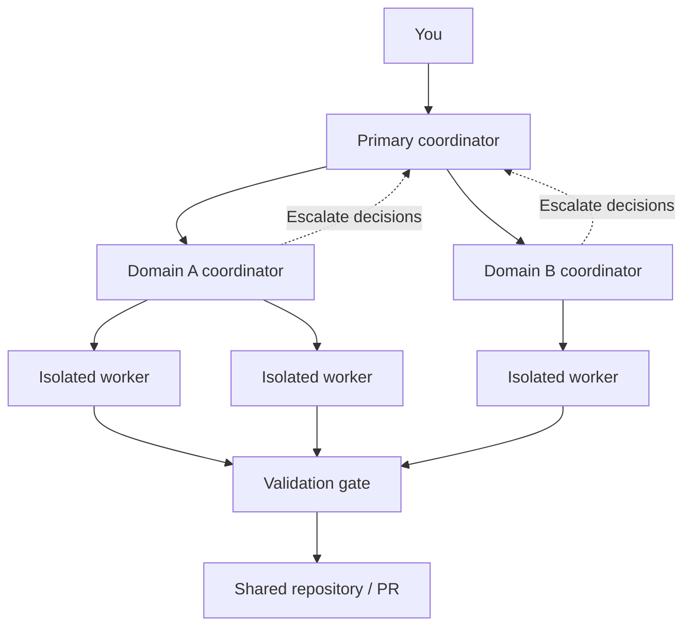
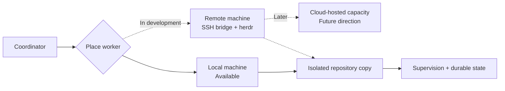
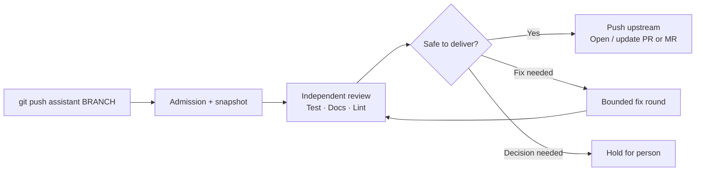

# Assistant

**Orchestrate coding agents. Choose the right models. Ship validated code.**

Assistant is a **local-first orchestration and delivery system** for AI coding agents. Give a coordinator work to do, run specialized agents in isolated repository copies, and keep a human in control of consequential decisions. When changes are ready, a separate Git gate reviews and validates them before they reach the shared repository.


> **At a glance:** Parallel workers and hierarchical coordination run locally today. Remote worker execution across machines is being built; cloud-hosted workers are a future direction, not a shipped feature.

## Why Assistant?

| Without Assistant | With Assistant |
| --- | --- |
| Manually juggle several coding sessions | Coordinate isolated parallel workers and delegate task domains |
| Use one model or effort level for every job | Configure agents, model providers, versions, and effort by role |
| Lose context when a session ends | Track durable task and run state, resuming what can be recovered |
| Push changes and then discover mistakes | Submit changes to a separate, multi-stage validation gate |
| Wonder what an agent spent or left behind | Inspect recorded usage, budgets, holds, and kept work |

## 1. Give each agent a job

A primary coordinator can launch task workers and delegate a **named domain** to a subordinate coordinator. A subordinate manages tasks within its assigned domain; decisions beyond its authority escalate to the primary coordinator. This keeps ownership and permissions explicit.

You can define roles for workers, reviews, and fixes, choosing the **agent**, **model provider**, **model family and version**, and **reasoning effort**. Roles can also specify an explicit fallback for recognized availability or quota failures. Assistant refuses unsupported model/agent combinations instead of silently substituting another one.



### Example role configuration

In your operator's `~/.assistant/config.yaml`, a role can pin a model and effort:

```yaml
agent:
  - claude
  - cursor

roles:
  worker-hard:
    agent: claude
    provider: anthropic
    type: opus
    version: "5.5"
    effort: high
  review:
    agent: codex
    provider: openai
    type: gpt
    version: "6.1-sol"
    effort: high
  fix:
    agent: cursor
```

These are **example pins**, not guaranteed entitlements or the default configuration. Installed CLI support, authentication, and available models still matter. General worker tasks use the configured agent list unless a task selects a named role; review and fix are reserved system roles. For adapter capabilities, model mappings, and fallback rules, see [multi-agent support](docs/multi-agent-support.md).

## 2. Run independent work without losing control

Each task gets an isolated repository copy. Workers can investigate a problem and report findings without immediately editing or shipping code; a subsequent promotion can turn an investigation into delivery work. The supervisor watches progress, raises decisions and stalled-work signals, and maintains durable records through service restarts.

Assistant also records **kept work** when a copy cannot safely be removed. It surfaces that retained state rather than silently deleting work. The full answer/dispatch-hold workflow is still being completed, so do not assume every recovery path is automated.

**Where workers run:** Local pipe workers are available today, with terminal-backed workers where the selected adapter supports them. Multi-machine placement through a remote bridge and herdr sessions is **in active development** and not yet an end-to-end supported workflow.



## 3. Validate before delivery

`assistant init` creates an `assistant` Git remote for your checkout. Push a branch to that remote to start validation. Your normal `origin` remote remains available; Assistant only gates pushes sent through its own gate. It **does not replace CI** or the host's merge policy.



The gate's pipeline also accounts for rebase, safety, scope, and host checks. It will refuse uncertain operations rather than treat missing evidence as a pass. GitHub and GitLab integrations support the code-host portion of delivery; optional autonomous merging is restricted by configuration and live checks. See [operating the gate](docs/operators.md) for the exact behavior.

## 4. Understand agent usage and control budgets

Assistant exposes human-readable and structured status, active task and run views, and recorded agent usage broken down by agent, role, model, provider, and effort. Run-level output-token budgets and home-wide usage ceilings provide distinct controls: a run budget can park an individual run, while a home ceiling can hold further agent starts.

### Real example: one validated change

This is a real execution, not a mock-up. A small Go repository with a local upstream pushed one branch through the gate. The operator's `~/.assistant/config.yaml` pinned the review role and set both controls:

```yaml
roles:
  review:
    agent: claude
    provider: anthropic
    type: opus
    version: "5.5"
    effort: high

run_usage_budget:
  output_tokens: 200000   # parks a run once its own calls reach this many output tokens

usage_ceiling:
  window: 168h            # sums every run's calls over 7 days
  output_tokens: 2000000  # holds further agent starts once reached
```

The run passed review, test, document, lint and push. One review-agent call was recorded. **The figures below are reported token usage—not dollars billed—and do not include task workers' own turns.**

| Recorded metric | Value |
| --- | ---: |
| Agent / model | Claude Code / `claude-opus-5-5` |
| Purpose / role / effort | Review / `review` / High |
| Stage-agent calls | **1** (0 failed) |
| Elapsed agent-call time | **14.255 seconds** |
| Input tokens | **6** |
| Output tokens | **994** |
| Cache-read tokens | **77,801** |
| Cache-creation tokens | **20,219** |
| Seven-day output-token ceiling | **994 / 2,000,000** (under limit) |

<details>
<summary>See the actual <code>assistant runs --usage=24h</code> output</summary>

```text
What the agent calls made to vet your changes cost follows, in the exact terms each call was recorded in. It counts those calls and nothing else: a worker's own turns are not in it, it carries no price, and a count the agent did not report is shown as unreported rather than as nothing. Nothing to decide from it alone.
Window     24h: calls started since 2026-10-22T00:32:58Z, read at 2026-10-23T00:32:58Z
Counts     stage-agent-calls; not worker-turns, price
Ceiling    Agent use recorded for this home is under the ceiling you set. Agent calls go on starting until it is reached. Nothing to decide.
           usage ceiling under over the last 7d; output_tokens 994 of 2000000 (under)
Total
      calls 1, failed none, took 14.255s
      input 6, output 994, cache read 77801, cache written 20219

By agent, model, purpose, role, provider, type, version, effort and context window
  claude  claude-opus-5-5  review  role review  anthropic opus 5.5  effort high  context (not named)
      calls 1, failed none, took 14.255s
      input 6, output 994, cache read 77801, cache written 20219

By run and stage
  run b4543e55cc849343  stage review
      calls 1, failed none, took 14.255s
      input 6, output 994, cache read 77801, cache written 20219
```

</details>

### Illustrative: four agents on one feature

A coordinator could delegate backend and frontend work to separate workers, then send the result to an independent reviewer. Different roles may use different agents, models and effort settings:

| Role | Example configuration | What you can inspect |
| --- | --- | --- |
| Coordinator | Claude, high effort | Delegation and task status |
| Backend worker | Claude, high effort | Worker status; worker-turn token totals **not** in the usage report |
| Frontend worker | Cursor, default effort | Worker status; worker-turn token totals **not** in the usage report |
| Gate reviewer | Codex, high effort | **Recorded** review-stage call and reported tokens |

**This is a workflow illustration, not an execution record or a four-agent bill.** Assistant's current usage view covers agent calls made by validation stages, not every coordinator or task-worker turn. It records input, output and cache-token categories when the adapter reports them. Missing counts stay **unreported**, never zero. Assistant does **not** calculate USD cost; CLI subscriptions, cache charges, model prices and provider billing cannot be inferred from these token totals alone.

For the recorded view, run `assistant runs --usage=24h` or `assistant --json runs --usage=24h`. See [usage budgets and ceilings in the operator guide](docs/operators.md) for interpretation and configuration.

## Quick start

**Prerequisites:** Go, Git, and at least one supported coding-agent CLI installed and authenticated. For hosted PR/MR operations, install and authenticate the relevant code-host tooling. macOS and Linux are the primary supported environments.

```sh
go install github.com/dayamjz/assistant/cmd/assistant@latest

# From your repository
assistant init
assistant doctor
assistant service start

# After committing a feature branch
git push assistant YOUR_BRANCH
assistant watch
```

`assistant init` needs a known upstream and default branch. It can suggest test and lint commands, but a run trusts those commands only after the repository configuration is committed to the default branch. Follow `assistant doctor` to complete setup; see [operators.md](docs/operators.md) for flags, credentials, and troubleshooting.

| Command | What it helps you do |
| --- | --- |
| `assistant doctor` | Diagnose setup and learn the next safe step |
| `assistant watch` | Follow validation and its decisions |
| `assistant tasks` | Inspect task work |
| `assistant status` | See repository and gate state |
| `assistant sync` | Reconcile a checkout with validated changes |
| `assistant runs --usage=7d` | Review recent recorded usage |
| `assistant --json status` | Consume structured status |

## Available now vs. on the roadmap

| Capability | Status |
| --- | --- |
| Local isolated task workers and supervision | **Available** |
| Hierarchical coordinator domains and escalations | **Available** |
| Role-specific agent, provider, model, effort, and fallback | **Available** (adapter/model constraints apply) |
| Nine-stage validation and GitHub/GitLab delivery | **Available** |
| Usage records, per-run budgets, home-wide ceilings | **Available** |
| Kept-work visibility | **Available**; resolution flows are being expanded |
| Cross-machine placement, bridge, herdr provider | **In development** ([GitHub #490](https://github.com/dayamjz/assistant/pull/490), [Linear AGE-310](https://linear.app/zolutions/issue/AGE-310/gap-12-remote-worker-execution)) |
| Role-level configurable context windows | **In development** ([Linear AGE-418](https://linear.app/zolutions/issue/AGE-418/roles-let-a-role-name-a-context-window-claudes-1m-so-a-configured)) |
| Automatic cloud worker provisioning | **Future direction** |

The roadmap shows intent, not a shipping commitment. The implementation and [operator guide](docs/operators.md) are authoritative for actual behavior.

## Learn more

- [Operator guide](docs/operators.md): setup, pushes, decisions, and recovery
- [Multi-agent support](docs/multi-agent-support.md): adapters, roles, model pins, and fallback behavior
- [Product requirements](docs/prd.html): principles, contracts, limitations, and deferred features
- [End-to-end verification](internal/journey/README.md): what the tests establish

Assistant is developed in Go. For repository checks, use `make check` with the toolchain and lint dependencies specified by the project.
