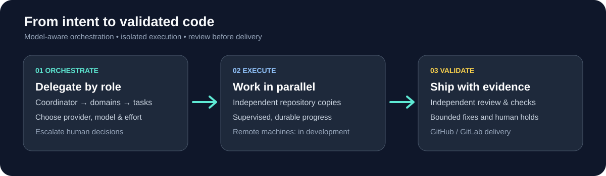
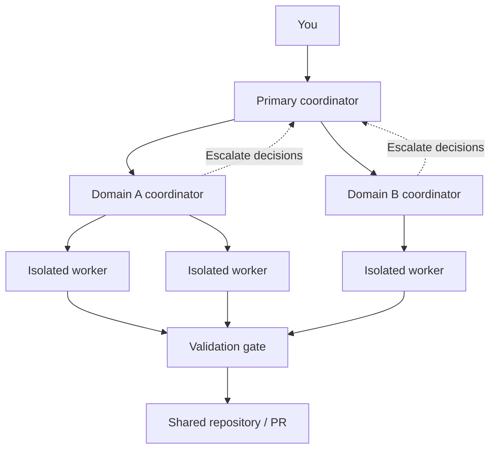
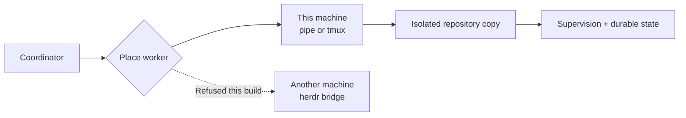
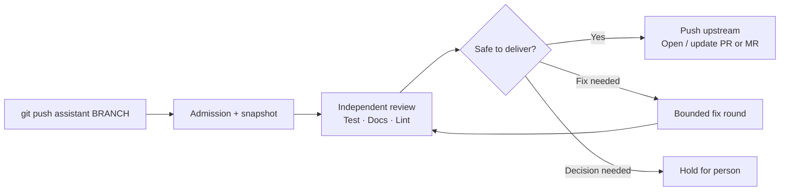

# Assistant

**Orchestrate coding agents. Choose the right models. Ship validated code.**

Assistant is a **local-first orchestration and delivery system** for AI coding agents. Give a coordinator work to do, run specialized agents in isolated repository copies, and keep a human in control of consequential decisions. When changes are ready, a separate Git gate reviews and validates them before they reach the shared repository.



> **At a glance:** Parallel workers and hierarchical coordination run locally today. Remote worker execution across machines is being built; cloud-hosted workers are a future direction, not a shipped feature.

## Start here

New to Assistant? Start with [installation and prerequisites](#installation-and-prerequisites), then choose one of two paths: [coordinate coding workers](#quick-start-coordinate-two-tasks) to delegate work, or [validate a committed branch](#quick-start-validate-a-branch) to use the Git gate. The two workflows are related but independent; configuring a gate does not automatically create coordinator tasks.

## Why Assistant?

| Without Assistant | With Assistant |
| --- | --- |
| Manually juggle several coding sessions | Coordinate isolated parallel workers and delegate task domains |
| Use one model or effort level for every job | Configure agents, model providers, versions, effort, and context window by role |
| Lose context when a session ends | Track durable task and run state, resuming what can be recovered |
| Push changes and then discover mistakes | Submit changes to a separate, multi-stage validation gate |
| Wonder what an agent spent or left behind | Inspect recorded usage, budgets, holds, and kept work |

## Why this architecture?

Assistant combines a durable **agent coordinator** with a **separate code-delivery gate**. A coordinator can assign and supervise isolated workers, but a worker declaring its task complete does not by itself authorize publication or merging. The gate evaluates the submitted Git change under its own validation and approval rules.

The Go service owns task/run state and decisions rather than treating an agent conversation as the sole record of progress. That separation makes recovery and auditability explicit, while adding configuration and operational overhead. It is intended for developers who want inspectable, controlled multi-agent delivery, not necessarily the fewest steps from prompt to PR.

## Installation and prerequisites

Assistant targets **macOS and Linux** and requires Git, at least one installed and authenticated supported coding-agent CLI, and a compatible Go toolchain for installation from source. This repository declares `go 1.25.0` and `toolchain go1.26.9` in [go.mod](go.mod); use Go's toolchain selection/download mechanism or install the specified toolchain before building. For contributing, `make check` additionally requires **golangci-lint v2** (CI pins v2.12.2), alongside the tools required by the tests. Host-integrated PR/MR delivery also requires the relevant host CLI and authentication. See [multi-agent support](docs/multi-agent-support.md) for adapter-specific authentication and [the operator guide](docs/operators.md) for setup details.

```sh
go install github.com/dayamjz/assistant/cmd/assistant@latest
assistant --help
```

The installation command uses the latest published module version; check the project's documented toolchain and installed CLI dependencies if a build fails.

## Quick start: coordinate two tasks

Use this path to have a coordinator direct **two independent delivery workers**, each in its own repository copy and on its own branch. The example assumes you have initialized the repository, started the service, and have a working supported agent. Replace the sample project name, branches and instructions with real work. Only create genuinely independent tasks in parallel.

```sh
# In the repository you want Assistant to work on
assistant init
assistant doctor
assistant service start

# Ensure the supervisor is running before assigning work
assistant coordinator supervision

# Read the repository identifier from repository.id in this JSON response
assistant --json status
```

Use that identifier as `REPO_ID` below:

```sh
assistant coordinator create --shape delivery --project demo \
  --repository REPO_ID --branch task/backend \
  --instructions "Implement the backend change and its tests"

assistant coordinator create --shape delivery --project demo \
  --repository REPO_ID --branch task/frontend \
  --instructions "Implement the independent frontend change and its tests"

assistant tasks
assistant watch --once
```

The create command records a task; **it is not proof that its worker has launched**. Inspect individual task state and supervision, and respond to holds as needed:

```sh
assistant --json tasks TASK_ID
assistant --json coordinator peek TASK_ID
assistant coordinator message TASK_ID --text "Clarification for this task"
```

A worker can be held, stopped, or require a person's decision; work is not automatically merged simply because tasks were created. Investigation tasks use `--shape investigation` without a delivery branch, and can later be promoted. For promotion, worker recovery, decision commands, and coordinator domain delegation, follow the [coordinator skill](skills/coordinator/SKILL.md) and [operator guide](docs/operators.md). The coordinator manages tasks; the Git gate separately determines what may be delivered.

## Quick start: validate a branch

Use this path when you already have a **committed feature branch** to validate. `assistant init` registers the current checkout and creates a Git remote named `assistant`. It needs a known upstream and default branch. `assistant doctor` identifies missing setup and the next safe step.

```sh
# From the checkout of your repository
assistant init
assistant doctor
assistant service start

# After committing the feature branch
git push assistant YOUR_BRANCH
assistant watch
```

Validation covers only committed changes pushed to the `assistant` remote; ordinary pushes to `origin` are **not gated** by Assistant. By default, test, document, and lint commands come from the trusted `assistant.json` on the default branch; without commands, those stages may hold. An operator can explicitly opt out of that default using the trusted-only `allow_pushed_commands` setting, which permits commands from a pushed branch. `init` can suggest commands but does not make an unmerged local config trusted. Assistant does not replace code-host CI or branch protection.

| Command | What it helps you do |
| --- | --- |
| `assistant doctor` | Diagnose setup and learn the next safe step |
| `assistant coordinator supervision` | Check that task supervision is live |
| `assistant coordinator create` | Register a delivery or investigation task |
| `assistant tasks` | Inspect task work |
| `assistant watch` | Follow validation and pending decisions |
| `assistant status` | See repository and gate state |
| `assistant sync` | Reconcile a checkout with validated changes |
| `assistant runs --usage=7d` | Review recorded **validation-stage** agent usage, not all worker turns |
| `assistant --json status` | Consume structured status and find the repository identifier |

## 1. Give each agent a job

A primary coordinator can launch task workers and delegate a **named domain** to a subordinate coordinator. A subordinate manages tasks within its assigned domain; decisions beyond its authority escalate to the primary coordinator. This keeps ownership and permissions explicit.

You can define roles for workers, reviews, and fixes, choosing the **agent**, **model provider**, **model family and version**, **reasoning effort**, and a **context window** (`standard` or `1m`) where the adapter declares that window for the model. Roles can also specify an explicit fallback for recognized availability or quota failures. Assistant refuses unsupported model/agent combinations, and a context window the adapter has not declared, instead of silently substituting another one.



### Example role configuration

In your operator's `~/.assistant/config.yaml`, a role can pin a model and effort:

```yaml
agent:
  - claude
  - cursor

roles:
  worker-hard:
    agent: claude
    provider: anthropic
    type: opus
    version: "5.5"
    effort: high
    context: 1m  # declared for Claude Opus 5.5; requires model access
  review:
    agent: codex
    provider: openai
    type: gpt
    version: "6.1-sol"
    effort: high
  fix:
    agent: cursor
```

These are **example pins**, not guaranteed entitlements or the default configuration. `context: 1m` is currently declared for Claude Opus 5.5 only; the Codex adapter does not declare a selectable context window. Explicit `effort` is supported by Claude and Codex, not every adapter. Installed CLI support, authentication, and available models still matter. General worker tasks use the configured agent list unless a task selects a named role; review and fix are reserved system roles. For adapter capabilities, model mappings, and fallback rules, see [multi-agent support](docs/multi-agent-support.md).

## 2. Run independent work without losing control

Each task gets an isolated repository copy. Workers can investigate a problem and report findings without immediately editing or shipping code; a subsequent promotion can turn an investigation into delivery work. The supervisor watches progress, raises decisions and stalled-work signals, and maintains durable records through service restarts.

Assistant also records **kept work** when a copy cannot safely be removed. It surfaces that retained state, holds new tasks in that project until a person answers land or carry on, and does not remove a copy on a discard answer in this build. See [kept work in the operator guide](docs/operators.md#kept-work).

**Where workers run:** The default session provider is `pipe`: the worker is the service's own child. `session_provider: tmux` hosts each worker in a tmux server of its own when the adapter declares terminal workers. The schema also accepts `session_provider: herdr`, `remote_hosts`, `placement.local`, `placement.arch`, and `remote_disconnect_grace`. This build has no herdr provider and does not act on those keys. The service refuses to start when `config.yaml` sets one of them, naming the key. See [Watch a worker in a terminal](docs/operators.md#watch-a-worker-in-a-terminal).



## 3. Validate before delivery

`assistant init` creates an `assistant` Git remote for your checkout. Push a branch to that remote to start validation. Your normal `origin` remote remains available; Assistant only gates pushes sent through its own gate. It **does not replace CI** or the host's merge policy.



The gate runs **nine stages in order**. Each can hold for a decision when it lacks sufficient evidence, even when its implementation exists:

| Stage | What it establishes |
| --- | --- |
| Intent | Records the supplied change intent; automatic transcript-based inference is not yet implemented |
| Rebase | Checks and reconciles the change against the target history where safe |
| Review | Requests an independent agent review |
| Test | Executes configured test commands (trusted by default) or holds when none are configured |
| Document | Updates stale documentation with the configured command; a non-zero exit produces a non-blocking note, while a missing command or exit status holds for a person |
| Lint | Executes configured lint commands (trusted by default) or holds when none are configured |
| Push | Publishes the validated commit according to the gate's safety rules |
| Pull request | Opens or updates the code-host PR/MR where supported |
| Checks | Observes required code-host checks before completion |

The gate's pipeline also accounts for rebase, safety, scope, and host checks. It will refuse uncertain operations rather than treat missing evidence as a pass. GitHub and GitLab integrations support the code-host portion of delivery; optional autonomous merging is restricted by configuration and live checks. See [operating the gate](docs/operators.md) for the exact behavior.

## Failure handling and boundaries

A validation gate is useful only if its failure behavior is clear. Assistant's documented policies include:

| Situation | Behavior / boundary |
| --- | --- |
| The upstream branch moves during delivery | Delivery is anchored to an observed commit; an unexpected move is refused rather than overwritten blindly. |
| Hosted CI fails after a push | `fix_rounds.checks` defaults to 3. A check still failing after the last round parks the run. An explicit 0 holds for a person and makes no repair. [Operating the gate](docs/operators.md#keep-your-ci-required) says when a repair is reviewed and pushed, and when that path holds instead. |
| A worker dies or the service restarts | Durable state and supervision support reconciliation, but uncertainty is surfaced; not every recovery path is automated. |
| A requested agent/model/window is unsupported | Adapter capability checks refuse unsupported combinations rather than silently substituting them. |
| Task work cannot safely be discarded | The isolated copy is kept; new work in the project waits for a person's kept-work decision. |
| A stage cannot establish enough evidence | It holds for a person rather than converting missing evidence into success. Not every non-zero command exit is a hold: the Document stage records it as a non-blocking note. |

See [operating the gate](docs/operators.md), [multi-agent support](docs/multi-agent-support.md), and [end-to-end verification](internal/journey/README.md) for details and evidence. These are documented behaviors and implementation contracts, **not comparative benchmark results** or a guarantee that every failure has been exercised on every supported host.

## 4. Understand agent usage and control budgets

Assistant exposes human-readable and structured status, active task and run views, and recorded agent usage broken down by agent, role, model, provider, and effort. Run-level output-token budgets and home-wide usage ceilings provide distinct controls: a run budget can park an individual run, while a home ceiling can hold further agent starts.

### Recorded run: one validated change

This is a real execution, not a mock-up. A small Go repository with a local upstream pushed one branch through the gate. The operator's `~/.assistant/config.yaml` pinned the review role and set both controls:

```yaml
roles:
  review:
    agent: claude
    provider: anthropic
    type: opus
    version: "5.5"
    effort: high

run_usage_budget:
  output_tokens: 200000   # parks a run once its own calls reach this many output tokens

usage_ceiling:
  window: 168h            # sums every run's calls over 7 days
  output_tokens: 2000000  # holds further agent starts once reached
```

The run passed review, test, document, lint and push. One review-agent call was recorded. **The figures below are reported token usage—not dollars billed—and do not include task workers' own turns.**

| Recorded metric | Value |
| --- | ---: |
| Agent / model | Claude Code / `claude-opus-5-5` |
| Purpose / role / effort | Review / `review` / High |
| Stage-agent calls | **1** (0 failed) |
| Elapsed agent-call time | **14.255 seconds** |
| Input tokens | **6** |
| Output tokens | **994** |
| Cache-read tokens | **77,801** |
| Cache-creation tokens | **20,219** |
| Seven-day output-token ceiling | **994 / 2,000,000** (under limit) |

<details>
<summary>See the actual <code>assistant runs --usage=24h</code> output</summary>

```text
What the agent calls made to vet your changes cost follows, in the exact terms each call was recorded in. It counts those calls and nothing else: a worker's own turns are not in it, it carries no price, and a count the agent did not report is shown as unreported rather than as nothing. Nothing to decide from it alone.
Window     24h: calls started since 2026-10-22T00:32:58Z, read at 2026-10-23T00:32:58Z
Counts     stage-agent-calls; not worker-turns, price
Ceiling    Agent use recorded for this home is under the ceiling you set. Agent calls go on starting until it is reached. Nothing to decide.
           usage ceiling under over the last 7d; output_tokens 994 of 2000000 (under)
Total
      calls 1, failed none, took 14.255s
      input 6, output 994, cache read 77801, cache written 20219

By agent, model, purpose, role, provider, type, version, effort and context window
  claude  claude-opus-5-5  review  role review  anthropic opus 5.5  effort high  context (not named)
      calls 1, failed none, took 14.255s
      input 6, output 994, cache read 77801, cache written 20219

By run and stage
  run b4543e55cc849343  stage review
      calls 1, failed none, took 14.255s
      input 6, output 994, cache read 77801, cache written 20219
```

</details>

### Illustrative: four agents on one feature

A coordinator could delegate backend and frontend work to separate workers, then send the result to an independent reviewer. Different roles may use different agents, models and effort settings:

| Role | Example configuration | What you can inspect |
| --- | --- | --- |
| Coordinator | Claude, high effort | Delegation and task status |
| Backend worker | Claude, high effort | Worker status; worker-turn token totals **not** in the usage report |
| Frontend worker | Cursor, default effort | Worker status; worker-turn token totals **not** in the usage report |
| Gate reviewer | Codex, high effort | **Recorded** review-stage call and reported tokens |

**This is a workflow illustration, not an execution record or a four-agent bill.** Assistant's current usage view covers agent calls made by validation stages, not every coordinator or task-worker turn. It records input, output and cache-token categories when the adapter reports them. Missing counts stay **unreported**, never zero. Assistant does **not** calculate USD cost; CLI subscriptions, cache charges, model prices and provider billing cannot be inferred from these token totals alone.

For the recorded view, run `assistant runs --usage=24h` or `assistant --json runs --usage=24h`. These limits only apply to the recorded scope, not all coordinator or worker turns. See [usage budgets and ceilings in the operator guide](docs/operators.md) for interpretation and configuration.

## Operations and recovery

A **hold** is a stage or task waiting for a person's decision; a **parked run** has stopped at a configured bound. An **investigation** can report findings without shipping code; **promotion** turns that investigation into a delivery task. **Kept work** is an isolated copy containing work not proven to have landed, so it is retained rather than removed. New tasks in that project wait until a person answers land or carry on (or until cleanup closes the entry on proof). A discard answer previews what removal would lose and does not remove the copy in this build. Use `assistant watch`, `assistant tasks`, and the [operator guide](docs/operators.md#kept-work) to inspect those states.

## Available now vs. on the roadmap

| Capability | Status |
| --- | --- |
| Local isolated task workers and supervision | **Available** |
| Hierarchical coordinator domains and escalations | **Available** |
| Role-specific agent, provider, model, effort, and fallback | **Available** (adapter/model constraints apply) |
| Nine-stage validation and GitHub/GitLab delivery | **Available** |
| Usage records, per-run budgets, home-wide ceilings | **Available** |
| Kept-work visibility, dispatch hold, land and carry on | **Available**. Removal on a confirmed discard is not in this build ([operator guide](docs/operators.md#kept-work)). |
| Cross-machine placement, bridge, herdr provider | **Refused in this build.** The schema accepts the keys. The service does not start when `config.yaml` sets one. [Operator guide](docs/operators.md#watch-a-worker-in-a-terminal). |
| Role-level configurable context windows | **Available** (a role names `context` as `standard` or `1m` beside a complete model triple; an undeclared window is refused before launch). See [multi-agent support](docs/multi-agent-support.md). |
| Automatic cloud worker provisioning | **Future direction** |

The roadmap shows intent, not a shipping commitment. The implementation and [operator guide](docs/operators.md) are authoritative for actual behavior.

## Related projects and tradeoffs

- **[No-Mistakes](https://github.com/kunchenguid/no-mistakes)**, related work.
- **[Firstmate](https://github.com/kunchenguid/firstmate)**, related work.

A Go service owns Assistant's state, and the gate is first-class. No controlled head-to-head performance or defect-detection benchmark is claimed here.

## Learn more

- [Operator guide](docs/operators.md): setup, pushes, decisions, and recovery
- [Multi-agent support](docs/multi-agent-support.md): adapters, roles, model pins, and fallback behavior
- [Product requirements](docs/prd.md): principles, contracts, limitations, and deferred features
- [End-to-end verification](internal/journey/README.md): what the tests establish

Assistant is developed in Go. For repository checks, use `make check` with the toolchain and lint dependencies specified by the project. Which checks `main` requires, and which file owns each workflow's settings, is in [AGENTS.md](AGENTS.md).
