**Assistant** <kbd>PRD v0.1</kbd>

**Contents**

- [1. What Assistant is](#summary)
- [2. Vocabulary](#vocabulary)
- [3. Why the two halves merge](#merge)
- [4. Principles](#principles)
- [5. The delivery gate](#gate)
- [6. The orchestrator](#orchestrator)
- [7. Execution model](#execution)
- [8. Architecture](#architecture)
- [9. Surfaces](#surfaces)
- [10. Configuration](#config)
- [11. Failure and recovery](#recovery)
- [12. The MVP cut](#mvp)
- [13. Verification](#verification)
- [14. Decisions recorded](#decisions)

<sub>Product requirements</sub>

# Run many coding agents at once, and let none of them ship unvalidated work.

Assistant is a local tool that does two things you currently do by hand. It runs a fleet of
coding agents in parallel, each in its own isolated copy of a repository, and it puts a
validation gate in front of your remote so no change reaches a shared branch until it has been
independently reviewed, tested, documented, and linted.

<table>
<tr><td>Validation stages</td><td><b>9</b></td><td>fixed order, configurable contents</td></tr>
<tr><td>Task shapes</td><td><b>2</b></td><td>delivery and investigation</td></tr>
<tr><td>Finding actions</td><td><b>3</b></td><td>fix, ask, note</td></tr>
<tr><td>Loop bounds</td><td><b>3</b></td><td>independent, per run</td></tr>
</table>

> **How to read this document**
>
> Sections 4 through 7 are the specification. Section 4 states the invariants, and those
> invariants are the acceptance criteria, so they come before the feature descriptions rather
> than after. Section 14 records the decisions that shaped it, and names what the first
> working version should settle next.

<sub>Section 1</sub>

## <a id="summary"></a>What Assistant is

You can run one coding agent without much trouble. The moment you want three tasks running at
once you become a tab manager: you babysit sessions, copy context between repositories, and
lose track of which terminal held the failing test. At the same time, the faster those agents
produce changes, the less of each change you actually read before it reaches a branch other
people pull from.

Assistant addresses both problems with one system. You talk to a single **coordinator**. It
dispatches **workers** into isolated copies of your repositories, supervises them, and brings
you only the decisions that genuinely need you. Every change a worker produces reaches a shared
branch through the same **gate**, so "this was validated" means the same thing for every
change, in every repository, whether an agent or you wrote it. The coordinator may delegate a
named domain of tasks to a **subordinate coordinator** it starts in this home, which reports
to it and never to you.

### Promise 1: parallel work you can watch

Every worker is one you can read and reach. In phase 1 the Claude Code worker runs in its
command line's standard-input stream-json mode: you read it through the service's capture
and reach it through Send. Under the tmux session provider it runs in its interactive interface instead, typed into through Send; that mode is an option, not a promise. If you intervene directly in a worker, that
intervention is authoritative and the coordinator reconciles around it.

### Promise 2: nothing unvalidated is shared

The gate is a named remote you push to on purpose. Pushing to it is how you consent to
having that change validated, fixed, pushed, and turned into a pull request. Nothing else
implies that consent, and your ordinary `git push` keeps working as it always did.

### Who this is for

One developer who operates several coding agents and whose own credentials and accountability
are on the line. Everything runs on your machine, under your identity, at your initiative.
Assistant is not a shared service and does not hold a team's policy.

Some workers may run on another machine of yours that you name, still under your identity and
at your initiative. That machine holds only their copies and terminals; the home, the gate, and
every decision about a task's course stay on the machine you work at. Section 8's
[workers on another machine](#remote-hosts) says how.

### What it is not

- It is not continuous integration. Your CI stays the shared outer check.
- It is not a code host, and it does not own merge policy. Your forge does.
- It is not a model or an agent harness. It drives whichever coding agent you already use.
- It is not a team governance platform, and it publishes facts rather than verdicts.

<sub>Section 2</sub>

## Vocabulary

Every term below means exactly one thing throughout this document and in the product. Where a
word appears in both the interface and the implementation, it means the same thing in both.

| Term | Definition |
|---|---|
| **coordinator** | The agent you talk to. It takes your request, dispatches work, supervises it, and reports outcomes. It never edits a project itself. |
| **worker** | An autonomous agent working one task in one isolated copy of a repository. It never talks to you directly. |
| **delivery task** | A task whose deliverable is a change to a project. |
| **investigation task** | A task whose deliverable is a written report. It creates no branch and opens no pull request. |
| **subordinate coordinator** | A host session the coordinator starts in this home, placed by the same credentials and lineage as a worker, holding the coordinator's commands over one domain's tasks and nothing else. It reports to the coordinator and never to you. |
| **housekeeping pass** <kbd>proposed</kbd> | A task that keeps one repository's agent context true. The program decides when one is due and the coordinator creates it. It starts as an investigation and becomes a delivery only by promotion, so it is not a third task shape. Section 6's [housekeeping](#housekeeping) owns the rule. |
| **domain** | A named set of tasks the coordinator has delegated to one subordinate coordinator. A task's domain is written once at intake; a task with none is the coordinator's own. |
| **the gate** | A local bare repository that sits between your working copy and your real remote. You push to it by name. |
| **run** | One pass of the validation pipeline over one branch. |
| **stage** | One of the nine steps of a run. The order is fixed. |
| **finding** | One issue a stage reports, carrying a severity and an action. |
| **action** | What a finding asks for: `fix`, `ask`, or `note`. This is the entire split between machine judgment and yours. |
| **fix ladder** <kbd>proposed</kbd> | The order in which a stage's automatic fix rounds change how they are answered once the fixer's session is not converging: a fresh session, then a harder effort, then the fixer's next model, then a hold for you. Not a loop bound, and it never parks. Section 5's [fix ladder](#fix-ladder) owns the rule. |
| **hold** | A run or task waiting on a decision from you. A hold is durable and survives a restart. It is not the lifecycle state Paused, which section 6 reserves for a worker's own declared external wait. |
| **wake** | An event that might need attention. Most wakes are handled without involving a model. |
| **home** | One instance's private state directory. Locks, queues, and records are all scoped to a home. |
| **remote host** | Another machine of yours, named in your global settings, on which workers may run. It holds their isolated copies and terminals and no home. Not a code host, and not the host session a coordinator runs in. |
| **bridge** | The process of this program the service starts on a remote host to act for it there. It holds no record and decides no task's course. What needs that host's kernel or filesystem it does there, on rules section 8 fixes: it starts and ends workers' sessions, cuts and asserts their copies, and places their calls and pushes from that kernel, never from anything a caller states. |

> **The interface vocabulary is narrower than this one**
>
> The terms above are the implementation vocabulary. What Assistant says to you is deliberately
> smaller: outcomes, consequences, and decisions. Section 6 specifies that boundary, because
> leaking internal mechanics into your chat is the most common way a tool like this becomes
> exhausting to use.

<sub>Section 3</sub>

## <a id="merge"></a>Why the two halves merge

Orchestration and validation are usually built as separate tools. Keeping them separate costs
you two state stores, two supervision loops, and two vocabularies for the same escalation. The
merge makes the gate the spine: a worker's only route to a shared branch runs through it.

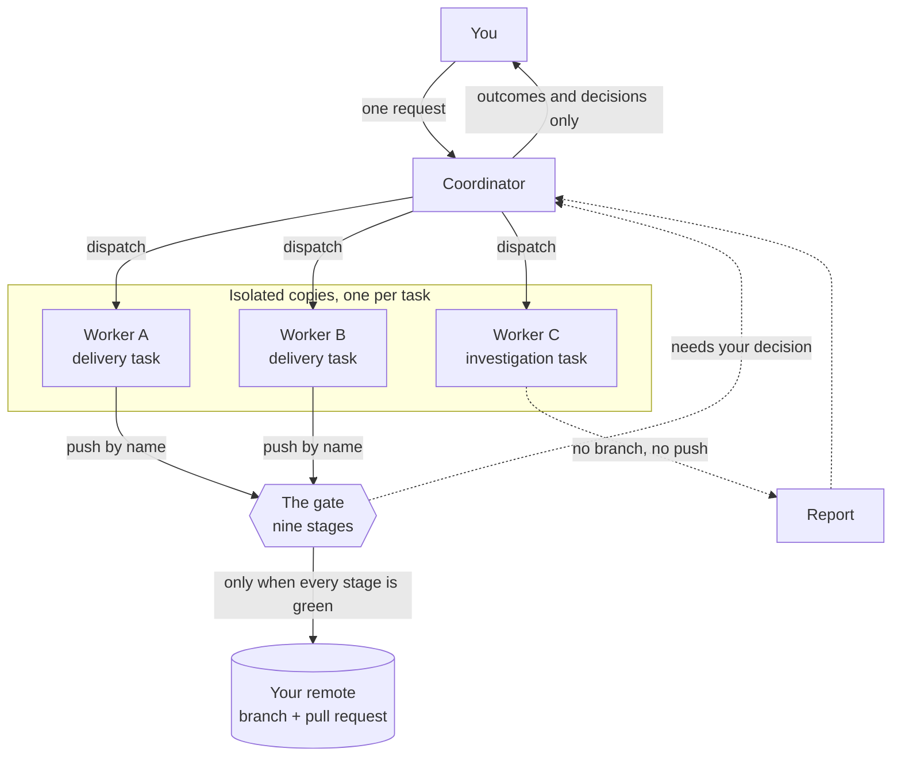

### One state store

A task's validation state and its supervision state are the same record. Today they live in two systems that have to be reconciled by reading logs.

### One escalation path

A finding that needs your judgment and a worker that is stuck arrive the same way, in the same words, with the same options.

### One supervision loop

The supervisor that notices a stalled worker is the supervisor that notices a run held at a decision. Neither can be running while the other is not.

<sub>Section 4</sub>

## Principles

These are the acceptance criteria, not aspirations. Each one names the failure it prevents,
because each corresponds to a real failure in the systems this design draws from. A feature that
violates one of these is wrong even if it works.

<details open>
<summary><kbd>P1</kbd> The push is the consent boundary</summary>

Pushing to the gate by name authorizes that run to validate the change, apply reviewable fixes, push the branch, and open a pull request. Nothing else implies that consent.

**Prevents:** a tool that silently rewires `origin` and starts doing things with your credentials that you did not ask for. Your ordinary `git push` must keep behaving exactly as it always has.

</details>

<details>
<summary><kbd>P2</kbd> A pass means the same thing everywhere</summary>

The stage order is fixed and not configurable. A repository can make a stage stricter; it can never remove, reorder, or weaken one. You may skip stages for a single run, on purpose. Standing configuration may never skip a stage on your behalf.

**Prevents:** "it passed the gate" quietly meaning something different in each repository, which makes the claim worthless.

</details>

<details>
<summary><kbd>P3</kbd> A finding that is not classified stops for you</summary>

Every finding carries an action. If the action is missing, malformed, or unrecognized, treat it as `ask`. An unclassified finding is never eligible for automatic fixing.

**Prevents:** an agent that omits a field getting its output silently auto-applied. The safe default when you do not know whose call it is has to be yours.

</details>

<details>
<summary><kbd>P4</kbd> The reviewer never certifies its own prescription</summary>

Reviewing and fixing are separate roles with separate memory. Every review runs in a fresh context. Only the fixer keeps a session across rounds. Context crosses between rounds only as an explicit summary of what was found and changed, and the findings a person left unselected.

**Prevents:** a re-review that resumes the session which prescribed the fix. That seats the prescriber as the certifier, and it has shipped incorrect code accompanied by a test that blessed it and a review that found nothing.

</details>

<details>
<summary><kbd>P5</kbd> Fixes the gate writes are reviewed like code you wrote</summary>

A change the pipeline authored is author code. It gets the same adversarial review as anything else. Previous findings, fix summaries, and tests written in the same round are claims, not evidence.

**Prevents:** the gate trusting itself. Automatic fixes are the least-reviewed code in the system precisely because they look like housekeeping.

</details>

<details>
<summary><kbd>P6</kbd> Never lose work</summary>

Not your commits, not commits that appeared on the remote out of band, not fixes the pipeline itself created. Every history-rewriting update is anchored to a commit the run actually observed, never to the tip read a moment before pushing. When a safety fact cannot be verified against fresh state, refuse the operation and report it.

Work the pipeline holds always has a path back into your hands, including after a crash, a cancellation, or a failed run.

**Prevents:** the single unrecoverable failure. A refused push is an annoyance; a lost commit is not repairable. Note the specific trap: anchoring a lease to the tip you just read always succeeds and therefore protects nothing.

</details>

<details>
<summary><kbd>P7</kbd> The branch under validation does not choose what runs</summary>

Configuration that executes code or selects which agent process starts is read from your default branch at a commit resolved by a fresh fetch, never from the pushed commit. If that trusted copy cannot be read and parsed, the run stops before launching anything.

The pushed branch is untrusted input. Nothing on it may direct what executes with your credentials, and no instruction file on it may give a validation agent an identity or authority it should not have.

**Prevents:** a contributor landing a hostile command on a branch and having your machine run it. Also prevents a repository whose own instructions describe an agent operator from convincing the validating agent that it is that operator.

</details>

<details>
<summary><kbd>P8</kbd> An event log is not current state</summary>

A worker appends events. Current state is a separate resolution, computed on each read from the records that own its facts, with its source attached and determined as of one consistent read. Reading the last line of an event log is always wrong: it cannot distinguish a stale note from a live condition, and it cannot see that a run has moved past what the note describes.

**Prevents:** a coordinator that acts on a decision the worker already resolved, or that reports a task as blocked when its validation run finished twenty minutes ago.

</details>

<details>
<summary><kbd>P9</kbd> Supervision costs nothing until something is actionable</summary>

A cheap non-model supervisor classifies every wake. It absorbs a wake only on positive evidence that work is genuinely proceeding: an active validation stage attributed to that task's branch, or a live process signal from its terminal. Absence of evidence surfaces; it never absorbs. That rule is about wakes that carry evidence: the program's own entries, `queued` and `dispatched`, carry no evidence of anything and are absorbed by their kind.

**Prevents:** two opposite failures. Waking a model on every heartbeat makes a fleet unaffordable. Absorbing wakes on a timer makes a finished or crashed worker invisible.

</details>

<details>
<summary><kbd>P10</kbd> No turn ends blind while work is under way</summary>

Whenever a task is in flight, exactly one live supervision cycle exists. If the coordinator is about to stop while work is running and no healthy supervisor is the service holding this home's lock, it is blocked from stopping until its host supplies a re-entry signal.

**Prevents:** the most expensive silent failure in the whole system. Work holds at a decision, nothing is watching, and you find out hours later. This warrants more than one mechanism.

</details>

<details>
<summary><kbd>P11</kbd> Isolation is asserted, never assumed</summary>

A worker does not launch unless the resolved path is a real isolated copy, distinct from the primary checkout. The check runs at launch and again in the worker's own instructions before it creates a branch. Being a linked copy is not sufficient proof on its own when the tool can be pointed at its own repository.

**Prevents:** a worker doing its work in your primary checkout, which turns a routine task into a recovery operation.

</details>

<details>
<summary><kbd>P12</kbd> Cleanup refuses when it cannot prove the work landed</summary>

Removing an isolated copy requires positive proof that its work is reachable from a remote branch, or its pull request merged with a head containing the work, or its content is already present in an up-to-date default branch. Anything inconclusive refuses.

A refusal is a result that means stop and investigate. It is not an obstacle to work around with a force flag.

**Prevents:** discarding a worker's committed but unlanded work because a lookup failed.

</details>

<details>
<summary><kbd>P13</kbd> You get outcomes, not mechanics</summary>

Everything Assistant says to you names the project outcome, the consequence, and the next decision. Internal terms do not appear: no task identifiers, no isolated-copy paths, no watcher or wake vocabulary, no stage names, no state labels, no compressed safety jargon. Worker reports and tool output are evidence to read, never text to relay.

Detailed evidence documents may keep exact identifiers. Section 9 names which outputs are evidence documents: the detail view, the usage view, the log view of one stage of a run, and the relay of a finding that needs your decision. The message that points you at one still translates, and so does every plain status line.

**Prevents:** a tool that is technically correct and practically unusable, because using it requires holding its implementation in your head.

</details>

<details>
<summary><kbd>P14</kbd> Every fact has exactly one owner</summary>

A contract lives in one place. Everything else points at it. This applies to documentation, to configuration, and to code: when two mechanisms would judge the same question, reconcile them into one rather than stacking them.

**Prevents:** duplicated rules drifting apart, and the specific version of that where two independent reviewers both feel responsible and neither is.

</details>

<details>
<summary><kbd>P15</kbd> Nothing the program starts outlives its owner, and kept work is never silent</summary>

Every process, terminal session, agent session, wait, isolated copy and lock the program creates has exactly one recorded owner: a run, a task, a delegation, or the service itself. When the owner ends, what it owns ends with it: a process by its whole group and within a stated bound, a wait by its deadline. An external program the service invokes (an agent, a check command, a notify command, a version probe) runs under a deadline, and when the deadline passes it is ended together with everything it started. A task's worker is the exception: a long-lived worker agent session has no invocation deadline. It runs in a process group of its own with a recorded owner, and it ends when its task lands, when it is stopped, and when the service stops, within `stop_grace`, on the terms and in the further cases section 8 states. The liveness probe ends nothing: it is how the service learns a worker has ended. A live worker that has stalled is surfaced, by `escalation_window` at the latest, and never ended; a bound that ends one is not yet specified. <kbd>proposed</kbd> Section 6's [stalled worker](#stall-hold) would specify it and replace that clause: a stall that outlasts the coordinator's inspection holds its task for you, the stall itself never ends the worker, and your answer to that hold may end it through section 6's stop, beside every other end section 8 lists. On stop and on restart, the service ends or reclaims what a previous incarnation left under its home. Whatever it finds there that no record owns, it reports; it never ignores it.

Work is the one exception, and the exception is loud. An isolated copy holding work that has not landed is kept, on P6's and P12's terms, because a leaked copy costs disk while a deleted one costs work. A kept copy is not a leftover. It is a decision owed to you: it is surfaced the moment it is kept, and no new task starts in its project until you make it: you land it, you have it carried on, or you discard it yourself. The program never discards it on its own. Ending a process never discards work.

This binds the program, its tests, and the tooling that builds it. A test that starts a process ends it, and a development fleet's watchers, reviews and repairs end what they start.

**Prevents:** agents and services that keep spending tokens and machine time nobody asked for, slowing every other run and hiding real failures under the load they create; and work that is safe on disk but that nobody knows about until days later.

</details>

<sub>Section 5</sub>

## <a id="gate"></a>The delivery gate

The gate is one deliberate place where validation happens before a branch is shared. It is not
an abstraction over git; it is a local bare repository that git can push to normally.

### Setup

Initializing a repository does five things, and repeating it repairs rather than fails:

1. Create a local bare repository, identified by a stable hash of the working path.
2. Install an admission check that runs before any reference changes, and a notification that runs after.
3. Add a remote named `assistant` to your working copy pointing at it. Your `origin` is untouched.
4. Install the agent-facing instructions so a coding agent can drive the same gate.
5. Make sure the background service is running.

If the working copy moves, initialization reattaches the existing gate and keeps the run history.
If the working copy was copied while the original still exists, the copy gets its own gate.

### The nine stages

The order is fixed. What each stage runs is yours to configure.

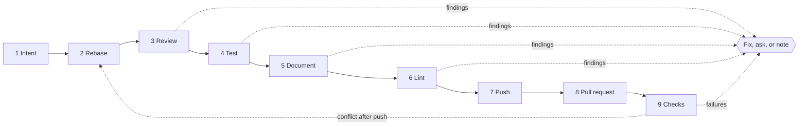

| # | Stage | What it does and why it sits here | Fix rounds |
|---|---|---|---|
| 1 | **Intent** | Establishes what you set out to do. Supplied intent is authoritative acceptance criteria; inferred intent is a low-confidence hint, and the two are framed differently in every downstream prompt. Intent read off the task a worker was given is a source of its own and is the acceptance criteria of the run that worker's push starts. A person's push of the same branch carries none of it. This stage never blocks a run. | none |
| 2 | **Rebase** | Fetches fresh upstream and the branch target, then rebases onto them, so everything after runs against current code. Stops if the branch would quietly carry commits from your local default branch that were never pushed. If nothing remains to change, the run ends successfully and the rest is skipped. <kbd>proposed</kbd> Section 6's [nothing left to deliver](#nothing-to-deliver) says what that end means for the task the run belongs to. | 3 |
| 3 | **Review** | Independent review of the change against the diff and your intent. Runs before tests so it reads code the fixer has not touched. Gets one automatic fix round, restricted to `fix` findings. Any `ask` finding holds immediately and is never included in that round. | 1 |
| 4 | **Test** | Targeted validation of this change and this intent, not a full suite. If no targeted check can establish the intent, the stage must write one, verify manually with recorded evidence, or report that sufficient evidence is not possible. | 3 |
| 5 | **Document** | Updates documentation the change made stale, then reports only what it could not resolve. Runs after tests so it documents code known to work. Scope is limited to what this change affected. | in pass |
| 6 | **Lint** | Static analysis. Last among local checks so it does not churn over code that may still change. | 3 |
| 7 | **Push** | Forwards the exact verified commit, and only after confirming the update will not discard commits already on the target. Requires a durable record that a completed review approved a commit this one descends from. When the head is not that commit, a fresh review of the commits between them must raise nothing but notes before anything is pushed (section 14, decision 7). | none |
| 8 | **Pull request** | Creates or updates the pull request. Body is written for a reviewer who was not present: what changed, what was checked, what the risks are, what the pipeline had to fix. | none |
| 9 | **Checks** | Watches your CI and mergeability, fixes failures, resolves conflicts. The only stage that talks to the outside world for validation. A conflict after the push is resolved by rebasing, reviewing again, and pushing again, and only where the rebase applies cleanly; the run never decides conflicting content on its own (section 14, decision 7). | 3 |

> **The review fix round has a condition attached**
>
> Letting review fix its own findings automatically is the one place where P4 and P5 are most
> likely to be violated by accident, because the fixer has just been told exactly what to
> change and it is tempting to let it confirm its own work. Two rules make the round safe, and
> both are load-bearing rather than optional.
>
> - The round covers `fix` findings only. An `ask` finding never enters
>   it, so the round can never resolve a question that was yours to answer.
> - The re-review after the round runs in a fresh session with no memory of the fix, and it
>   treats the fix commit as author code. It receives the previous findings and the fix summary
>   as claims to check, never as evidence that anything was resolved.
>
> If either rule is dropped, this setting becomes the exact failure P4 describes: the reviewer
> certifying its own prescription.

> **Why review comes before test**
>
> If tests run first, their fix rounds modify the code, and review then reads code the fixer
> wrote rather than code you wrote. Reviewing first keeps the reviewer's subject the actual
> change. This ordering is load-bearing, which is why the order is not configurable.

### Findings and their actions

A finding has a severity (`error`, `warning`, `info`) and an
action. The action decides who resolves it, and it is the single most important field in the
system.

#### <kbd>fix</kbd>

Objectively wrong and mechanically fixable. Eligible for the automatic fix loop.

Correctness, reliability, and security issues stay here even when the smallest correct fix restores a little previously deleted logic.

#### <kbd>ask</kbd>

Touches your intent or your judgment. Holds for a decision; never enters the automatic fix loop.

Questioning a deliberate product choice, arguing an intentional removal should be undone, or reporting that a stage could not gather enough evidence.

#### <kbd>note</kbd>

Informational. Needs no fix and blocks nothing.

A stage whose findings are all notes is approved as it stands.

> **Missing action means ask**
>
> If a finding arrives with no action, an empty action, or an action the system does not
> recognize, it becomes `ask`. This is not an error path to log and move past; it is
> the defined behavior, and it is what makes P3 hold when an agent's output is imperfect.

### What a review report has to carry

A finding is a claim about code, and a claim is worth what a reader can check. So a review report
carries the revision it read and the set of paths it actually read. This fixes a property of the
report, not a field name or a wire shape.

- A report whose revision is not the commit the stage was asked to review is refused rather
  than credited. A reading of some other commit is not a review of this change.
- A finding whose location names a path outside the declared evidence set is refused, and it is
  reported as refused with the path it named. A reviewer asserting past what it read is visible
  rather than quietly trimmed.
- A finding with no location and no explicit citation normalizes to `note`. Nothing
  supports it, so it may inform you and may not stop a run.
- That last rule does not reach P3. A finding whose action is missing, empty, or unrecognized
  becomes `ask` and stays `ask`; normalizing to `note` applies
  only where the reviewer stated an action the system recognized.

> **The evidence set has to be able to fail**
>
> A reviewer satisfies the rule above by declaring every changed file and nothing else, and
> then reading nothing but the diff. That declaration is derivable from the run without asking
> the reviewer, so on its own it proves nothing about what was read. A check that can pass
> without checking anything is worse than no check, so the discriminator belongs in the
> requirement rather than in a later reading of it.
>
> - The evidence set and the change's own set of touched paths are reported separately and
>   compared. The discriminating part is the paths the reviewer read that the change did not
>   touch, and that part is reported whether or not it is empty.
> - A finding asserting something about code the change does not touch, such as a caller, an
>   interface, or a test that covers it, cites that code, and the finding is refused unless the
>   evidence set names the cited path. Declaring the diff wholesale therefore buys nothing:
>   it forfeits every finding that reaches past the diff, which is most of what an independent
>   review is for.
> - An evidence set equal to the touched paths is a permitted outcome, not an error. Small
>   changes need nothing else, and a guard that failed here would fail on correct work. What it
>   may not be is invisible: it is a reported outcome, so a reviewer that never reads past the
>   diff is a fact you can see across runs rather than a possibility you have to assume away.

### Scope as a review lens

Every changed line should trace to the stated intent. That is a lens the review stage applies,
and it ships in the default review guidance rather than as a stage of its own. P2 fixes the list
at nine and this adds none.

- A scope observation is a `note` by default. It informs you, blocks nothing, and
  never enters the automatic fix loop.
- It rises above `note` only when it independently meets the bar for
  `fix` or `ask`. A line being unexplained is not that bar. A change nobody
  asked for that is also wrong is reported for being wrong.
- The lens is measured against the recorded intent and inherits that intent's source. Against
  supplied intent it compares a change to acceptance criteria; against inferred intent, or
  intent read off a task, it compares a change to a low-confidence hint, which is the second
  reason its default is `note`.
- Being guidance, it is strengthened the way review is strengthened anywhere, through
  path-scoped review rules. No key in the configuration schema turns it off, and turning it off
  would not skip a stage, because it is not one.
- A reviewer's reason for tracing a path is recorded in its own words and, on its own, never
  checked, so a false reason silences the note for that path. Where a decision model is
  available, the reason is checked against the changes it claims to explain. The next
  subsection owns that check.

### Checks a decision model may add

A decision model is a hosted classifier that answers a typed question about a piece of text with
a probability, not with generated text. Two checks may use one. They augment review and never
bring a run down: what they find can add scrutiny, and what they fail to do changes nothing.
They run by default wherever the operator has supplied the provider's key.

- **A trace's reason is checked against the path's changes.** Each trace the review reports
  for a touched path is put to the model together with that path's changed lines: does the reason
  describe what these lines do? A trace the model does not confirm silences nothing. Its path
  gets the scope lens's ordinary untraced note, which also quotes the reason and says the changes
  did not bear it out. The check reads the reason against the lines, not against the intent, so
  it says nothing about whether the change was asked for.
- **Pushed content is screened for text aimed at the reviewer.** The changed lines of every
  file the reviewer is shown are put to the model one file at a time: does this add text that
  addresses a reviewing agent and tries to steer its verdict, suppress its findings, or make it
  act? A file the model flags is reported next to whatever the reviewer found, naming the file,
  so a person reading the report reads that file too. The screen runs beside the review rather
  than before it, so the reviewer has already read the content; what it protects is the
  person's reading of the verdict, not the reviewer's exposure.

| Mode | What the checks do |
|---|---|
| `evaluate` | The default. Both checks run and every result is a `note`, including a flagged file, so nothing they say holds a run. Every answer is recorded, which is what this mode is for: it lets a person decide from evidence whether the checks earn their place. |
| `enforce` | As `evaluate`, except that a file the screen flags becomes an `ask` and the review stage holds for a person. The trace check stays note-only in every mode, because the scope lens it feeds blocks nothing. |
| `off` | Neither check runs and nothing is sent to the provider. |

> **An answer may only add, and a failure may not block**
>
> A model's answer can add a `note`, or in `enforce` an `ask`.
> It can never remove a finding, lower an action, pass a stage, skip a stage, or decide that
> something needs less review. That last one is the permanent non-goal in section 12: a
> classifier's guess must never weaken what a pass means. The answer is a judgment with no
> evidence behind it, so it never stands in for a citation, and the findings these checks
> produce are built by the program rather than parsed from an agent's report.
>
> A check that cannot run never holds a run, in any mode. A missing key, a request that errors
> or times out, and an answer the program cannot read all leave the run exactly as it would be
> with the checks off, and the report says which check did not run and why. A failed call is
> never read as an answer either way. This is not the silent degradation section 12 forbids:
> what a pass means is set without these checks, so their absence weakens nothing, and it is
> reported rather than hidden.

- **The key is the consent.** Running a check sends the changed lines of every reviewed file
  to a third party with the operator's credentials. The checks therefore run only where the
  operator has put the provider's key in their environment; without it nothing is sent. The mode
  is a global-only setting, so a repository cannot turn the checks on, off, or into
  `enforce`, in either copy. Like the agent adapters, this is a provider called from
  your machine with your key; it does not make Assistant a hosted service.
- **Every answer is recorded with what happened next.** The record keeps the question, the
  model version, the probability, the cutoff, the finding it produced if any, and what the run
  did afterward with that path: whether review, a fix round, or a person's answer at a hold
  touched it. That is enough to say how often each check fired, how often a flagged file was
  later acted on, and how often a person waved a held file through. Which surface shows it is
  left to section 9, which this does not extend.
- **Turning a check off is proposed, never applied.** When the record shows a check firing
  without anything ever following from it, Assistant may raise a `note` proposing to
  turn it off, on the same terms as a recurring finding: the proposal names the window and the
  runs, and the mode changes only when the operator changes it.
- **The questions, the model version, and the cutoffs are fixed in the program.** The
  version is pinned rather than an alias, because a cutoff only means something for the version
  it was measured on. No configuration key moves a cutoff, since a cutoff set high enough is an
  off switch.
- **A change to a question, the version, or a cutoff has to beat the one it replaces.** It
  is measured on labeled examples the change was not written against, held out by kind of
  failure rather than at random, because a question rewritten after reading the failures it
  missed fits those failures and shows nothing about the next kind. It is kept only when it is
  better by more than the variation between repeated calls, and the scorer and the labeled set
  are not edited in the same change. Flagged files that people read in `evaluate` and
  `enforce` are how real examples reach that labeled set.
- **Nothing is truncated to fit.** A file whose changed lines exceed what one request may
  carry is split into consecutive pieces and every piece is put to the model. Truncating would
  leave the rest of the file unscreened while the report said it was screened.
- **The run records what ran.** The mode, whether each check ran, on which model version,
  and how many files or traces it covered are part of what the pull request records, so a pass
  from a machine with the checks on is distinguishable from one without.

What neither check establishes: the screen catches text that addresses a reviewer in a way the
model recognizes, so it is a tripwire for plain attempts and not a defense against content
written to slip past it. It reads changed lines only, not commit messages or the recorded
intent. The trace check confirms that a reason describes its lines; a reason that is accurate
about lines nobody asked for still passes it. Neither touches the limit in "What the gate does
not establish" below, which is about where the intent came from.

### Recurring findings become a proposal, never a rule

A class of finding that keeps recurring across runs of the same repository is usually a missing
review rule rather than a run of accidents. Assistant may say so. It may not act on it.

- A recurring class may be raised as a `note` proposing an addition to that
  repository's path-scoped review rules, for a person to accept or discard.
- The proposal names the class and the runs it recurred in, so the reader checks the pattern
  instead of taking a count on faith.
- It is never applied and never inferred into effect. The review rules in force for a run are
  exactly the resolved configuration, and path-scoped rules are read only from the trusted copy,
  so accepting a proposal means a person putting the rule on the default branch.
- Being a `note`, it holds nothing and enters no fix round.

### The fix loop and its three bounds

When a stage returns fixable findings and its limit allows, the fixer applies them and the stage
re-runs to verify. This is the one cycle in the whole design, and unbounded cycles are the most
common defect in systems of this shape, so it carries three independent bounds.

The loop has three outcomes and not two, and anything that redraws the diagram below has to keep
room for all three. A finding that needs your decision holds. A stage whose fix round limit is
zero holds as well, because it has no fixer to send the finding to. A limit or a budget that is
spent, or a round that changed nothing, parks. A hold waits for you; a park stops the run.
A park ends the run, and it says which bound it was. The work goes on in a fresh run, after
raising that stage's round limit or the run budget where the bound was one of those; nothing
resumes the parked run itself.

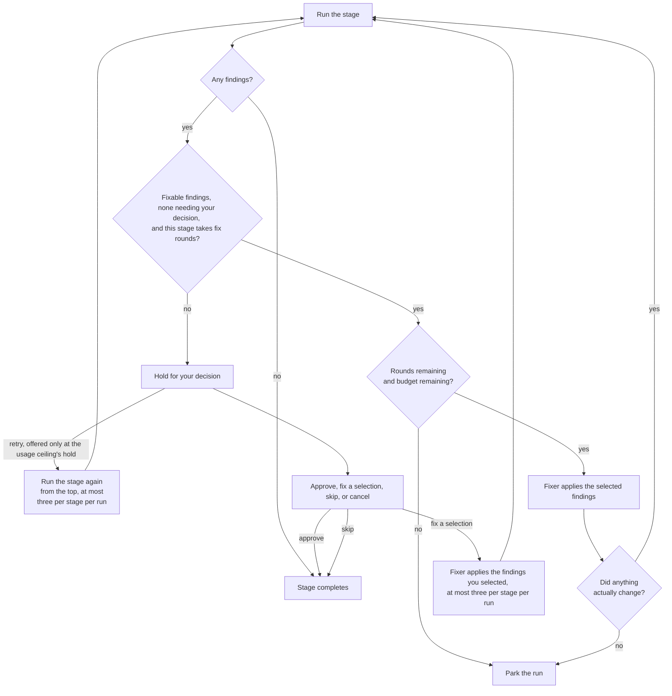

| Bound | Rule | Catches |
|---|---|---|
| **Per-stage rounds** | Each stage has its own limit. Reaching it parks the stage rather than continuing. | One stage oscillating between two wrong fixes. |
| **Run-wide budget** | A total step budget across the whole run, independent of any stage's limit. | Several stages each staying under their own limit while the run as a whole never finishes. |
| **Per-run usage budget** | The output tokens the run's own agent calls report, read from the agent invocation record before every step and compared against the budget the run recorded when it started. Reaching it, or a call that reported no count, parks the run. It changes on a live run only by adopting a new budget into the run's history. | A run whose stages each stay under their round limits, and whose steps stay under the run-wide budget, while its agent calls cost far more than intended. |
| **Convergence** | A fix round that produces no change parks the loop. The measure is over the run's whole state, so the loop parks after its second round that changes nothing, not its first. The automatic loop and the rounds standing consent asks for both park this way; a round you ask for at a hold does not (section 14, decision 8), and neither does a retry at the usage ceiling's hold (decision 25). A retry also starts the measure of the stage's own fix rounds afresh, so the first such round after it is compared with nothing; a round that repeats one taken since the retry still parks. | An agent that reports success each round without editing anything. Neither counter would catch this before exhausting itself. |

### <a id="fix-ladder"></a>The fix ladder <kbd>proposed</kbd>

> This subsection, and every passage elsewhere marked *proposed* that points at it, is a draft
> written for the owner's decision (AGE-491). Nothing it describes is built, and nothing here is
> decided until the owner says so.

With session reuse on, every automatic fix round of a run is answered inside the one fixer
session the run's first round opened: the rounds after the first resume it. That is right while
the session is converging and wrong once it is not, because a session that has failed to satisfy
review several times carries its own wrong turns into every later round, and the remedy a person
reaches for, a fresh start, a harder effort, or a stronger model, is not one the loop can take on
its own. The **fix ladder** is that remedy, taken by the program in a fixed order, one lever at a
time, and recorded. It changes how a stage's unattended rounds are answered. It adds no stage, no
loop, and no round, and section 5's bounds above stay the outer limit.

| Rung | What the round does | What it changes against the rung below |
|---|---|---|
| **Opening** | Rung zero, today's behavior. The stage's rounds resume the run's fixer session, the first one opening it. | Nothing. |
| `fresh` | The round opens a new fixer session and gives it the handoff below. Later rounds at this rung resume that new session. | The conversation. The agent, the model, and the effort are the `fix` role's. |
| `effort` | As `fresh`, at the `fix` role's effort one step up the closed set section 10 gives, `low` to `medium`, `medium` to `high`. | The effort. |
| `model` | As `fresh`, on the next entry of section 10's `fix_ladder.models`, at the effort that entry names. Each entry is a rung of its own, in order. | The agent, the model, or both. The raised effort is not carried over, as a backup inherits nothing from its primary. |
| **Spent** | No round is taken. The stage holds for you. | Not a rung: the ladder has nothing left to try. |

- **Which rung a round is on.** A rung is a fact about one stage's unattended rounds in one
  run, and it is derived, never stored on its own: from that count, `fix_ladder.climb_after`,
  `fix_ladder.rounds_per_rung`, and the rungs `fix_ladder.order` names. The first `climb_after`
  unattended rounds are on the opening rung, and each named rung after it takes
  `rounds_per_rung` of them.
- **The count is the stage's unattended rounds, and half of it is a new counter.** A
  stage's unattended rounds in a run are its automatic fix rounds and the rounds standing consent
  asked for at its holds, because nobody attended either. The first half exists: the graph's bound
  accounting counts each edge's traversals, and the traversals into the stage's fixer are its
  automatic rounds, the count its round limit reads. The second half does not. A round asked for
  at a hold, by you or by standing consent, enters the stage's requested round over the same
  edges, and the accounting keeps only whether the latest answer was unattended, so once a later
  answer is given nothing can tell which earlier requested rounds standing consent asked for.
  Counting the automatic rounds alone would leave a stage whose round limit is zero, under
  standing consent, on the opening rung for every round consent asks for; counting every round
  into the stage would count yours. So this proposes one counter, kept in the same bound
  accounting: per edge, how many of its traversals followed an unattended answer, written in the
  same checkpoint as the traversal it counts and never revised. The stage's unattended rounds
  are its automatic rounds plus the unattended traversals into its requested round. A checkpoint
  written before the counter existed reads it as zero, so a run in flight then climbs on its
  automatic rounds alone. Whether an answer was unattended is the answering caller's declaration,
  as it already is for the convergence check: the program declares every answer standing consent
  gives as unattended, and no other.
- **A round you ask for is not counted and does not move the ladder.** It runs at the rung
  the stage's unattended rounds last put it on, and decision 8's bound is unchanged. A retry at
  the usage ceiling's hold retakes the round the ceiling refused at the rung that round was on,
  and adds nothing to the count, since the refused round was already counted.
- **A rung with nothing to change is skipped and says so.** `fresh` when session reuse is
  off, since every round is already session-free; `effort` when the `fix` role names no effort
  or names `high`; `model` when `fix_ladder.models` is empty. A skipped rung takes no round and
  is recorded as skipped with its reason, so a ladder that climbed past a lever is never read as
  one that tried it. With the default fixer, which names no effort and no model, the default
  ladder is therefore the opening rung, `fresh`, and then the hold.
- **The handoff is the program's, and it is P4's summary, not a memory.** A fresh session
  is told what P4 already lets cross a round and nothing more: the run's intent and its source;
  the findings the round answers, as the stage reported them; each earlier round of the run in
  order, its selection, who selected it, the commits it made, and its one-line summary marked as
  the fixer's own claim; and the findings a person left unselected. The program writes it from
  section 8's round record and the run's commits, never from an agent's account of the session
  it replaces, and never from that session's transcript. Nothing in it comes from a review's
  session, and no review is given it: a re-review still receives the previous findings and the
  fix summary as claims, as section 5 says, and never resumes or reads any fixer session, on any
  rung (P4, P5).
- **Past the last rung the stage holds, it never parks.** When the stage's next unattended
  round would fall past the last rung while its round limit and the run's budgets still allow
  it, no round is taken and the stage holds on an `ask` the program builds. A round standing
  consent asks for past the last rung is not taken either: its answer sends the stage to that
  hold instead. It names every rung
  the stage climbed or skipped, the session each round was answered in, and the findings still
  open, so you decide with the ladder's evidence in front of you. The hold offers section 5's
  actions as any hold before push does. Standing consent leaves it for you, because the one
  answer it gives, another fix round, is exactly what the ladder has run out of. A spent ladder
  is a hold and not a park: it waits on a person, it is not one of the three loop bounds, and
  it is not a fifth park.
- **The bounds above stay the outer limit.** The ladder never takes a round the per-stage
  limit, the run-wide budget, or the per-run usage budget would not allow, and each still parks
  on its own terms when it is reached first, whatever rung the stage is on. At the default
  limits, three rounds for the test, lint, and checks stages and one for review, the default
  ladder reaches `fresh` on a stage's second round and holds before a third, and review's one
  automatic round never climbs on its own.
- **Convergence is untouched.** The rung is not part of the run's state, so a round that
  changes nothing on a new rung is measured exactly as on the old one, and the loop still parks
  after its second round that changes nothing. A fresh session that changes nothing is a round
  that changed nothing, not a reason to try another lever.
- **The graph owns the accounting.** The ladder's shape, `climb_after`, `rounds_per_rung`,
  and the rungs `order` names, is recorded when the run starts and carried in the checkpoint's
  bound accounting beside the run budget, and a run is held to the ladder it started under. The
  `fix` role and the entries of `fix_ladder.models` are read again at each round, as section
  10 reads a role at every launch, so a change to which model an entry names applies from the
  next round that reaches it. Which rung the next round is on, and whether the next round is
  spent, are answered by the graph module, which owns every loop bound, from that accounting
  and the stage's unattended rounds, so no second reader of those counts decides either.
- **Every round records its rung.** Section 6's [learning what converges](#round-records) owns what
  is recorded; the rung, whether it was climbed or skipped, and the session the round was
  answered in are part of it, so the order of the rungs can be changed later from what the
  records show rather than from a guess.

What the ladder does not establish: that a later rung converges where an earlier one did not.
The order is a default chosen from the development fleet's evidence, recorded on this proposal's
pull request, and that evidence measured a worker reworking a pull request across many pushes,
not the gate's own rounds within one run. It is what the round records are for. Nor does it
climb a task's worker: a worker that keeps failing review across runs is relaunched on section
6's terms, and nothing here changes its session, effort, or model.

### What you do at a hold

A hold offers up to five actions, and they are the same whether you act through the terminal
interface or an agent acts through the machine interface. Approve, skip, and cancel are offered
at every hold. Fix is offered at the six stages before push, intent through lint, and not at
push, pull request, or checks, for the reason section 14 decision 8 records: a round at push
would push its result before you saw it, and a round at the two stages after push would leave
a commit nothing pushes. Retry is offered only at a hold the usage ceiling raised (section 10),
at whichever stage it holds, for the reason section 14 decision 25 records. Such a hold is the
only one that lists it, and an answer of retry at any other hold is refused while that hold
stays open.

| Action | Effect |
|---|---|
| **Approve** | Accept the findings as they stand and advance. |
| **Fix** | Run one fix round over the findings you selected, with any notes you attached and any findings you wrote yourself. The stage re-runs and holds again so you see the result. |
| **Retry** | Run the stage again once the usage ceiling would admit its call: the calls in its window have aged out, you changed the ceiling in your own configuration and restarted the service, or the record that could not be read can be read. The stage runs from the top, in the same run. If its agent call is refused again it holds again on the same question, and otherwise it goes on as it would have. An automatic fix round the ceiling refused is taken again only if the stage, run first, still reports something to fix, and it is the round the refusal already counted against the stage's round limit, not one more. A fix round you asked for that the ceiling refused is not taken again, because a retry carries no request: the stage holds on that round's account, which says it did not run, and you can ask for it again. Every hold a fix round left for the stage's next execution is kept except the ceiling's own, so a round you asked for is still shown to you and a ceiling question that no longer applies is not. The program marks the ceiling's own hold as standing for a call that never started, a mark no agent's report can carry, and that mark is what offers the retry and what the retry drops. |
| **Skip** | Mark this stage skipped for this run only. |
| **Cancel** | End the run. Work stays recoverable. |

What the fixer receives for a round is the selection you made, your notes, your own findings,
the findings you left unselected in that round's report, and the previous round's summary.
History does not accumulate beyond that: a finding you left unselected in an earlier round can
be reported again by a later review, and you decide about it again. That fails toward you, since
nothing is hidden, and the cost is your attention. No review reads this history.

### A check does not judge its own edits

A check is only as independent as the files that decide its verdict. The test command is read
from the trusted copy, but the tests it runs, the lint configuration it reads, and the workflow
files that define your CI come from the change under validation. Whoever can edit those files
can make a check pass without making the code right, so an edit to them is a fact a person
sees, never one that slips through as a pass.

Those files are the **judge paths**: the patterns in `judge_paths`, read only from
the trusted copy, because a branch that could shrink the list could exempt its own edits. The
defaults cover the common conventions. A repository replaces them from its default branch when
its tests or check configuration live elsewhere.

- **The pipeline may not edit the judge on its own authority.** Any commit the pipeline
  authors after the review stage has read the change, which means a fix round of the test,
  lint, or checks stage and the document stage's in-pass edits, is compared against the judge
  paths. If it adds, changes, deletes, or renames one, the stage holds with an `ask`
  naming each such path, what happened to it, and the commit. This is decided from the paths
  the commit touched, not from the fixer's account of what it did. The fixer is also told that
  the judge paths are not its to change, but the hold does not depend on it listening.
- **The rule covers the case where the stage is supposed to write a test.** Section 5 lets
  the test stage write a targeted check when none exists. A test the pipeline wrote to certify
  its own pass is the clearest case for a person to read, so it holds like any other judge
  edit.
- **The author's edits to the judge are reported in review.** The review stage lists every
  judge path the change touched and what happened to it, and asks the reviewer to say whether
  each edit makes a check weaker. An edit or an addition is a `note`; the reviewer's
  own finding carries any judgment that it is wrong. A judge file the change deletes, or moves
  to a path no judge pattern matches, is an `ask`, because removing a check is the
  plainest way to make a run pass, and whether the check was meant to go is the author's call.
  Like the scope lens, this is part of review and adds no stage.
- **At the hold, the existing actions apply.** Approve accepts the edit. Fix sends a round
  with your notes, such as "fix the code, not the test," and that round is held to the same
  rule. Cancel ends the run with the work recoverable.

What this does not establish: the judge paths are patterns, so a check that reads a file outside
them, such as a script the test command calls, a build file, or a package manifest that also
holds test configuration, can still be changed without a hold. A weakened assertion inside a
test the change edited is reported as an edit, not detected as a weakening; that judgment is the
reviewer's. And the rule stops the pipeline changing the judge after review, not changing the
code. A test or lint round's edits to the rest of the code are reviewed before anything is
pushed, which section 14's seventh decision records; a checks round runs after the push, and its
repair passes the review stage again before it is pushed, as "A repair after the push" below
records.

### Waiting on checks

The checks stage waits for the checks on the pull request's head to settle, and that wait is
not a hold: while it lasts the run is executing and something is advancing it, so the run reads
as running, and a task attributed to it reads as validating. Section 6's lifecycle word Paused
is a worker's own declared wait and is not this one. Only when `checks_timeout`
elapses does the stage hold, which is section 10's "on elapse the run holds rather than ending",
and that hold is the one section 11's recovery step 3 re-reads the pull request before resuming.

Every read of the wait, including the first after a restart, reads the pull request's state
before it reads the checks, by the pull request's recorded identifier and never through a
lookup that cannot return a merged or closed pull request. Only a pull request the provider
positively reports as merged or closed ends the wait. A state that is open, unrecognized, or
not read leaves the run waiting, or held once the timeout has elapsed.

A run that ends because its pull request was merged is complete, not newly validated: its
checks were not read to a verdict, the rule that only a `no_ci` declaration makes an
empty check list green was never applied, and the record says a merge ended it and that the
checks were not settled. A pull request closed without merging ends the run as failed, with the
reason recorded as "pull request closed without merging". Neither adds an outcome: the outcome
row in section 9 is unchanged. The read that ends a run on a merge writes exactly one record,
the merge record in section 8's data model: the pull request, the head read, and when. The run's
`passed` is derived from that record, and so is the task's Landed in section 6;
neither stores the fact again.

### A conflict after the push

Another pull request can merge first while a run waits on its checks, and the code host then
reports this one as conflicting with its base. The checks stage answers that by sending the
run back to the rebase stage. It adds no stage: it is a path between existing stages, and like
every cycle it is bounded. A run takes it at most twice, and a third conflict parks the run.

- **The rebase is of the branch the run pushed, anchored where the run left it.** The
  rebase stage observes the branch again and goes on only if it still stands at the commit the
  push stage forwarded. A branch anybody else moved since holds for you, so a commit someone
  else pushed there is never dropped.
- **Only a rebase that applies cleanly goes on.** One that conflicts is abandoned, nothing
  is rewritten, and the stage holds. The run never decides on its own what conflicting content
  should be, and no automatic fix round is offered for it; a fix round you ask for at that hold
  is your explicit answer, held to the judge rule like any other. A rebase that leaves nothing
  to push holds too, rather than ending the run past an open pull request.
- **The result is reviewed again before it is pushed.** It passes the review stage in a
  fresh session with no memory of any fix, then the test, document, and lint stages, as the
  first pass did. Fix round limits are per run, so a stage that spent its rounds on the first
  pass has none left on the second. The second pass shares the run's fix rounds, so a stage
  that spent them on the first pass parks on a fix finding in the second.
- **The second push is anchored on the first.** The push stage updates the branch only on
  an observation of it standing at the commit the first push left there, checked against the
  live target like any push, so a branch that moved after the rebase stage observed it is
  refused and held. The commits it replaces are the ones the first push left there, and the
  push names them.

Where that path cannot do its job, the checks stage holds on the conflict instead and says
why: the run pushed nothing, its head is not the commit it pushed, or the run skips the
rebase, review, or push stage. A checks fix round's commit is not taken down this path; it
takes a path of its own, back to the review stage, which "A repair after the push" below
describes.

### A repair after the push

A check that fails after the push takes the checks stage's fix round, and the repair reaches
the pull request only after it is reviewed again: the checks stage sends the run back to the
review stage. It adds no stage: it is a path between existing stages, and like every cycle it
is bounded. Every repair is one of the checks stage's fix rounds, and fix rounds are per run,
so a check still failing after the last round parks the run, and a repair already sent back
once counts as a further round rather than being sent back again.

- **The repair is anchored where the run left the branch.** Before it sends the run back,
  the checks stage observes the branch and goes on only if it still stands at the commit the
  push stage forwarded and the repair descends from that commit. A branch anybody else moved
  since holds for you, so a commit someone else pushed there is never dropped.
- **The repair is reviewed again before it is pushed.** It passes the review stage in a
  fresh session with no memory of the fix, then the test, document, and lint stages, as the
  first pass did.
- **The second push is a fast-forward from the pushed commit.** The push stage updates the
  branch only on that observation, checked against the live target like any push, so a branch
  that moved after the checks stage observed it is refused and held.
- **You are told the repair was reviewed again** before it was added to the pull request,
  or that it has not been added yet.

Where that path cannot do its job, the checks stage holds on the repair instead and says why:
the run pushed nothing, or it skips the review or push stage. A checks stage with no fix rounds
makes no repair, and the path is not there.

### What passing the gate means

Exactly this, and nothing more:

- The branch was rebased onto freshly fetched upstream and branch targets.
- Review, targeted tests with evidence, documentation, and lint all ran before anything was pushed.
- You stayed in control of every judgment call, or you explicitly consented to a bounded amount of unattended resolution.
- The branch update was checked against the live target and refused rather than guessed at.
- The pull request records what was checked, what was fixed, and how many attempts it took.

The gate does not define compliance. It publishes facts precise enough for any external system to
reach its own verdict.

### What the gate does not establish

One limit is worth writing down now rather than meeting it later. The gate validates a diff. It
does not establish where the intent behind that diff came from.

A worker steered by content it read while working produces an intent the intent stage records
faithfully, and a diff that implements that intent consistently. Review, tests, and lint still
read the change on its merits, so this is not a bypass of them: a change that is wrong is still
caught for being wrong. The scope lens is the part that gives no warning at all, because every
changed line does trace to the stated intent. The lens measures a change against the intent; it
never asks where the intent came from.

Nothing in this document closes that. P7 bounds what a pushed branch may execute, may configure,
and may claim about a validating agent's authority, which is a different question from what a
worker was persuaded you wanted. A change that passes the gate has been validated on its merits.
Passing is not evidence that the intent behind it was yours.

<sub>Section 6</sub>

## <a id="orchestrator"></a>The orchestrator

The coordinator turns one request from you into supervised work, and turns many workers' output
back into a small number of decisions for you.

### Task lifecycle

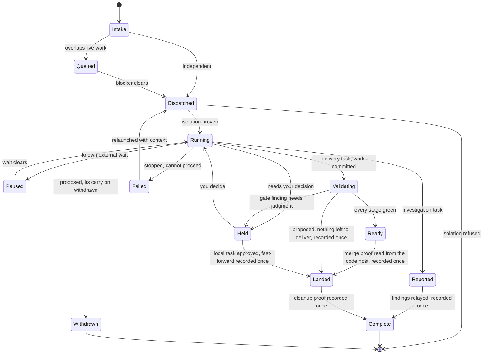

Paused is a worker's own declared external wait, entered only on the worker's own say-so; the
checks stage's wait is not shown as Paused, and a hold is never Paused. Landed and Complete are
terminal facts the program records once each: Landed is derived from the one merge record the
code-host read writes, the same record the run's `passed` is derived from, or, for a
task delivered under the `local` posture, from the local landing record its
approved fast-forward writes; and Complete is, for a delivery task, the cleanup proof recorded once the same way and, for an investigation, the record that its findings were relayed, written once by the coordinator and not inferred from the report or from the cleanup proof. Neither is inferred from a run.
<kbd>proposed</kbd> Landed is also derived from the nothing-to-deliver record a run writes when its
rebase leaves nothing to deliver, on the terms of [nothing left to deliver](#nothing-to-deliver).
That record is written by the program at the run's end, read from its recorded position, and not
inferred from the run's status.
<kbd>proposed</kbd> Withdrawn is a terminal fact of the same kind, recorded once by the withdraw
that ends a task a carry on created before it ever dispatched (section 6's [kept work](#kept-work)).
The relaunch from Failed is bounded by section 10's `relaunch_attempts`: past it the
task holds for you, and you decide whether it is retried.

#### Delivery task

- Deliverable is a change to a project.
- Works on its own branch in its own isolated copy: a full clone of your primary checkout, the upstream the gate already knows, under its task directory at `tasks/<id>/copy`, with an `assistant` remote pointing at the gate's bare repository.
- Reaches a shared branch only through the gate: the worker pushes to `assistant` the way a person does, so admission and the run start through the hooks the gate already installs. Every push that reaches the gate goes through the hooks it installs, so those pushes have one admission path. A push the worker makes to any other remote is not seen by the gate, and nothing here prevents it.
- Its isolated copy is protected; cleanup refuses on unlanded work.

#### Investigation task

- Deliverable is a self-contained report with evidence.
- Creates no branch, pushes nothing, opens no pull request.
- Its isolated copy is at `tasks/<id>/copy`, is cut the same way, is declared scratch and discardable, and carries no `assistant` remote because it pushes nothing.
- Can be promoted to a delivery task in place, keeping its context.

A task runs under a role, section 10's `roles`. Intake records the role name and
nothing about which agent, model provider, model type, model version, effort, or context window that name meant: the role row is the one owner of
those, and a launch reads it then (P14). No role at intake is the `worker` role.
<kbd>proposed</kbd> A housekeeping
pass names no role and runs under the `housekeeping` role, as
[housekeeping](#housekeeping) says.
Promotion and relaunch keep the name. The review and the fix of a run that the task's push
starts are the `review` and `fix` roles, not the task's role.

A launched worker's first turn is the task's instructions, then any relaunch note, then section
10's project knowledge, read afresh for every attempt.

> **A report is evidence, not authorization**
>
> A diagnosis, a recommendation, or an implementation-ready finding does not authorize changing
> code. Implementation is a separate request. Promotion is the explicit mechanism: it flips the
> task's contract in place, in the same terminal with the same loaded context, so the
> protections that apply to delivery work start applying.

### <a id="nothing-to-deliver"></a>Nothing left to deliver <kbd>proposed</kbd>

> This subsection, and every passage elsewhere marked *proposed* that points at it, is a draft
> written for the owner's decision (AGE-487). Nothing it describes is built, and nothing here is
> decided until the owner says so.

A gated delivery task can end with nothing to deliver. Most often another change already put the
same edit on the default branch, so the rebase stage finds nothing left to change, and section 5
ends the run successfully with every later stage skipped, nothing pushed, and no pull request. No
merge record can follow, because there is nothing to merge. Without an end of its own the task
resolves Ready from that run forever, and everything that waits on Landed or Complete waits with
it: the end of its worker, the cleanup of its copy, a task queued behind it, and a housekeeping
pass's claim on its repository. A task under the `local` posture starts no run, so it never ends
this way.

This is the one end without a merge or a fast-forward that the program records on its own, on the
owner's decision of 2026-10-24, recorded on AGE-487. Every other end that does not land stays
where its records put it, and the coordinator escalates it to you; nothing ends it on its own.
That covers a run that failed, was cancelled, parked, or holds; a pull request closed without
merging; and a worker that runs too long or hangs.

- **The record.** A run that ends on section 5's empty-diff short circuit, with its work proven
  present as below, writes one **nothing-to-deliver record**, once, in the same write that ends
  the run. The record names the run, the default-branch commit the rebase stage read at its fresh
  fetch, the commit the run was submitted with, the answer of the content check below, and the
  checkpoint entry those facts were read from. The rebase stage records the commit and the answer
  in the run's position beside the short circuit, so the record is read from the position, the
  checkpoint history, and never from a stage's report, the run's status, or its outcome. A report
  saying nothing remains is not the position: a run whose position does not carry the short
  circuit writes no record, whatever its report says.
- **Only work proven present.** An empty difference after the replay is not proof that the work
  is on the default branch. The rebase skips a commit whose patch matches one the default
  branch gained since the branch left it, even when the default branch reverted that one later, and then the
  replay is clean and empty while the default branch does not hold the change. So when the rebase
  stage takes the short circuit it also asks P12's content check, `internal/safety`'s
  incorporation: whether integrating the commits the run was submitted with into the commit it
  read would change nothing. Only a yes writes the record. A no, and a check that could not
  answer, write none, and the task stays where its records put it. A branch with no commit of its
  own writes none either, because an empty set of commits is no answer, and neither does a commit
  together with its revert, because the commit on its own is not present.
- **Only a run whose branch was never published.** The record is written only when the run's own
  push anchor, which its rebase stage observed before rebasing, found the branch absent where the
  run would push it. A branch present there was published by somebody, an earlier run, the
  worker's own push to another remote, or another task of the same name, and may carry a pull
  request the record knows nothing about; such a run writes no record. The short circuit is taken
  before the push stage, so the run itself never pushed, and a rebase after a push that leaves
  nothing to push holds instead (section 5).
- **What it establishes, and no more.** Every commit the run was submitted with was present by
  content in the default-branch commit the run read: somebody else landed the same change. That
  is the same proof P12 accepts for removing a copy, made against the commit the run was given
  rather than against the copy, which is why the copy is still asked on its own, below.
- **What the task resolves.** The task the run is attributed to resolves Landed from the record,
  in the terminal tier, on the merge record's terms: it is final, it outranks a hold and a run,
  and a later run does not displace it. Attribution is section 6's rule by branch, not by who
  pushed, so a person's push of a task's own branch lands that task as its worker's push would,
  and a run no task is attributed to changes no task.
- **Everything that waits on Landed proceeds as after a merge.** The worker is ended as a landed
  task's worker is (section 8), with no hold. The copy is asked section 6's cleanup decision, and
  Complete follows on its proof. A task queued behind it dispatches, because Landed clears a
  blocker. A housekeeping pass is no longer open, under its own one-at-a-time rule
  ([housekeeping](#housekeeping)), and is not retired. Nothing new waits on the record itself.
- **It never loses work (P6).** The record moves no branch, closes no pull request, removes
  nothing, and forces nothing. It says nothing about the task's copy, which can hold more than
  the run was given: commits the worker made after it pushed, uncommitted files, a stash. So
  nothing is removed on the strength of the run. The copy is removed only by the cleanup decision
  on P12's terms, which reads the copy as it stands at removal; the proof that ordinarily answers
  here is the content check, that the copy's work is present by content in the default branch's
  tip read at a fresh fetch. A copy that holds anything that tip lacks, or whose proof cannot be
  made, is refused and kept. Its kept-work entry names what it holds and holds the project's next
  task until you answer it (P15). Ending the worker ends a process and never discards what it
  wrote. So the copy holds nothing unlanded because P12's proof shows it at the moment of
  removal, never because the run said so.
- **Audited.** The record is written once, in the same write that ends the run, so a run is never
  recorded as ended this way without it, and it is never revised. It names the commits and the
  checkpoint entry it rests on, so a reader can check the claim against the default branch's
  history. The task's resolution names it as its source, the cleanup record names the proof that
  removed the copy, and the catch-up read lists it with what landed (section 9).
- **What reaches you.** The catch-up read and the task's status line say the change was already
  on the default branch and nothing was delivered, phrased under P13; it adds nothing
  to what reaches you immediately. It is not a pass: no review, test, or check ran on it, so the
  task's line never words it as validated or merged, as a `local` change is never worded with the
  words a passed run uses. The autonomy flag merges nothing here, since it merges only a pull
  request the run recorded.

What this does not establish:

- The run's own outcome. Section 9's outcome set names none for a run that ended on the short
  circuit, and none of its finished outcomes describes such a run: it validated nothing and pushed
  nothing. This subsection settles the task's state and not the run's outcome.
- How a task that does not land this way reaches you. A run whose branch was already published,
  or whose work the content check does not find present, still ends successfully on the short
  circuit, and its task resolves Ready from it, which is not in flight, so nothing above raises it
  to you.
- Section 5's short circuit itself. It reads the tree after the replay, so a run whose commit
  matched a patch the default branch later reverted ends successfully with its change on no
  branch but the gate's and the copy's. Nothing is lost, since the run pushes nothing and removes
  no copy, but the run reports success for a change it neither validated nor delivered. This
  subsection keeps such a run from landing its task and does not change section 5.
- The default branch afterwards. The record rests on the rebase stage's reading at its fetch, so
  a default branch rewritten later to drop the change leaves the task Landed with the change gone,
  as a reverted merge does.
- A worker still running when its task lands is ended, and a push it makes before that end
  starts a run attributed to a landed task, which validates as any run does; what that push
  carried is in the copy and is kept on P12's terms, as after a merge.

### <a id="kept-work"></a>Kept work

When a task's or a run's copy is kept because its work has not landed, the program records a
kept-work entry naming the project, the branch, what the copy holds that the default branch
lacks, and why it was kept. It surfaces at once: in the catch-up read, in `status`,
and through the private channel when one is configured.

Kept work is answered before new task work starts. While a project has an unanswered kept-work
entry, no new task in that project dispatches; it waits, naming the kept work and the three
answers, and dispatches as soon as the entry is answered. Your own push is never held by it: a
run your push starts proceeds as it always does, and its answer names the kept work. Work
already running is not interrupted, and kept work in one project never holds another. The three
answers are:

- **land**: the program carries the work to the gate as a delivery and asks nothing it would not ask of a push;
- **carry on**: a worker is relaunched in that same copy with a note saying what is already there. The worker is a new task's, of the same project and branch, whose copy is the kept copy; the task the copy outlived stays finished, since work that continues on it is a new task, and the entry closes once the new task owns the copy;
- **discard**: you name the copy, the program shows exactly what will be lost, and it removes the copy only on that answer, recording who discarded what.

A kept-work entry is answered as a hold, with section 9's hold answer and no verb of its own;
section 9 says how, including how a discard is shown before it is confirmed.

An answer is a **claim** until its outcome is recorded, on the owner's decision of 2026-10-22
on #475's design, recorded on #530. An answer closes an entry only in the write that records its
outcome; a carry on's outcome, as its answer above says, is the new task owning the copy. Until
then the answer is a claim on the entry. A claim keeps the entry open, listed, and holding its
project's dispatch, and every other answer to that entry, or to another entry of the same copy,
is refused while it stands. A service that stops with a claim owed takes it up again at the next
start. An answer that fails having done nothing takes its own claim back, and the entry is open
as it was.

<kbd>proposed</kbd> Each answer's outcome, under that rule:

- **land**: the run it starts, which carries the work to the gate as a delivery. The entry closes
  when that run is recorded, not when the work lands: from then on the run's holds, failures and
  landing reach you as a push's do.
- **carry on**: the new task owning the copy. A carry on moves the copy to the new task's path,
  and shapes it there, before the task owns it, so a carry on can stand with the copy moved and
  its claim still open.
- **discard**: the copy removed. While its removal is deferred to AGE-486, a discard records no
  claim: its preview writes nothing and its confirmation is refused.

<kbd>proposed</kbd> A claim can be left that the program can neither carry out nor take back on
its own. A carry on whose task was created but whose copy cannot be adopted stays owed, with the
entry open and holding its project's dispatch, until a later attempt adopts the copy, which may
be never. So a claim has an answer of its own, **withdraw**, which takes it back. Withdraw is
given as a hold answer on the entry that holds the claim, by whoever may give that entry's other
answers, and section 9 says how. An entry holding a claim is listed naming it: its kind, who
gave it, and when, so a claim left owed reads as one and not as an entry nobody answered. A new
task the entry holds waits naming the claim and the withdraw, not the three answers, which are
refused while the claim stands; another answer given to the entry is refused naming them too.

<kbd>proposed</kbd> A withdraw is refused, and changes nothing, while the claimed outcome is
**mid-flight**:

- any claim while a call in the service is carrying it out; the refusal says so, and the
  withdraw can be given again once that call ends;
- a landing left by a service that stopped after starting its run and before recording it,
  while that run has not ended, since it can still carry the work to the gate; section 9's
  `--cancel=RUN` ends it, and the withdraw is then taken. Once that run has begun validation the
  landing is not withdrawn either: the run is its outcome, and the claim is carried out by
  recording it at the next call or the next start. A run that ended before validation began is
  not its outcome and refuses nothing. A landing whose run is recorded has closed the entry, so
  no claim is left to withdraw, and what that run does afterwards, cancelled or not, reaches you
  as a push's run does;
- a carry on once its task has begun an attempt;
- a discard's claim, once AGE-486 gives a discard one, once its removal has begun.

<kbd>proposed</kbd> A carry on that moved the copy is not mid-flight. Its withdraw moves the copy
back to the path the entry names, as one move, only when the copy at the new task's path is the
copy the claim read and nothing stands at the entry's path; otherwise it is refused naming what
stands where, and changes nothing.

<kbd>proposed</kbd> A claim whose copy is **gone** is withdrawn too, and its withdraw closes the
entry as gone instead of reopening it. Gone means nothing stands at any path the claim knows: the
entry's path, and for a carry on the new task's path as well. No answer can be carried out over
a copy that is not there, so an entry reopened over it would hold its project's dispatch with
nothing able to release it (P15). Closing it removes nothing, since nothing stands, ends a task
the carry on created as any withdraw does, and lets the project's waiting tasks dispatch. The
copy is read as gone only when each path is read and nothing stands there: a path that cannot be read
refuses the withdraw naming it, and a directory standing at a path is not gone, so the rules
above apply to it.

<kbd>proposed</kbd> An entry with no claim has nothing to withdraw, so the answer is refused as
incorrect usage. A withdraw given on another entry of the same copy is refused naming the entry
that holds the claim.

<kbd>proposed</kbd> What a withdraw leaves behind:

- **The entry, open again.** The claim is cleared and the entry is open as if it had never been
  answered: listed, holding its project's dispatch, and answered afresh with any of the three
  answers. A withdraw whose copy is gone closes the entry as gone instead, as above.
- **Everything on disk, kept.** Nothing is removed (P6). A copy that stands is where the entry names
  it with what it holds, moved back there if a carry on had moved it. What the carry on's shaping
  added to it, and anything the claim wrote in the gate or under the home, stays.
- **No task a carry on created, ever dispatched.** When the claim's task was created, the
  withdraw ends it in the same write. It never had an attempt, so no worker ran and no copy was
  cut for it. Its record and its directory stay as they were written. The state resolver reads
  the withdrawal as that task's terminal record, so it resolves Withdrawn, and dispatch refuses
  a task the withdrawal names whatever it resolves. A later carry on of the entry creates a new
  task.

<kbd>proposed</kbd> A withdraw is audited by one record, written once in the same write that
clears the claim. It names the entry, the claim as it stood (its kind, who gave it and when, and
for a carry on the task it named), who withdrew it, when, where it moved the copy back from if it
did, whether it closed the entry as gone, and the answer's note. Who withdrew it is the surface that gave the answer, recorded the way
every answer's resolver is and never taken from the note. For the entry the record is evidence
and not state: whether an entry holds a claim is read from the entry, never from its withdrawals
(P8). Section 8's kept-work withdrawal record is where it is kept.

A reported investigation keeps its worker for `promotion_window` after the report is
stored, so that a promotion in the same sitting continues the worker that wrote the report.
When the window passes, the worker is ended and its copy is kept. A later promotion relaunches a
worker in that copy, with the stored report as its starting point. When that copy has a kept-work
entry, the promotion records the entry's answer as carry on, which closes it.

### Events and current state

This is P8 made concrete, and it is the highest-value single change in the whole design. Two
records exist per task, and they answer different questions.

| Record | Shape | Answers |
|---|---|---|
| **Event log** | Append-only | What has happened to this task, in order. Each append is a wake. Never read its tail to decide what is true now. |
| **State record** | Resolved on read, not stored | What is true now. A resolution with the source of the answer attached, computed on each read from the records that own its facts, and determined as of one consistent read of them. Nothing stores it: a stored copy would be a second record of facts that already have an owner, per P14. |

The state resolver answers in a fixed precedence:

1. A terminal record the program wrote once for this task: Landed, derived from the merge record the code-host read writes or, for a `local` task, from the local landing record, or Complete, the cleanup proof for a delivery task and the findings relayed record for an investigation. This outranks a run, because a passed run resolves Ready forever and only a record of what happened after it can move a task past that. A terminal record is final for the task. A run attributed to the same branch afterwards does not displace it. Work that continues after Landed is a new task. <kbd>proposed</kbd> Withdrawn, read from the kept-work withdrawal record that ends a task a withdrawn carry on created (section 6's [kept work](#kept-work)), is a terminal record of this tier too. <kbd>proposed</kbd> So is the nothing-to-deliver record of a run attributed to the task, which resolves Landed ([nothing left to deliver](#nothing-to-deliver)). It is read beside the merge record, and Complete follows from it on the cleanup proof as from any landing.
2. The hold tier: an open hold naming this task, which resolves Held, because the task is waiting on you. It sits below the terminal record and above the run, so a task waiting on you never resolves Failed or Unknown, and a terminal record still outranks it.
3. A validation run attributed to this task's own branch, whether active or finished. This outranks everything below, because a worker handed off to the gate stops writing to its own log.
4. A stored report: an investigation task whose report is stored resolves Reported. The report is a record the program wrote once, not an event, so it outranks the terminal below it: a worker still running after it filed and a worker whose terminal has ended have both delivered, and neither is a crash. The answer rests on the stored report and never on the log entry that says one was filed. A stored report is not Complete: Complete for an investigation stays the terminal record of the lifecycle's Reported to Complete edge, in the first tier, and is not inferred from the report or from the cleanup proof alone, so a reported investigation whose copy is gone without that record still resolves Reported. A promoted task is a delivery task and is not read by this tier.
5. A live process signal from the task's terminal.
6. The event log, and only when its most recent event maps to a recognized state.
7. Otherwise, unknown. A dead terminal with no attributed run and no stored report reports unknown rather than trusting a stale event.

An event that closes a decision is decision-only: it never becomes current state, and its text
never leaks into the state detail. If the log's last event says a decision is open but the
validation run has moved past it, the resolver reports that event as superseded.

Which run belongs to a task has no owner row. A run is attributed to the task whose latest
attempt is the newest attempt on that repository and branch that had started by the time the
run was created. A later task's run is not attributed to an earlier task on the branch. A task
with no attempt is attributed no run by its branch. The resolution names the run it chose, so
a reader can see what the answer rested on.

Task state is its own vocabulary and not a second rendering of a run's outcome. The outcome
translation in section 9 answers the person driving one run; task state answers the fleet view,
and the two are not required to agree word for word. A test pins that every run status maps to
a task state; it does not pin the words to the outcome set, so a run a person cancelled reads
`cancelled` as an outcome and Failed as a task state. The lifecycle's Landed and
Complete are resolved from the terminal records the program writes once each, in the first
tier of that precedence, and from nothing else. <kbd>proposed</kbd> So is Withdrawn, from the
kept-work withdrawal record alone, for the one kind of task it ends: a task a withdrawn carry on
created, which never had an attempt. A task with no attributed run, an investigation
task among them, shows its task state and has no run outcome: the outcome set in section 9 is
not extended for it, and no outcome word is shown where no run produced one.

### Supervision

The supervisor is a loop inside the service, not a separate process. It blocks on the fleet and
classifies every wake without invoking a model, and it absorbs a wake only on positive evidence
of progress. Its liveness is the service's instance identity in a beacon file together with a
probe of the home's lock: a supervisor is live when the service that wrote the beacon is the
one holding the lock. This is what makes running many workers
affordable, and it is also where the design is easiest to get subtly wrong.

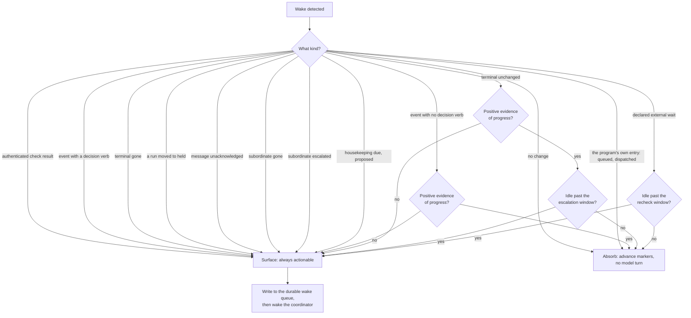

#### Absence of evidence surfaces

A wake is absorbed only when something positively proves work is proceeding. A worker that finished, crashed, or silently stopped produces no such proof, so it surfaces, unless its task resolves Reported, Landed, or Complete, as the end of this card says. Never absorb on elapsed time alone. The program's own intake and dispatch entries, `queued` and `dispatched`, are not a worker's wake at all: they record the program's own act, so they are absorbed and never wake the coordinator. Two kinds surface always and are never read as no change: terminal gone, which is a capture that failed, a probe that could not observe the terminal, or a terminal that died; and a run moved to held, which carries no worker event at all, because the supervisor that notices a stall is the one that notices a hold. A task that resolves Reported from its stored report is not watched for terminal gone: its worker has delivered, so a terminal that ends after the report is the work finishing, not a crash, and the report's own decisions reach you as holds. A task that resolves Landed or Complete is not watched for terminal gone either: its work is delivered, so a terminal that ends after that is the work finishing too. Two kinds are a subordinate coordinator's, and both surface always: subordinate gone, its terminal observed dead or not observable; and subordinate escalated, a decision it hands up because answering it is one of the commands it does not hold. Both reach the first coordinator and never the subordinate.

#### The queue is durable and written with the markers

The durable wake queue is a table in the embedded database, not a directory. An actionable wake is written in the same transaction as the detector markers it advances, so no marker can move without its wake recorded and a missed process exit is recoverable by draining. Every turn that handles a wake drains the queue before doing anything else.

#### A declared wait is not a stall

A worker waiting on something external that will clear on its own says so. That silences the stall detector but arms a slower recheck, so a forgotten wait cannot stay invisible indefinitely.

#### A terminal-ish wait surfaces once

A worker that finished and is waiting on a merge, or that stopped on a blocker, surfaces once, then is absorbed even as its idle screen redraws, then surfaces again when something actually changes. Otherwise it storms every poll. A worker that crashed and is still silent is not absorbed for good: it surfaces again once per `escalation_window`, so a crash is never seen only once and still never storms. Acknowledging a resurfaced terminal-gone wake does not restart that spacing. A subordinate coordinator whose terminal is gone is spaced the same way: subordinate gone surfaces once per `escalation_window` while it stays gone.

### Keeping supervision alive

P10 is defended four independent ways, because a single mechanism has already failed in practice
and the cost of that failure is hours of silence. Work is in flight while any task resolves
Queued, Dispatched, Running, Paused, Validating, or Unknown, or has a wake not yet
acknowledged; a task that resolves Held, Ready, Reported, Failed, Landed, or Complete is not in
flight by its state alone, because the only one it waits on is you and the wake that told you
is in the queue. <kbd>proposed</kbd> A task that resolves Withdrawn is not in flight either: it
never had an attempt, dispatch refuses it, and nothing will move it. A wake counts until it is acknowledged, not until it is drained: a wake handed
out to the coordinator and not yet acknowledged keeps its task in flight.
<kbd>proposed</kbd> A housekeeping
pass that something moves is in flight whatever it resolves, on the terms
[housekeeping](#housekeeping) gives.
<kbd>proposed</kbd> A task
with an open stall hold is in flight too, whatever the queue holds, because its worker is still
running: section 6's [stalled worker](#stall-hold).

| Layer | Direction | What it does |
|---|---|---|
| **The live cycle** | Active | The coordinator holds exactly one supervision wait whenever work is in flight, resumed as the last action of every turn. With a domain delegated, that is one wait per domain: the subordinate coordinator's for its domain while the delegation stands and it is attached, and the coordinator's for everything else. P10's one live supervision cycle per home is unchanged by that, because the supervisor is the service's one loop and a wait is what each coordinator holds against it. |
| **Arm verification** | Active | Starting the service confirms its supervisor is genuinely alive: the service writes its instance identity to a fresh beacon file, the probe checks that the same instance holds the home's lock, and the result is an honest started, attached, or failed. An unexplained exit of the loop is a typed failure, not silence. |
| **Pull guard** | Passive | Ordinary commands warn when work is in flight and the supervisor has stopped, which the beacon and the lock probe decide, or when queued wakes are waiting to be drained. |
| **Stop guard** | Push | The guard acts through a hook the coordinator's host invokes at turn end, which runs the command section 9 names beside `assistant gate`. When the coordinator tries to end a turn while work is in flight and no live supervisor holds this home's lock, the turn is blocked until the host supplies a re-entry signal; the host defines that signal, not this program. The guard reads the host's `stop_hook_active` field on its standard input as re-entry, and the environment variable `ASSISTANT_HOST_REENTRY` carries the signal for a host that supplies no such field. It is never forced into a counted follow-up turn: a turn count is a bound nothing here owns, so without a host-supplied re-entry signal the only safe reading is blocked. Installing that hook is a change to the host's configuration, which a push never consented to (P1): the installer prints the exact line the host's configuration needs and writes it only when given an explicit flag, so without that flag nothing in the host's configuration changes. The line is installed at the host's user scope. |

> **Never kill watchers broadly**
>
> A pattern-matched process kill reaches services belonging to other homes on the same machine,
> and the supervisor is a loop inside one of them. Repair goes through the home-scoped owner
> path, which restarts the loop in place inside the service recorded in this home's beacon and
> holding its lock, and signals nothing else. The binary contains no pattern kill, and repair is
> an in-process restart. The rule that bad command shapes are refused is not implemented by
> this. Command shapes that violate this should be refused before they run, not
> cleaned up after.

### <a id="steering"></a>Steering a running worker

A worker that drifts off scope, asks a question in its output, or stalls on a live process
must be reachable without waiting for it to die, and stoppable without the agent reaching
around the program. Three operations do that, each a coordinator-only service method on the
terms section 9 gives creating, promoting, and relaunching a task. A caller inside a
registered worker group is refused, so no worker steers itself or a sibling, and who sent or
stopped is derived from the surface the way who resolved a hold is, with no value meaning a
person.

A caller is placed as the worker of a task, the subordinate coordinator of a domain, or
neither, from the credentials the socket reports and the caller's parent chain, never from
anything the caller says about itself; where placement cannot tell, each rule errs toward the
side that claims less. A subordinate coordinator may message, stop, and read the output of a
worker in its own domain, on the terms below, and is refused for a task outside it. Section 9
owns the whole of what a subordinate may ask and what it is refused.

| Operation | What it does | What proves it happened |
|---|---|---|
| **Message** | The program appends a message record naming the task, the attempt, and the text, with credentials removed, then sends the text through the terminal session provider's Send, which the Claude Code adapter frames as one stream-json user message, or under the tmux provider types as one bracketed paste once the worker's screen reads ready. The text is bounded by a fixed limit in the program and refused rather than truncated above it. Nothing resends a message. | Three facts on the message record, each written once. **Written**: Send returned, which proves the bytes reached the worker's input and nothing about whether it read them. **Refused**: Send failed, with the reason. **Acknowledged**: the worker appended the acknowledgement kind, naming the message, through the worker event path, and the store records it on the message record in the same transaction as the event. A record with neither written nor refused after a restart reads as unknown and is never resent. |
| **Stop** | Ends the worker through its session's close, or, for a session this service does not hold, through the one group ending that verifies the leader's identity first. The copy is never touched, so what the worker wrote stays where it is (P6). The program then registers a hold naming the task, keyed by the attempt it stopped. | The probe answering dead for the attempt's session reference, read after the stop and never inferred from the close returning. Anything else is a typed refusal and no hold is registered. The hold is what the task resolves from afterwards, Held in the hold tier, so reconciliation does not relaunch a worker someone stopped. |
| **Relaunch** | Answering the stop's hold `retry`, optionally with a note, runs the one anchored relaunch section 11 uses, in the same copy, with the same instructions, the note, and the text of every message the stopped attempt never acknowledged. `stop` leaves the task where its records put it. It is counted by `relaunch_attempts` like every other relaunch. | The new attempt, anchored to the attempt the answer named, and the copy assertion and launch that follow it on their existing terms. A second answer or a concurrent reconciliation loses at the anchor. |

- **A stop is a hold.** It waits on a decision. A message nobody acknowledged is neither a
  hold nor a park but a wake, and nothing here is a loop bound, so nothing here parks.
- **An unacknowledged message surfaces once.** A message written and not acknowledged
  within `escalation_window` surfaces as a wake of its own kind, always actionable,
  once per message, and is not resent.
- **A message never closes a decision.** A worker's open decision is closed by the worker's
  own event, and a hold only by an answer through the hold path. A message carries text and
  nothing the program reads as an answer.
- **What you hear.** A message not yet acknowledged, a stopped worker waiting on your
  decision, and a stop that could not be verified are phrased like every other line. The
  message's text and the worker's output are evidence, never relayed (P13).
- **Interrupt is not offered.** Ending a turn while keeping the process means knowing the
  turn ended, which nothing here reads. An interrupt is refused naming the missing capability,
  per section 8's rule that undeclared means unavailable, and the path is stop, then relaunch
  with a note. Section 12 defers it.

Not in this design: switching agent or model on relaunch, since agent selection is trusted
configuration (P7) and a worker names no model; answering a permission prompt a worker's agent
raises; and steering a validating agent, which section 9 contains.

### <a id="stall-hold"></a>A stalled worker holds for you <kbd>proposed</kbd>

> This subsection, and every passage elsewhere marked *proposed*, is a draft written for
> the owner's decision (#531). Nothing it describes is built, and nothing here is decided until
> the owner says so.

**What a stall is.** A worker is stalled when its task resolves Running, its terminal is
observed live, and its screen has not changed. Supervision surfaces such a screen once
`escalation_window` has passed, and again each window while it stays the same, and
it counts each consecutive surface of that one screen; a changed screen starts the count again.
That count is the only measure of a stall. Elapsed time alone is not one. A declared wait is
not one: its task resolves Paused and `recheck_window` watches it. A worker whose
gate run the service is advancing is not one either: its task resolves from that run and not
Running, and the run's own bounds and `checks_timeout` bound that wait. A terminal
that reads gone or Unobserved is section 11's, never this.

**The hold.** Once the same unchanged screen has surfaced `stall_inspection_count`
plus `stall_hold_count` times (section 10's keys), the next surface also registers
a hold naming the task. With the defaults that is the seventh consecutive surface, no sooner than
three and a half hours after the screen last changed. By then the coordinator has been asked
for a deeper inspection `stall_hold_count` times and the screen has still not
changed, so the stall becomes a decision owed to you. The hold ends nothing: the worker keeps
running and its copy is untouched. It is keyed by the attempt and the surface that reached the
count, so the same stall found again at a later pass or after a restart is the same hold, open
or answered, and a stall that reaches the count again after an approve is a new one. While it
is open the task resolves Held, the hold tier, and the decision waits in the queue as a hold,
phrased like every other line.

**A held stall stays watched.** A held task is otherwise in flight only while a wake about it
is queued, so once the coordinator acknowledged the hold its terminal would no longer be read.
A task with an open stall hold is in flight whatever the queue holds, because its worker is
still running: the stop guard counts it, every pass reads its terminal, and its unchanged
screen goes on surfacing once per `escalation_window` as before.

**A stall that ends by itself closes the hold.** The hold asks whether to end a live worker
whose screen has stopped changing. When a supervision pass reads the screen changed, or any
probe the program takes reads the worker dead, the probe a housekeeping retirement takes among
them, that question no longer stands, so the program closes the hold itself, recording
itself as the resolver and what it read, the way section 11's step 3 closes the checks stage's
hold on a pull request it read merged or closed. A changed screen restarts the count, and the
closure surfaces once as a wake of its own, so the coordinator can tell you the decision is no
longer needed. A dead worker surfaces as terminal gone, as any does, and section 11 takes it
from there. A terminal that reads Unobserved closes nothing: that reading is ambiguous, and
section 11 leaves it alone. An answer and the program's closure are each one write to the hold
and the first to land stands. A later answer is refused, with one exception: a stop or retry
whose own stop ended the worker before the program closed the hold on that death reports the
end it made, and a retry still relaunches through the stop's hold.

| Answer | What it does |
|---|---|
| **Approve** | The worker keeps running. The count of its screen starts again from zero, so a screen that stays the same is inspected again and holds again only after another full count. |
| **Stop** | The program stops the worker through this section's Stop, on its terms: the copy is never touched, the end is proven by the probe reading the worker dead, and the stop registers its own hold, which then carries the decision whether the worker is relaunched. A stop that cannot be proven is a typed refusal, and the stall's hold stays open. |
| **Retry** | The stop above, then the answer `retry` to the stop's hold, in one answer: the one anchored relaunch in the same copy, with the same instructions, an optional note, and the stopped attempt's unacknowledged messages. It is counted by `relaunch_attempts` like every other relaunch, so past that bound the bound's hold is registered instead and nothing starts. A stop that cannot be proven is refused as above, and nothing is relaunched. |

These three are the whole answer set. Any other answer is refused and the hold stays open,
unlike a hold a task raises with no answer set of its own, which records any answer and acts
on nothing.

- **The stall never ends the worker.** The hold is the escalation, and it waits on a
  person: it is a hold and not a park, nothing here is a loop bound, and section 5's bounds are
  unchanged. Your answer is the one end this adds. Every end section 8 lists still applies while
  the hold is open: the task landing, a housekeeping pass's among them when its run rebased to
  nothing (section 6's [nothing left to deliver](#nothing-to-deliver)), a stop, the agent's
  handoff to its backup, and the service's stop within `stop_grace`, by force
  past it.
- **Ending never discards work (P6).** A stopped worker's copy keeps its commits and its
  uncommitted files and stays the task's copy. Nothing here removes it or changes when a copy
  becomes kept work.
- **The hold is not a relaunch.** Registering it counts toward nothing; only the relaunch
  a retry begins counts toward `relaunch_attempts`, and a relaunched worker's new
  terminal starts a count of its own.
- **Who answers.** It is answered with section 9's hold answer, given the task, and no verb
  is added. The coordinator may answer it as it may any task hold, and a
  subordinate coordinator's answer is refused and handed up. The coordinator relays it to you as
  a blocker; nothing on the local socket tells your answer from the coordinator's, so that it
  reaches you rests on the coordinator relaying it.
- **A worker on another machine** is held on the same terms while its terminal reads
  Live. One whose host cannot be reached reads Unobserved and is never held by this.
- **A housekeeping pass** is held on the same terms. The stall hold is the durable form
  of the hung-worker escalation [housekeeping](#housekeeping) describes,
  and it retires nothing: a pass whose worker is live is something that moves it, so it is never
  retired and its retirement hold is not offered, stall hold or not. A retirement
  needs the probe to read the worker dead, and that reading closes the stall hold first, so no
  retirement leaves one open behind it.

### What reaches you, and how it is worded

#### Reaches you immediately

- Work ready for your review, with the full pull request URL.
- Finished investigation findings, relayed as findings rather than as a completion notice.
- A finding that needs your decision.
- A real blocker after the recovery path is exhausted.
- Anything destructive, irreversible, or security-sensitive.
- A credential or sign-in you need to provide.

#### Never reaches you

- Automatic fixes and retries that succeeded.
- Routine progress and elapsed waiting time.
- Internal supervision mechanics of any kind.
- Raw worker reports, event lines, or tool output.
- An unchanged fleet reported as if it were progress.

Every escalation stands alone and leads with evidence, then the consequence, then the options,
then a recommendation. The same evidence-first shape applies when Assistant disagrees with you:
it states the evidence rather than deferring.

This is a testable contract, not a style preference. The translation table below should be
enforced by a test that asserts both the required wording and the absence of the internal terms.
It governs everything a person reads except the four detailed evidence documents section 9
names, the detail view, the usage view, the log view of one stage of a run, and the relay of a finding that needs your decision, where exact
identifiers and stage names stay. The plain status lines are not evidence documents and stay
phrased.

| Internal term | What you hear instead |
|---|---|
| isolated copy, worktree, checkout | the local copy, and only when the location matters |
| teardown | cleanup |
| wake, watcher, heartbeat, stale, poll | waiting too long, stopped responding, still monitoring |
| hold, gate, ask-user, blocked, paused | the actual decision, approval, blocker, or external delay. The lifecycle state Paused is never shown as a word: it is translated to what the worker said it is waiting on. |
| stage names, run states, fix rounds | the concrete result: what passed, what failed, what was changed |
| brief | instructions |
| worker, task identifier, state file, raw path | omit unless you need it to act |
| fail-closed, fails open, refuses loudly | stops safely rather than proceeding; or continues without that optional protection |

### Delivery modes

Each project declares how its work ships. The gate is the default and the recommendation. The
autonomy flag is orthogonal to the mode.

| Mode | Path | When to use it |
|---|---|---|
| **gated** <kbd>default</kbd> | Implement, commit, run the full pipeline, open a pull request, watch checks, report ready when checks first go green. | Anything you or others will depend on. |
| **direct** <kbd>deferred</kbd> | Implement, commit, push, open a pull request. No pipeline. Deferred by section 12, so no configuration selects it yet. | A repository where the outer CI is the real gate and speed matters more. |
| **local** | Implement and commit on a branch. Nothing leaves your machine: the worker pushes to the gate as every delivery worker does, and no run starts. You approve, then Assistant performs a guarded fast-forward into your local default branch. | Work that never leaves your machine. |

The mode a project declares is its **delivery posture**, section 10's `delivery` key,
which only your own configuration may loosen (P7). Your global settings are the floor: a
repository copy, trusted or pushed, may name the same posture or a stricter one, and a lighter
one refuses the whole resolution, so the run, the intake, or the promotion does not proceed. A
stricter posture in a pushed copy affects only that run. If the trusted copy cannot
be read and parsed, nothing is delivered and the refusal is reported; no posture is assumed in
its place, not even `gated`. A posture belongs to a delivery task and never to a run.

- **A lighter posture starts no run.** A run, whenever one starts, is all nine stages. Under
  `local` no run starts at all, so no stage is skipped, reordered, or added, and
  nothing it delivers is a pass or carries a run outcome (P2). Its task resolves from its own
  records, and the phrase table words it as a change made on your machine without validation,
  never with the words a passed run uses.
- **Recorded at intake or promotion.** The posture a task was dispatched under is written
  on the task when it is created, or, for an investigation promoted into a delivery task, when
  it is promoted, read from your global settings and the trusted copy the same way, never from a
  pushed copy. It is written once, and that record,
  not a later read of the key, decides the task's path.
- **Only a task's own push.** A push a person makes to the gate always starts the full run,
  because that push is consent to validation (P1). Admission places a push inside a registered
  worker group by the credentials the socket reports, and only such a push follows its task's
  posture.
- **Tighten, never loosen.** At intake or promotion the coordinator may record a stricter posture than the
  project's, for work it judges risky. It may never record a lighter one, so no agent judgment
  weakens the path a project declared. A subordinate coordinator records no posture: a task it
  creates takes its delegation's, which was held to this same rule when the delegation was
  written.
- **Approving a `local` change.** The task holds for your approval. Answering
  approve fast-forwards your local default branch to the commit the worker pushed, anchored to
  the tip the program read and refused on anything that is not a fast-forward from it or that
  section 11's custody classification would block (P6). The fast-forward writes the local
  landing record once, and the terminal tier above reads it as Landed. Cleanup's proof for such
  a task is P12's content check, read against the local default branch that fast-forward
  moved.

> **The selected path owns its own rigor**
>
> When the gate is selected, the gate alone owns review, fixes, tests, documentation, and
> delivery. When it is not, take the faster path without inventing an extra reviewer. Never
> stack a second manual review on top of a gated run, and never hold gated work outside the
> pipeline for a separate clean verdict. If a fast path feels too risky, the decision to
> escalate is whether to use the gate, not whether to add a review nobody specified.

### The autonomy flag

#### Off, by default

You own every `ask` finding, every merge, and every local fast-forward approval.

#### On, by your explicit instruction

Assistant resolves routine gates itself, through section 9's standing consent and by no second mechanism, and merges a run that ended `checks-passed` in a repository you listed for it. It still escalates anything destructive, irreversible, or security-sensitive, and it never merges a failing pull request. Every autonomous merge produces a one-line outcome with the full URL.

Automating judgment expands only when you say so, never by a default changing underneath you.
Being away from the machine never expands this authority: it changes how you are reached, not
what may be decided without you.

The merge half of the flag is section 10's `autonomy.merge`, a global-only list of the
repositories where it is on, empty by default, so a repository can never grant itself merge
authority. Where it is on, the program merges only a run that ended `checks-passed`,
and only after a live read of the pull request by its recorded identifier finds it open, not a
draft, reported mergeable by the forge, and every reported check settled green on the head the
run observed, with an empty check list green only under `no_ci`. The merge request is
bound to that head, and where the forge cannot bind it the program refuses rather than merging an
unbound head (P6).

The forge's own rules decide whether the merge is allowed, and a refusal from it is reported,
never worked around: the program merges as an actor inside your merge policy and owns none of it.
The merge itself writes no record. The code-host read that ends a run on a merge writes the merge
record as it does for a merge you made, and the one-line outcome with the full URL is phrased
from that record.

### <a id="housekeeping"></a>Housekeeping <kbd>proposed</kbd>

> **A proposal for the owner's decision, not yet the contract**
>
> This subsection, and every passage elsewhere marked *proposed*, is a draft written for
> the owner to decide on (AGE-484). Until that decision, nothing starts a housekeeping pass and
> the rest of this document is the contract as it stands. Section 14's row 26 records the
> decision once it is made.

A repository's **agent context** is the set of files that tell a coding agent how the project
works. It goes stale as changes merge: a command is renamed, a package moves, a rule points at a
file that is gone. Workers and reviews read those files, so one stale claim can mislead
all of them. A **housekeeping pass** is a recurring task that keeps those files true. The
program decides when a pass is due. The coordinator creates the pass and adds what only it knows.
A worker does the work, and what it changes reaches a shared branch through the gate like any
other change. Housekeeping adds no task shape, no stage, and no verb.

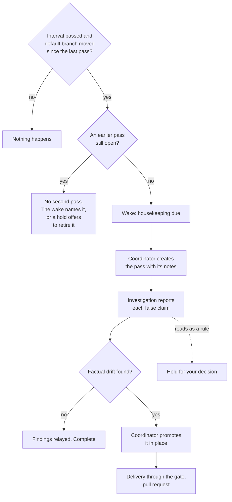

| Part | Rule |
|---|---|
| **When a pass is due** | The supervisor loop decides this without a model. It checks each repository whose global settings set `housekeeping.interval` and whose trusted `housekeeping.paths` is not empty. A pass is due when two things are both true. First, the interval has passed since the newest housekeeping pass of that repository was created, or no pass was ever created. Second, the default branch, read at a fresh fetch, stands at a commit other than the base of the last pass. The base of a pass is the default-branch commit its newest attempt recorded at launch. Section 8's task record already holds that commit as the knowledge revision, so no new record holds it (P14). If a fetch, the trusted copy, or a record cannot be read, the wake is raised and names what could not be read. Missing information is never read as nothing having changed. A pass created after such a wake is held to P7 at launch like any task. A due pass raises one wake, **housekeeping due**. The wake is about the repository rather than a task, and it is raised again only after another interval in which no pass was created. |
| **One at a time** | A repository has at most one open pass. A pass is open from its creation until its task has a terminal record, Landed or Complete, or until it is retired (next row). The program refuses to create a second pass while one is open. It decides this under the store's serialization, so two creations cannot both get through, and the typed refusal names the open pass. Once a pass has been open for a whole interval, the wake names it and what it waits on, and again each interval while it stays open, whether or not the default branch moved. So a pass stuck on a hold, on an unmerged pull request, or on a report nobody relayed, and a pass that is still running, is never silent and never doubled. |
| **Retirement** | A pass can end without either terminal record. Its run can be cancelled or fail, or its pull request can be closed without merging, and the task then resolves Failed. A pass can also run far longer than a pass should, or hang. Section 6's lifecycle has no end for any of these, so a pass that relied on one would block every later pass. <kbd>proposed</kbd> A run that rebases to nothing, because another change already made the same correction, is not one of these: it lands the pass on section 6's [nothing left to deliver](#nothing-to-deliver), as it lands any delivery task, so the pass is no longer open and is not retired. A pass whose branch was already published when such a run read it does not land that way, and is one of the ends below. Retirement releases a pass's claim on its repository and does nothing else. It is one record, written once, and it changes nothing the resolver answers about the task. It is written only while **nothing moves the pass**: every run attributed to the pass has ended, whether passed, failed, cancelled, or parked, and the liveness probe reads its worker's terminal dead, or its latest attempt never had a session. Each of those is read from the record or probe that owns it, never from the task's resolved state: the hold tier sits above the run tier, so a promoted pass that keeps a report's open decision resolves Held while its run is still validating, and a rule that read Held as stopped would release a pass whose run can still publish. A probe that cannot observe the terminal is not dead, and an ambiguous reading is left alone, as section 11's is. No end retires on its own: a run that rebases to nothing lands the pass, as above, and every other end goes to you. <ul><li>**Every other end, by your answer.** An open pass that has been open for an interval and that nothing moves gets a hold that says what the pass waits on and what retiring it leaves behind, such as an open pull request. Answering `retire` writes the record only if nothing moves the pass when the answer is applied, decided under the store's serialization; if a run attributed to the pass has started or its worker has been relaunched since the hold was registered, the answer is refused, naming what moves it, while the hold stays open. A `retire` that writes the record also answers `stop` on every open hold on the pass whose `retry` would relaunch its worker: the stop's hold, the relaunch bound's, a refused sweep's, and a failed backup handoff's. Each is recorded under the resolver of the `retire` answer, because that one decision is also the decision not to begin the work again. Answering `keep` closes the hold and leaves the pass open, and the hold is registered again at most once per interval. Standing consent never answers it, because it is not a hold on a run.</li><li>**A long run or a hang, escalated by the coordinator.** A pass that something moves, a run not yet ended or a worker the probe reads live or cannot read, is never retired, and no hold is offered on it, whatever its resolved state. The coordinator watches for these and escalates them to you as a blocker, on section 6's terms. A long run is the wake above naming a pass that something still moves once it has been open for an interval. A hung worker is section 6's supervision of the pass's task: an unchanged screen with nothing proving progress (at once) or past `escalation_window` with something that does, again each window, and a deeper inspection once it has surfaced `stall_inspection_count` times; a terminal that is gone; a declared wait idle past `recheck_window`; and a message unacknowledged past `escalation_window`. A run that holds surfaces as a run moved to held, including the checks stage at `checks_timeout`. Section 6's supervision reads a task's terminal only while the task is in flight or has a wake not yet acknowledged, and in flight is decided from the resolved state. A promoted pass that keeps a report's open decision resolves Held, which is not in flight, even while its run validates, so with its wakes acknowledged nothing would read its worker at all. A pass therefore counts as in flight while something moves it, whatever it resolves: its terminal is read on every supervision pass, the probe that reading takes is what says whether its worker still moves it, and the stop guard counts it (P10). Supervision reads the worker's terminal and not the run's stage. So while the run sits in a stage, that stage is positive evidence under P9 and an unchanged worker screen is absorbed only until `escalation_window` elapses, then surfaces and again each window, and a terminal that is gone surfaces whatever the stage shows. The long-run wake adds the pass itself, named once it has been open for an interval. Nothing ends a stalled worker on its own (P15). Your answer is an existing action: wait, have the worker messaged or stopped (section 6's steering), or cancel the run (section 9). A stop proves the worker dead and registers its own hold, which a `retire` answers as above; a cancel ends the run. Once neither moves the pass, the hold above applies.</li></ul> A retired pass is never relaunched: section 11's one anchored relaunch reads the retirement record and refuses, whoever asks, so neither reconciliation of a pass whose terminal is gone nor a `retry` on a hold left open can start a worker in its copy once its claim is released. Retiring asks section 6's cleanup decision for the pass's copy on P12's terms. A copy holding work that has not landed becomes a kept-work entry, which holds every new task in the project, the next pass included, until you answer it (P15). Retiring closes no pull request, moves no branch, and discards nothing (P6). The decision holds the pass's report raised stay open and are listed to the next pass; no hold that would relaunch its worker stays open, as above. |
| **Who creates it** | The coordinator creates every pass. It does so on the wake, or when you ask for one. The program cannot tell whether you asked, so a pass is held to the same scope however it was started. Intake is the coordinator's typed create with the housekeeping mark (section 9). The program never creates a task on its own: choosing to start work and writing its instructions belong to the agent (section 8), and the coordinator's notes have to reach the worker. The wake is in no domain and reaches the first coordinator. A subordinate coordinator is refused the mark. |
| **Instructions** | A pass's instructions have two parts. The program writes the first part, and the coordinator cannot change it. It holds: the scope, which is the repository's `housekeeping.paths`; the base of the last pass and when that pass was created, so the worker reads what merged since then from the repository rather than from anyone's memory; the open holds that earlier passes raised, so the same question is not asked twice; and the rules in this table. The coordinator writes the second part. It holds what only the coordinator knows: your decisions and standing instructions since the last pass, and anything it noticed that may be stale. Its notes are claims to check, not facts. The worker applies a note only where the repository bears it out, and its report says why it did not apply the rest. Both parts are the intent read off the task, so they are the acceptance criteria of the run that a promoted pass's push starts (section 5's intent stage). |
| **Shape** | A pass is created as an investigation task. Most passes find nothing to change. Section 6 gives an investigation an end for that case, Reported and then Complete, while its lifecycle gives a delivery task no end without a change except Failed. <kbd>proposed</kbd> Section 6's [nothing left to deliver](#nothing-to-deliver) adds one only for a change pushed to the gate whose commits the default branch already holds by content, so an investigation stays the shape for work that usually finds nothing to change. The report lists each claim found false, with the file or command that proves it. When the report lists factual drift, the coordinator promotes the pass in place. That keeps the worker and its context, and the worker then fixes the drift as a delivery task. Section 6 says a report is evidence, not authorization, and that implementation is a separate request. Here the request is standing and narrow: setting `housekeeping.interval`, or asking for a pass, is your request to correct factual drift in the scoped files and nothing else. That is why everything beyond it becomes a hold rather than part of the promotion. A pass is one task through both phases, so the one-at-a-time rule and `relaunch_attempts` each count it once. |
| **Role** | A pass runs under the `housekeeping` role. The program assigns that role, and no other task may name it. If the `roles` table does not name `housekeeping`, the role resolves to the `fix` row (section 10). So with no extra configuration a pass runs on the fixer's agent and model. It is not the `fix` role itself: intake refuses the two gate roles, and the fixer session belongs to a run (P4). The run that a pass's push starts still reviews with `review` in a fresh context and fixes with `fix`. Neither the review nor the fixer resumes the pass's worker session. |
| **Scope** | The agent context is the files that `housekeeping.paths` names, read only from the trusted copy. By default that is the files the common agents read at the root, in subdirectories, and in rules folders, plus the README and section 10's project knowledge document. A repository replaces the list from its default branch, and an empty list turns housekeeping off for that repository. A value in a pushed copy has no effect. |
| **What it may change** | Factual drift only. That is a claim in a scoped file that the repository at the default branch shows to be false, where the code or the configuration owns the fact and the file only describes it. Examples are a renamed command, a moved path, or a removed key. Each correction names the file or command that proves it. The run that a pass's push starts holds at review with an `ask` naming each path the change touched outside `housekeeping.paths`. This is decided from the paths the commits touched, not from the worker's account, as the judge rule is, and it adds no stage. The judge rule applies unchanged. |
| **What becomes a hold** | A pass never makes a change that would add, remove, or reword a rule, a principle, or a specification. Where a file owns its fact, a disagreement between that file and the code is a finding about one of the two, not drift in the file. A correction that a coordinator note asks for and that reads as a new rule is treated the same way, even when the note says you decided it. The worker puts each such question in its report as a decision. Section 11 requires each decision to be registered as a durable hold on the pass before the pass can complete, and the hold carries the proposed wording and the evidence. Answering the hold records your decision and changes no file. The change it proposes reaches the default branch only as a change you make or a task you ask for, like a proposal in section 5's recurring findings. The program cannot tell a rule from a fact. This rule rests on the worker's instructions and on the run's review, which reads the change against those instructions as its intent. |
| **Work and cleanup** | A pass edits only its own copy and reaches a shared branch only through the gate. It removes no copy, no branch, and no file outside the scoped paths, and it forces nothing (P6). Removing copies and temporary entries stays the program's own job, on P12's and P15's terms, so a pass has no cleanup of the machine to do. Nothing outside a project, such as your own configuration files, is in its scope. |
| **What reaches you** | Nothing new. A pass's pull request reaches you as work ready for your review, its holds, the retirement hold among them, as decisions, and a pass that failed past recovery, runs long, or hangs as a blocker the coordinator escalates, each on this section's terms. The due wake, the report, and a pass that found nothing never reach you. The coordinator reads the report as evidence (P13). A report with no drift and no decision is recorded as relayed with nothing said, because an unchanged repository reported as progress is on the never-reaches-you list. The catch-up read lists a pass like any task. |
| **Bounds** | A pass is bounded as any task is: by `relaunch_attempts`, and once promoted by its run's own bounds, which park the run on section 5's terms. Housekeeping adds no loop, so it adds no park. The interval spaces passes out, the one-at-a-time rule stops them stacking up, and the wake about an open pass, like the retirement hold, surfaces at most once per interval. A worker's turns are not covered by the usage ceiling (section 14, decision 17), so the interval is the only bound on how often passes spend them. |

What housekeeping does not establish: a pass finds only the drift its worker notices, and nothing
checks the worker's reading against the repository beyond the run's review of what it changed. A
file outside `housekeeping.paths` can drift unseen. The base is the commit the last
pass saw, so a pass reads merges since then as its lead. Drift older than the first pass is found
only as far as the worker reads whole files against the tree.

### <a id="round-records"></a>Learning what converges <kbd>proposed</kbd>

> This subsection, and every passage elsewhere marked *proposed* that points at it, is a draft
> written for the owner's decision (AGE-491). Nothing it describes is built, and nothing here is
> decided until the owner says so.

The product should learn what makes review and rework converge, for all the work it does, in
every repository this home serves. That needs one fact per round that a reader can join across
runs, tasks, and repositories, and it needs the cost of the work that is not a stage call, which
the agent invocation record does not hold today. Nothing here decides anything at run time:
these are records to read, and the fix ladder's order is changed from them by a person, in
configuration.

**Every round is recorded, in every repository.** Section 8's round record already keeps one
row per stage execution, with its findings, the selection and who made it, the payload sent to
the fixer, and the summary. A review is a stage execution, so every review has a row, and the
automatic or requested fix round that follows it is that row's. Each row gains what the ladder
and a later reader need, and points at the record that owns everything else, so no fact gains a
second owner (P14):

| Fact | Owner | How a reader gets it |
|---|---|---|
| Repository | The run record | The row's run names it. |
| Task | Section 6's attribution by branch | Resolved from the run's branch, as for every other read, never stored on the row. A run no task is attributed to reads as none. |
| Agent, model, effort, context window | The agent invocation record | The row names, by sequence, every agent invocation it served: the review's call, and the fix round's. |
| Fresh or resumed | The agent invocation record's session use | The fix round's invocation says whether it opened a session or resumed one. |
| Rung, and each rung skipped on the way | The round record, new | Written once, when the fix round starts: the rung, what it changed, and each skipped rung with its reason. A row with no fix round has none. |
| Review kind | The round record, new | `full` for a review of the whole change, which every execution of the review stage is, re-reviews among them; `delta` for section 14 decision 7's review of the commits after an approved commit. |
| Verdict, and counts by action and severity | The round record's findings | Derived on read: the count of each action, `fix`, `ask`, and `note`, at each severity, and a refused report as refused. A verdict word is not stored beside the counts it would restate. |
| Findings in the previous fix round's lines | The round record, new | Written once, when the review that follows a fix round is accepted: how many of its findings are located in lines that round's commits changed, and how many of those are `fix` or `ask`. |
| Tokens by category | The agent invocation record | Read from the named invocations: input, output, cache read, and cache creation, each kept apart, and a count an agent did not report stays unreported, never a zero. |
| Wall time | The round record, new | When the stage execution began and when its fix round ended, written once at the end. An agent's own duration stays the invocation's. |
| Eventual outcome | The records section 6's resolver reads | Derived on read, never written to the row: the run's park, from the checkpoint history; an open hold, from the hold record; Landed, from the merge record, the local landing record, or the nothing-to-deliver record. A run still going reads as open. |

- **The outcome is read, never copied.** A row written when a round ends cannot know how its
  run ends, and a row revised later would be a second, staler owner of a fact the terminal
  records already hold (P8, P14). A reader asking what became of a round reads the run's records
  as of that read.
- **The new-defect count is a measure, not a judgment.** It counts findings located in the
  lines the previous round changed. It does not establish that the round caused them: a finding
  there may name a defect the round left in place, and a defect the round caused elsewhere is not
  counted. It is recorded because it can be computed once, from the commits, without asking any
  agent, and because a fix that keeps producing findings in its own lines is the clearest sign a
  round is not converging.
- **Nothing here holds or parks.** The records add no bound, no hold, and no wake.

**Worker turns join the record.** A task's worker is a long-lived session whose turns the agent
invocation record does not hold today, so its cost is invisible beside the stage calls it
dwarfs. Each turn a worker's adapter reports usage for is appended to that record as one row of
purpose `worker`, naming the task and the attempt in place of a run and a stage, with the same
facts a stage call's row carries: the agent, the model triple and the identifier started, the
role, the effort, the context window, timing, failure category, and each token count, an
unreported one kept apart from zero. Never the turn's prompt, its output, or anything it read. A
fix round's call is already a stage call of purpose `fix` and is recorded today; this adds
the worker's turns, a housekeeping pass's among them, and no other kind of call.

- **What it covers, and what it does not.** With this built, the usage view and its protocol
  read say they cover stage agent calls and worker turns, and exclude the coordinator's own turns
  and any price. The coordinator you talk to runs in its host's session, which this program does
  not start and cannot read; a subordinate coordinator's turns are not recorded either. Section
  9's usage view owns the wording.
- **What reads it.** The usage view totals worker rows by task where it totals stage rows by
  run and stage. The per-run usage budget reads the run's own rows, which a worker row is not.
  The usage ceiling sums stage calls only, as decision 17 has it, so a worker's turns are
  recorded beside it and still not bounded by it: what the ceiling bounds is unchanged, and
  whether it should count worker turns is a decision this proposal leaves to the owner.
- **An adapter declares it.** Reporting worker turn usage is a capability of section 8's
  adapter declaration. An adapter that does not declare it writes no worker row, and the usage
  view says that task's turns are not recorded rather than totaling them as nothing.

**Harvesting evaluation cases is opt-in, per repository, and local.** A review that finds what
blocks a change is the best test of a reviewer and of a fixer there is, because it is real code
with a real defect and, later, a fix somebody accepted. For each repository named in section
10's `evaluation.harvest`, a review whose findings include a `fix` or an `ask` at
severity `error` writes one **evaluation case**: the repository, the run, the round, the
commit the review read, and that round's findings, read from the round record and not copied
from an agent.

- **A case completes when its branch lands, task or no task.** The case gains, once, its
  accepted fix from the first landing written after it for a run of the same repository and
  branch: a merge record of a pull request read as merged, which names the head that merged, or
  a nothing-to-deliver record, which says the change was already on the default branch and so
  has no fix of its own. A merge record of a pull request read as closed without merging is
  not a landing: it completes nothing, and the case waits for a later landing of its branch. The
  landing is matched by repository and branch, as section 6 attributes a run to a task, and not
  through a task, so a case harvested from a person's own push, which no task is attributed to,
  completes from the merge of a later run of that branch exactly as a task's case does. The fix
  is named as the commit the review read and the head that landed, both kept reachable as below,
  and not as the commits between them: the gate rebases before every review, so a later head need
  not descend from the commit an earlier review read, and what changed between the two is read
  from their trees. The case names the landing it completed from.
- **A case whose branch never lands stays open and says so.** It keeps no fix. A branch
  reused for unrelated work before the first change lands would complete the case with that
  work; the landing the case names is how a reader sees it, and nothing here detects it.
- **It stays in this home.** A case is written to the home's store, and the commits it names
  are kept reachable by a reference the case owns in the gate's bare repository, in a
  namespace of its own that no stage pushes and no pull request names, so a case's commits stay readable after the branch that held them is gone. No
  path of the program sends a case anywhere: no adapter, no forge, no notify command, and no
  decision-model check is given one. Reading cases is for a person's own tooling on this machine,
  such as caliper's fourth question (AGE-492), which reads them where they are.
- **It is off by default and off for a repository nobody named.** `evaluation.harvest` is
  global-only: what this machine keeps of a repository's code is your decision, so a repository's
  own file can neither turn it on nor off.
- **It changes no run.** Writing a case adds no stage, no hold, and no finding, and a case that
  cannot be written is reported in the service log and changes nothing about the run.

What this does not establish: that a round's outcome was caused by its rung, its model, or its
effort. The records make the comparison possible; they do not control for the change, the
repository, or the reviewer. A worker turn its adapter does not report, and every coordinator
turn, stay outside the totals, so a total is a floor of what the work spent and never the whole.

<sub>Section 7</sub>

## <a id="execution"></a>Execution model

Both halves of this product are graphs already. The pipeline is a linear sequence with a fix
cycle and human decision points. The fleet is a set of independent supervised runs. Neither is
written as a graph today, which is why resuming, displaying, and reasoning about them is harder
than it should be.

### The decision

<kbd>Rejected</kbd>

#### Keep it hardcoded

A fixed sequence plus a state file, as today.

**Cost:** resume logic is bespoke per stage, progress display is derived by parsing logs, and every new pause point is a new special case. Both source projects show the accumulated cost of this.

<kbd>Rejected</kbd>

#### Adopt a workflow engine

Build on an existing agent-graph or durable-execution framework.

**Cost:** a dependency, a domain-specific language, and a migration, to gain features this product needs a fraction of. A local single-user tool should not require a cluster, and none of the surveyed engines fits a local process model without pulling in most of their world.

<kbd>Recommended</kbd>

#### Reify the graph you already have

Make the existing topology an explicit, small, in-house structure.

**Buys:** resume from a checkpoint instead of from stage boundaries, a live progress view that reads structure rather than logs, static checks over the topology, and one place where pause and resume are defined. Roughly one module, not a platform.

> **This is a survey result, not a preference**
>
> The graph frameworks in this space are converging on a shape worth copying and away from a
> shape worth avoiding. Two of the leading agent libraries deleted their own built-in
> persistence during 2026 and now plug into external durability substrates. One major vendor
> shipped a visual workflow graph, deprecated it within eight months, and documented that
> workflows "requiring strong determinism at their core may not migrate faithfully." Both the
> gate and the fleet are squarely in that category, so the lesson is to own the determinism
> and keep the machinery small.

### Two different shapes for two different problems

#### The gate is a bounded cyclic step graph

Nodes are stages, one edge is a back edge for the fix loop, and some nodes halt before running to wait for you. State is a typed record with declared merge rules. Determinism matters more than throughput.

#### The fleet is supervised independent runs

Each task owns its own graph instance and advances on its own clock. There is no barrier between phases, because worker latency varies by orders of magnitude and a barrier would idle every fast task behind the slowest one.

### The minimum viable abstraction

Five concepts. Everything else is built from them.

| Concept | Definition |
|---|---|
| **Node** | A named unit of work that reads declared state keys and writes declared state keys. Declaring what it reads and writes is what makes replay and forking possible, so it is required, not optional. |
| **Edge** | A transition, either unconditional or guarded by a predicate over state. Back edges are permitted and must be bounded. An edge is data, not a callback. |
| **State** | A typed record. Every key that more than one node can write declares a merge rule. A key with no declared rule may be written by exactly one node. |
| **Halt point** | A marker on a node meaning "stop before running this and wait for a decision." The node does not start. Its inputs are already in state, so nothing needs to be re-executed on resume. |
| **Checkpoint** | State plus position plus any open decision, written after every node, plus once when an executing segment claims the run. That claim write is what lets a second caller be refused before it starts a node rather than after, so a node body is not run again by a caller that has already lost the run. Restoring one re-emits the open decision. One call can restore and answer together. |

### Halt before, not interrupt inside

There are two ways to model waiting for a person, and the difference is not cosmetic.

#### Interrupt inside the node

The node starts, runs partway, and suspends. Resuming re-runs the node from the top with the answer injected, so everything before the suspension point must be idempotent. That requirement is invisible in the code and easy to violate later.

#### Halt before the node runs

The graph stops at the boundary. The node never starts, so there is nothing to make idempotent and nothing to replay. The decision is collected outside the graph and supplied as input on the next call. This is also exactly how both source systems already hold work.

Use halt-before. It is strictly simpler, and it makes P6 easier to hold because a halted run has
performed no partial side effects that a resume might repeat.

### Rules the topology must enforce

<kbd>1</kbd>

**No two nodes write the same key without a declared merge rule.**

Checked when the graph is built, not at run time. One popular framework removed its thread-safety wrapper and now has a reproducible bug where the same definition produces different business results depending purely on scheduling. Declared merge rules are the fix.

<kbd>2</kbd>

**Every back edge carries a bound at construction time.**

A graph with an unbounded cycle fails to build. Most surveyed frameworks ship no default cycle guard at all, and one defaults to running until something escalates, which is to say forever.

<kbd>3</kbd>

**A cycle that passes through a join must include that join's fork.**

Otherwise the join can be re-entered with a partial set of inputs and produce a result that looks complete. Only relevant once fan-out exists, which is why it belongs to a later phase, but the rule should be in the checker from the start.

<kbd>4</kbd>

**Node implementations are constructed per run, not shared.**

A single background process runs concurrent validation runs. Sharing node instances across them is a defect class that only appears under concurrency, which is the worst time to find it.

### Topology and durability are separate layers

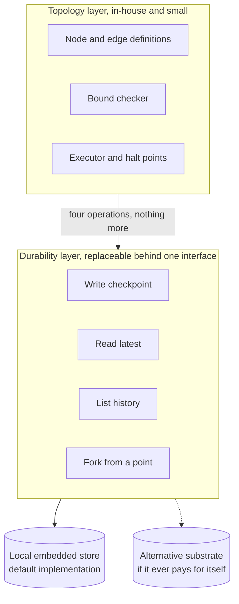

Keep the interface between them to four operations. The default implementation writes to the
local embedded database that already holds run state, because a local development tool must not
require a server. Keeping the boundary narrow means the substrate can change later without the
topology layer noticing.

Two of those four operations are a run's whole history and a fork from a point in it, so the
record behind them is a history and not a row rewritten in place. That record is section 8's
**checkpoint history**, and a run's position is written to and read from there and nowhere
else. No other record may hold a copy of where a run stands.

> **The checkpoint store is inside the trust boundary**
>
> Checkpoints are resumed with your credentials, so a tampered checkpoint is a code-execution
> path. Use a data-only serialization format, validate on read, and never load a checkpoint
> from a source outside this home. This is the same rule P7 applies to configuration, extended
> to run state.

### Where this pays off

| Capability | Because the graph is explicit |
|---|---|
| **Resume after a crash** | Restore the last checkpoint and continue, instead of reconstructing intent from stage rows and log files. |
| **Live progress** | The display reads the topology and the current position. It does not parse logs to guess where a run is. |
| **Re-run from a point** | Fork from a checkpoint to retry one stage with a different agent or a changed configuration, without repeating everything before it. |
| **One pause definition** | Every decision point in the product is the same halt-point mechanism, so a new one is a declaration rather than new pause and resume code. |
| **Diagram from source** | The pipeline diagram is generated from the topology, so it cannot drift from what actually runs. |

<sub>Section 8</sub>

## Architecture

This section is language-agnostic on purpose. It fixes the module boundaries, the data model,
and the process model, and leaves the implementation language, libraries, and testing tools to
you.

### What the coordinator is

The coordinator is two things with a hard line between them. An agent handles conversation,
intake, and judgment. A program owns every state change, every refusal, and every guard. The
agent decides what should happen; the program decides what is allowed to happen, and it is the
only thing that can make it happen.

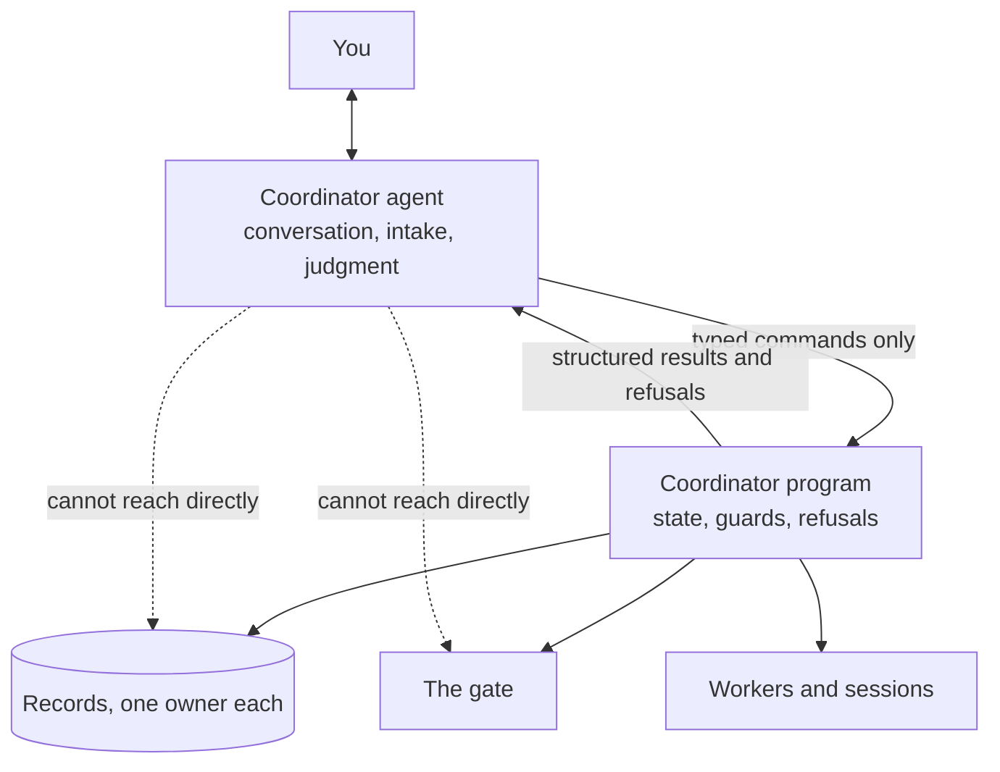

#### The agent owns

- Understanding what you asked for, and which project you meant.
- Choosing a task shape, writing the instructions, deciding when work overlaps, and choosing which configured role the worker runs under.
- Reading a report or a finding and deciding whether it needs you.
- Translating internal state into the outcome you hear, per P13.
- Every judgment the autonomy flag permits it to make.

#### The program owns

- Every write to state, and the resolver that reads it back.
- Every guard: isolation, custody, data loss, cleanup proofs, the trust boundary.
- The graph, its checkpoints, and every hold.
- Supervision, the wake queue, and the stop guard.
- Every refusal, and the reason attached to it.

> **The split only holds if the agent has no second path**
>
> A hybrid degrades into a pile of instructions the moment the agent can reach around the
> program: run a raw git command, edit a state file, kill a process. Then every guard becomes a
> rule the model is asked to remember, and P6, P11, and P12 all become advisory. Three rules
> keep the line real, and they are worth enforcing mechanically rather than describing.
>
> - State files and gate repositories are written by the program only. The agent has no
>   direct write path to either.
> - A refusal is a typed result the agent must report, not an error it may retry a different
>   way. There is no force flag reachable from the agent side.
> - Command shapes that would bypass the program are refused before they run, not detected
>   afterwards.

The practical test for which side a behavior belongs to: if getting it wrong loses work, breaks
isolation, or weakens what a pass means, it belongs to the program. If getting it wrong produces
a worse decision that you can see and correct, it belongs to the agent.

### Process model

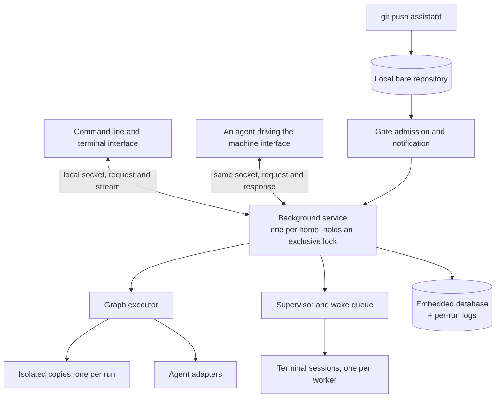

- A push returns immediately. The notification hands off and exits; the service owns everything long-running.
- The run start fetches the submitted commit from the gate's bare repository, where the push landed, into the run's isolated copy. It never reads a person's working copy, and never a task's copy, for that commit: what a run validates is what was pushed.
- Exactly one service owns a home. It takes an exclusive operating-system lock before recovery and before binding its socket, so the lock cannot go stale even after a hard kill.
- Admission runs before any reference in the gate changes, so a refusal happens before mutation rather than after.
- A push reaches the gate only from a process the service can place as a task's worker or as a person's shell, read along the pushing process's ancestry; a push it can place as neither is refused before any reference moves, with a typed reason naming what was read.
- A push from a remote host reaches the gate only through that host's bridge, which places the process that made it by that process's ancestry on that host. For each push it places, the service starts one receiving process of its own, which is placed as that one task's worker for exactly its own lifetime and receives that one push and no other; nothing else from a remote host is placed at all. [Workers on another machine](#remote-hosts) owns the rule.
- Pushes to the same branch serialize, and a new push supersedes the run in progress. Different branches run concurrently.
- Launch and readiness are different states. Publishing a process identifier is not proof of readiness; only a real health response is.
- Stopping is bounded. On a stop request or SIGTERM, the service stops admitting work, ends the process groups it registered, and exits within `stop_grace`; past the grace it ends them by force. A service that does not exit on SIGTERM is a defect, not a slow shutdown.
- Every invocation of an external program carries a deadline. The program runs in a process group that the invoker ends when the call returns or times out, so a child cannot keep a pipe or a terminal open after its parent is gone. Which deadline bounds which program is said here. git the service runs, and git a bridge runs for it on a remote host under the value the service hands it, is bounded by `git_deadline`, `gh` the service runs by `gh_deadline`, and a stage command by `command_timeout`; each is the operator's alone to set, and none stands in for another. `git_deadline` and `gh_deadline` bound an invocation whose caller set no deadline of its own; a caller's own deadline is kept instead. git and `gh` the command line runs itself, rather than the service, are built without your settings and run under those two keys' defaults. No other program's deadline is a configuration key.
- A task's worker is the exception to the invocation deadline: a long-lived worker agent session has none. It runs in a process group of its own, and its owner is its task, whose attempt records its session. It ends when its task lands or an investigation's findings are relayed, when it is stopped, when its agent reports itself unavailable and its configured backup takes over or that handoff is held, and when the service stops, within `stop_grace` and by force once the grace has passed. <kbd>proposed</kbd> A task lands, too, when its run leaves nothing to deliver (section 6's [nothing left to deliver](#nothing-to-deliver)), a housekeeping pass among them, and its worker ends then as on any landing, with no hold. Each of those ends a worker this service started and holds. One an earlier incarnation of the service started and did not end reads as ambiguous liveness (section 11) while it runs, and is ended only when it is stopped. The liveness probe ends nothing: it is how the service learns a worker has ended. A live worker that has stalled is never ended. Its unchanged screen surfaces on section 5's terms: at once when nothing proves progress, once `escalation_window` has passed when something does, and again each window while it stays unchanged. A bound that ends a stalled live worker is not yet specified (#531). <kbd>proposed</kbd> Section 6's [stalled worker](#stall-hold) would specify it and replace that sentence: once a stall outlasts the coordinator's inspection its task holds for you, the stall itself never ends the worker, your answer may end it through section 6's stop, and every end this item lists still applies, the service's stop within `stop_grace` among them.
- macOS and Linux are the supported platforms. Windows is not supported: the build is vetted for it so it does not rot, and nothing is run or tested there. What this build cannot provide on Windows refuses rather than degrades: no socket peer is identified, so every request that drives a run is refused and no worker is placed, and the managed service's install is refused.

### Modules

Grouped by the boundary they own. Each row is one module with one responsibility, and the
interface column is what the rest of the system is allowed to depend on.

| Module | Owns | Interface it exposes |
|---|---|---|
| **Core execution** |  |  |
| **graph** | Node and edge definitions, the bound checker, the executor, halt points. | Build a topology; run or resume one; the four checkpoint operations. |
| **stages** | The nine stage implementations and their prompts. | One node contract: read declared state, return findings and state writes. |
| **findings** | The finding and action vocabulary, normalization, identifier assignment, the fail-closed default. | Parse untrusted output into a validated finding set. |
| **runs** | Run and stage records, rounds, holds, and the run lifecycle. | Create, advance, hold, resolve, terminate. |
| **Git and delivery** |  |  |
| **gate** | Bare repository creation, hooks, remotes, identity, reattachment. | Initialize; refresh; remove. |
| **vcs** | All git invocation. Explicit repository addressing, non-interactive environment, isolated-copy lifecycle. | Typed operations. Nothing else shells out to git. |
| **safety** | The data-loss rules: anchored force updates, incorporation checks, the refuse-when-unverifiable path. | May this update proceed, and on what anchor? |
| **custody** | Reconciling your local branch with what the pipeline pushed or holds. | Classify; synchronize; recover. The only sanctioned mutation path. |
| **forge** | Provider abstraction for pull requests, checks, and merge state. | One interface, one adapter per provider. |
| **Fleet** |  |  |
| **tasks** | Task records, the two shapes, intake, queueing, promotion, cleanup proofs. | Create, dispatch, promote, complete, clean up. |
| **session** | Terminal session provider abstraction: create, capture, send, probe, close. | One interface; the default provider is the reference implementation. |
| **supervisor** | Wake classification, the durable queue, liveness beacons, the stop guard. | Classify a wake; drain the queue; assert supervision is live. |
| **taskstate** | The current-state resolver. Computes a task's state on each read and stores nothing. Read-only and free of side effects. | One call in, one state plus source plus detail out. |
| **Shared** |  |  |
| **agents** | Adapters for each coding agent, fallback ordering, retries, session reuse, structured output. | Run a prompt with an optional schema; return output, text, usage, session. |
| **config** | Schema, defaults, merge precedence, validation, and the trust boundary. | Resolve the effective configuration for a run, or fail. |
| **store** | The embedded database, the schema, and its migrations. | Typed accessors. No caller writes SQL. |
| **ipc** | The local protocol, its methods, and its bounded event stream. | Request and response; subscribe to a stream. |
| **redact** | Credential removal from URLs, errors, and anything persisted. | Redact. Called at every persistence boundary. |
| **judge** | The decision-model client: the fixed questions, the pinned model version, the cutoffs and the measurement behind them, and request splitting. | Put one typed question to the model; return a probability or a failed call, never a guess. |
| **ui** | The terminal interface. | Attach to a run. |
| **machine** | The agent-facing command surface and its output format. | Structured output, stable exit codes. |

> **An adapter declares what it supports, and undeclared means unavailable**
>
> Agent adapters differ in what they can do, and that difference has to be a declaration the
> program reads before it commits to a path, not something a stage discovers halfway through
> one. Each adapter declares its capabilities. A path the resolved adapter has not declared is
> refused before that adapter is launched, naming the capability that is missing, and is never
> replaced by a weaker path that would still be reported as a pass. Section 10 already
> specifies this shape for instruction suppression; this generalizes it to the rest of the
> interface. The same declaration says which version cells from section 10's table the
> adapter translates. A role whose triple that adapter has not declared is refused before
> launch, on these terms, and the table stays the one owner of which providers, types, and
> versions exist. The same declaration also says which of the agent invocation record's token
> counts the adapter reports; a count it does not declare is one it declares it does not report.
> Section 10's usage ceiling does not hold a call to a count its agent declares it does not
> report. A conformance probe holds each adapter's declaration to what that adapter reads off
> its agent's output, in both directions, and a declaration no probe checks fails the suite.
>
> The case that decides whether this is worth having is P4. A review may never resume the
> session that prescribed the fix it is checking, and a fixer session is the only memory that
> crosses a round. So an adapter that has not declared resumable sessions gets no substitute
> for one: nothing shared, replayed, or reconstructed may carry a fixer's memory into the
> review that checks it. Either the run has a declared session or it has no memory across
> rounds. Running both roles in one session is not a degraded mode that an undeclared
> capability may fall back to.

### Data model

The important part is not the field list; it is which records are authoritative and which are
history. One record is both, and it is called out below. A record marked Authoritative is the
one place its fact is read from. Appended means rows are added and never edited.

| Record | Kind | Notes |
|---|---|---|
| **repository** | Authoritative | Working path, upstream and optional fork, default branch. URLs are stored with credentials removed; the credentialed URL is recovered from the gate at run time. |
| **run** | Authoritative | Branch, submitted head, base, status, the commit a completed review approved, the push binding, pull request state, intent and its source, and the exact build that produced this run. |
| **stage result** | Authoritative | Per stage: status, findings, duration, log path, last activity, and the effective fix limit. |
| **round** | History | One row per stage execution. Findings, which findings were selected and by whom, the exact payload sent to the fixer, and the one-line summary. This is what the pull request narrative is generated from. <kbd>proposed</kbd> Each row also names the agent invocations it served, by sequence; for its fix round, the fix ladder rung and each rung skipped on the way with its reason; for a review, its kind, `full` or `delta`; when the review followed a fix round, how many of its findings are located in lines that round's commits changed and how many of those are `fix` or `ask`; and when the execution began and its round ended. Each is written once. A row written before these reads each as unknown. The outcome of the run is never written here: it is read from the run's own records, on the terms of section 6's [learning what converges](#round-records). |
| **checkpoint history** | Authoritative, appended | One entry per position a run has stood in: state, the node it has not yet run, the status it stood in, the decision it is halted on when it is halted, the bound accounting, and, on an entry a fork produced, the entry it was copied from. Appended after every node and never revised. The entry with the highest sequence is where the run stands, and it is the only record that answers that. |
| **task** | Authoritative | Shape, project, launch notation (how the worker was started), the role it runs under (the name only, recorded at intake and kept by promotion and relaunch), delivery posture (recorded at intake or promotion, in a field of its own), domain (written once at intake from the creator's placement, kept by promotion and relaunch; empty means the first coordinator's own, which is what every row written before the field reads as), isolated copy path, session reference, linked run, linked pull request. <kbd>proposed</kbd> Whether it is a housekeeping pass, written once at intake and kept by promotion and relaunch, a row written before the field reading as not one; it is the one place that fact is stored ([housekeeping](#housekeeping)). The machine it runs on, written once at dispatch and kept by promotion and relaunch, empty for this machine, which is what every row written before the field reads as; it is the one place a task's machine is stored ([workers on another machine](#remote-hosts)). For a worker on a remote host it also holds, written with the session reference, the identity of the herdr server hosting that worker, as the store holds a subordinate's tmux server beside its delegation attempt's reference. Each attempt also records, once at launch, the knowledge revision its worker was told: the default-branch commit and the digest of section 10's project knowledge document there, a known commit with no digest meaning the branch held none, and never the text. |
| **task state** | Resolved on read | Not a stored row. A resolution with its source attached, computed on each read from the records that own its facts, as of one consistent read of them; section 6 says what it rests on. Distinct from the event log, per P8. |
| **task event** | History | Append-only. Every append is a wake. |
| **wake** | Authoritative, appended | The durable wake queue, one row per actionable wake, written in the same transaction as the detector markers it advances and drained by the coordinator, or by the subordinate coordinator of the task's domain for the kinds it can act on. A table here and not a directory, so a wake and its markers are one write. Draining hands a row out; acknowledging closes it. The coordinator that drained a row acknowledges it after it has acted on it, and a row handed out and never acknowledged is handed out again: after a restart, and once the coordinator it was handed to is no longer attached. No row is deleted: closed rows are kept, and a row is actionable until acknowledged. Which coordinator a wake reaches is decided by its kind, and every wake has exactly one recipient. While a delegation stands, a progress-class kind of a delegated task, one the subordinate can act on with the commands it holds, reaches the subordinate; a decision-class kind, one whose action the subordinate is refused, a hold among them, reaches the first coordinator. A wake's domain is derived from its task when it is drained and stored on no row. A kept-work entry no task names, the run of a person's own push among them, is raised as the kept-work wake: a wake about the entry rather than a task, a row of its own shape keyed by the entry, appended once per entry by the supervisor loop on the same terms and drained, handed out and acknowledged on the same terms. An entry surfaces once whichever shape carries it, so an entry already raised on a task's wake is not raised on this one, nor the reverse. Its domain is derived from the entry when it is drained, as a task wake's is from its task, and stored on no row: the entry names a project and no task, and a domain is a set of tasks, so the wake is in none and reaches the first coordinator, where its kind, kept work, a decision-class kind, routes it as well. The entry's project and branch, read off the entry, are what the wake is listed and offered under. Like every wake it is actionable, and counts toward section 6's work in flight, until it is acknowledged. The coordinator that drained it acknowledges it after it has acted on it, on the same terms as every row; acknowledging it closes the wake and answers nothing, because the entry stays open until section 6's answer or a removal on a proof closes it, and status and the catch-up read list it until then. <kbd>proposed</kbd> The housekeeping-due wake is a wake about a repository rather than a task. It is a row of its own shape, keyed by the repository and by the pass it follows, or by none before the first pass. The supervisor loop appends it when [housekeeping](#housekeeping) says a pass is due, and it is drained, handed out, acknowledged and offered to the private channel on the kept-work wake's terms. It is in no domain and reaches the first coordinator. Acknowledging it creates nothing and answers nothing. |
| **notification** | Authoritative, appended | One row per wake offered to section 10's `notify.command`, claimed before the command runs and settled once with how it ended: `sent` or `failed`, the exit status where the command reported one, and a detail with credentials removed. The claim is never rewritten and the settlement is its one revision. A claim never settled, a crash between the two among them, is not offered again. No row is deleted. A wake about a domain rather than a task has its twin, the domain notification record, on the same terms, keyed by that wake. The kept-work wake has its twin too, the kept-work notification record, on the same terms, keyed by that wake, so an entry no task names is offered to the private channel once, as every wake is. <kbd>proposed</kbd> The housekeeping-due wake has its twin on the same terms, keyed by that wake. |
| **merge record** | Authoritative, appended | Append-only and written once, by the code-host read that ends a run on a merge: the pull request, the head read, and when. The code host owns the merge; this is the program's record that it saw it. The run's `passed` on a merge and the task's Landed are both derived from this one record, and neither stores the fact again. |
| **local landing record** | Authoritative, appended | Append-only and written once, by the approved fast-forward that delivers a `local` task: the task, the commit, the local default branch's tip before and after, and when. The task's Landed for a `local` task is derived from it, read in the same tier as the merge record. |
| **nothing-to-deliver record** <kbd>proposed</kbd> | Authoritative, appended | Append-only and written once, in the same write that ends a run on section 5's empty-diff short circuit, of a branch its push anchor found absent where the run would push it, whose submitted commits P12's content check found present in the default-branch commit its rebase stage read at its fresh fetch: the run, that commit, the commit the run was submitted with, the check's answer, the checkpoint entry those facts were read from, and when. The facts are read from the checkpoint history, never from a stage's report or the run's status. The Landed of the task the run is attributed to is derived from it, read in the same tier as the merge record, on the terms of section 6's [nothing left to deliver](#nothing-to-deliver). It moves nothing and removes nothing; the copy's cleanup is decided on P12's proof as after any landing. |
| **cleanup record** | Authoritative, appended | Append-only and written once, recording the cleanup check it was made from. A delivery task's Complete is derived from it; an investigation's Complete is derived from the record that its findings were relayed, never from this one. With the merge record it is what section 6's resolver reads in the tier above the run tier. <kbd>proposed</kbd> So is the nothing-to-deliver record, beside the merge record. |
| **kept work** | Authoritative | One row per copy kept because its work has not landed: the owner it outlived, what it holds, when it was kept, when it last surfaced, and its answer. It is written once when the copy is kept. Its revisions are the answer's: yours, given as a hold answer, or carry on, recorded by a promotion of the investigation whose copy it is. A land or carry-on answer is written first as a claim, which leaves the row open, and then with its outcome, in the one write that closes the row; a claim the answer takes back itself is cleared, which leaves the row as it was (section 6's [kept work](#kept-work)). A promotion's carry on is written whole, with the promotion. <kbd>proposed</kbd> A claim you withdraw is cleared the same way, in the write that appends its kept-work withdrawal record, and a withdraw whose copy is gone also closes the row as gone in that write, the one closure besides a removal on a proof. |
| **kept-work withdrawal** <kbd>proposed</kbd> | Authoritative, appended | Written once per claim you withdraw, in the same write that clears it from the kept-work row: the entry, the claim as it stood (its kind, who gave it and when, and for a carry on the task it named), who withdrew it, derived from the surface, when, where it moved the copy back from if it did, whether it closed the entry as gone, and the answer's note. Whether an entry holds a claim is read from the kept-work row and never from this record. It is the one record that ends a task a withdrawn carry on created: the state resolver reads it in its first tier as that task's terminal record, Withdrawn, and dispatch refuses the task it names ([kept work](#kept-work)). |
| **housekeeping retirement** <kbd>proposed</kbd> | Authoritative, appended | Written once per housekeeping pass that ends without a terminal record: the pass, how it was retired, and when. How it was retired is the resolution of the retirement hold your answer closed. <kbd>proposed</kbd> A pass whose run rebased to nothing writes none: it lands, on section 6's [nothing left to deliver](#nothing-to-deliver). It is the one record that ends a pass's claim on its repository other than the terminal tier ([housekeeping](#housekeeping)). The state resolver does not read it, so a retired pass still shows the state its own records give. Section 11's anchored relaunch does read it, and refuses a retired pass. |
| **hold** | Authoritative | A decision waiting on you, with a stable key. Idempotent to register. Closed only by an explicit resolution, recorded with who made it, never by the surrounding work finishing. One resolution the service makes itself is for the hold the checks stage raises when `checks_timeout` elapses: when the pull request that hold waits on is read as merged or closed, the question it asked no longer exists, and the service records that reading as the resolution and itself as the resolver. The other is each answer section 9's standing consent gives, recorded under the resolver that consent has of its own. Every other hold keeps the rule. |
| **message** | Authoritative, appended | One row per message sent to a worker: the task, the attempt, the text with credentials removed, and who sent it, derived from the surface. Each of written, refused, and acknowledged is recorded on it once and never revised, and it is the one place whether a message was delivered is read from. Section 6's steering says what writes each. |
| **delegation** | Authoritative, appended | One row per domain the coordinator delegated: the domain, the delivery posture its tasks take, held to intake's rule when the row was written, and the anchor the write was decided against. Written once; `ended_at` with a closed `end_reason` is its one revision, and a delegation stands until that revision is written. Nothing else ends one: not a restart, not a dropped connection, not a subordinate whose terminal is gone. |
| **delegation attempt** | Authoritative, appended | One row per start of a domain's subordinate coordinator, with its session reference, sealed. A relaunch is a new row anchored to the attempt history it read, bounded by `relaunch_attempts` on section 11's terms. |
| **escalation** | Authoritative, appended | One row per decision a subordinate coordinator hands up to the first coordinator, sealed. It is raised as a wake of its own kind, subordinate escalated, which section 6's flowchart surfaces always. |
| **seen mark** | Authoritative, appended | One row per merge or cleanup record you were shown and marked seen, keyed the way that record is keyed. <kbd>proposed</kbd> A nothing-to-deliver record is shown and marked seen on the same terms. One per home. It is what section 9's catch-up reads to decide what landed since you last looked, and nothing else reads it. |
| **agent invocation** | History | Purpose, agent, the model provider, model type, and model version the launch was asked for, the model identifier the adapter started, the role, the effort, and the context window of the launch, timing, failure category, token usage, and the run and stage it served where it served one. Never prompts, outputs, diffs, or credentials. The run, the stage, the role, the provider, the type, the version, the effort, and the context window were added later, so a row written before one of them reads that one as unknown, never as a guess. A provider, a type, a version, an effort, or a context window that was not named is recorded as not named, and is never stored as one of the named values. <kbd>proposed</kbd> A worker's turn whose adapter declares that it reports worker usage is a row too, of purpose `worker`, naming the task and the attempt in place of a run and a stage, on the terms of section 6's [learning what converges](#round-records). The usage ceiling and the per-run usage budget compare stage calls only, as before. |
| **evaluation case** <kbd>proposed</kbd> | Authoritative, appended | Written once, for a repository `evaluation.harvest` names, by a review whose findings include a `fix` or an `ask` at severity `error`: the repository, the run, the round, the commit the review read, and the reference in the gate's bare repository that keeps that commit reachable. The findings are the round's, read from the round record and never copied. Its one revision is the accepted fix, written once from the first landing written after it for a run of the same repository and branch, whether or not a task is attributed to that run, a landing being a merge record of a pull request read as merged or a nothing-to-deliver record; a merge record of a pull request closed without merging is not one and completes nothing: the landing it completed from, and the head that landed, kept reachable on the same terms; a nothing-to-deliver record completes it with no fix of its own. It moves no branch and is never sent anywhere ([learning what converges](#round-records)). |

> **A run's position has exactly one record, and it is appended**
>
> The checkpoint history is the one record here that is appended and never revised and still
> answers a present-tense question. That is not the failure P8 names. P8 forbids inferring
> what is true now from a log of things that happened, and there is nothing here to infer
> from: every entry is a whole position, complete on its own. Which entry is the latest is
> the sequence the store assigned it, decided under the same serialization that decided the
> write's anchor, rather than whichever row was appended most recently.
>
> There is one checkpoint record and there may not be a second: no row per run rewritten in
> place holding the same state, position, and open decision alongside the history. Section
> 7's durability layer has to answer a run's whole history and a fork from a point in it,
> which such a row cannot, so the history replaces it rather than sitting beside it. Two
> records for one fact is the P14 failure whichever of the two a reader ends up believing,
> and the rewritten summary is the one that would go stale unseen.

> **Two schema rules worth fixing now**
>
> Schema changes are additive, and a column added later reads back as unknown for old rows,
> never as a fabricated zero. A surprising result must always be traceable to the exact build
> and configuration that produced it, so record both on every run.

> **Every hold resolution records who resolved it**
>
> A hold is closed only by an explicit resolution, and that resolution carries who made it,
> drawn from a closed set of values. The set is closed, so there is no free-text alternative
> that could grow into an unaudited one. The service is a member of that set, as the member named
> `program`, for the one resolution this document gives it on a fact it re-read,
> with nobody deciding anything. It is a member a second time, as
> `standing-consent`, for each answer section 9's standing consent gives. The two
> differ in what happened: `program` closes a question that no longer exists, on a
> fact it re-read, while `standing-consent` answers a question that still exists,
> decided by the program on consent you gave in advance. The value meaning a person decided cannot be produced
> by any path an agent reaches, on any surface. An agent driving the machine interface resolves
> holds with the same options and the same authority as you, per section 9; what it cannot do
> is produce a record saying a person decided. A subordinate coordinator is no member of the
> set and never resolves a hold: a hold waits on a person, its answer is refused before
> anything is written, and the set gains no value for it.
>
> This records, it does not gate. Nothing reads the value to decide whether a resolution is
> allowed, and no resolution that standing authority permits today may become refused because
> of what it would say. It exists so a run's history answers who made each call directly,
> rather than by inferring it from what the autonomy flag happened to be at the time.

### On-disk layout

Everything lives under one root, relocatable by environment variable. One root is one home.

```text
<home>/
  config.yaml            global configuration
  state.db               the embedded database
  lock                   exclusive lock held for the service lifetime
  socket                 local endpoint for the command line and agents
  repos/<id>.git         bare gate repositories, id from a hash of the working path
  worktrees/<repo>/<run> disposable isolated copies, removed when a run ends
  evidence/<run>         test evidence, deliberately outside the isolated copy
  tasks/<id>/            per-task records: instructions, report, events
  tasks/<id>/copy        the task's isolated copy, a full clone of your checkout with an assistant remote
  instance               the service's instance identity, written once by the service at start; not state
  beacon                 the supervisor's liveness beacon, written by the supervisor loop; not state
  logs/<run>/<stage>.log per-stage logs, the stage's full output as far as its writes landed;
                         writes are best effort, and a lost write leaves no mark
  logs/service.log       bounded lifecycle log with rotation
```

- **Evidence is never inside the isolated copy.** Test artifacts must not become part of the change being validated.
- **The full log is the authority.** What appears in findings, streams, and prompts is a bounded projection with an explicit marker naming what was omitted and how to read the rest.
- **Log rotation truncates in place.** A service or child process holding an open descriptor keeps writing to the bounded file rather than to an orphaned inode.
- **Records precede directories.** Insert the run row before creating its directory, so a directory with no row is always safe to remove.
- **A remote root is not a home.** On a remote host the configured root, empty or absent when a bridge first uses it, holds `lock` and `socket` for its one bridge, `home` naming the home it belongs to, written once at first use, `instance`, the running bridge's own instance identity, written by each bridge when it starts, and, for each task placed there, `tasks/<id>/copy` with, beside it, the configuration file and launch file of that task's herdr server, which the bridge writes and which hold no state. It holds no store, no gate, and no record.
- **Nothing under `tasks/` is state.** A task's state is resolved on read, per P8 and section 6, so no file there holds it, and no file in a task's records holds it. The durable wake queue is a table in `state.db`, not a directory.

### Two boundaries that are easy to get wrong

#### Process lifetime

Agent processes are scoped to the invocation that started them. On completion, failure, or
cancellation, terminate the whole process tree, escalating from a polite signal to a
forceful one after a grace period. A descendant that detaches from its process group
escapes that, so keep an identity-based sweep that matches processes by the isolated copy
their working directory resolves under, never by command line. Once a run reaches a final
state, its isolated copy is swept. The sweep must never touch a copy whose run is still
active. Where the platform has no sweep, section 11 says what a relaunch does, and a retried
dispatch into a copy a crash left standing is held the same way: it starts only on your
answer to retry it.

#### Event delivery

Streams are bounded, so overflow is a design decision rather than an accident. Classify
events as activity, state, or control. Bounded, never blocking the executor, and never
evicting state is a trilemma, so the property that holds is that state is never silently
dropped: activity is discarded first, a state event may be evicted only when that
eviction is collapsed into the sticky gap marker, and control is never discarded.
Publishing never blocks the executor. Anything dropped collapses into one sticky gap
marker that is delivered ahead of queued payload, so a consumer learns it is missing
something before it acts on what follows. Every state event carries a monotonic revision,
a delivery counter the publishing service holds for as long as it runs and increments per
event it publishes; a consumer applies a delta only when its revision is newer than what
it holds. It orders delivery within that life and is not state: a restart begins
a new sequence, and every subscription opens in the gap state, including one opened after
a restart, so attaching always reconciles from a full read before applying a delta. A
task's state is read, never reconstructed from its events.

### <a id="remote-hosts"></a>Workers on another machine

The development fleet that builds this program already runs workers on a second machine by hand
(#388): the coordinator on one Mac starts agent sessions in herdr panes on another over SSH, reads their
screens, watches their status, and keeps placement rules in its head. This subsection makes that a
feature, decided on 2026-10-22 as section 14's decision 22, without moving any decision about a task's course. One home, one service, one store, one gate and one
supervisor loop stay on the machine you work at. Another machine of yours, a **remote host**
named in your global settings, holds only the isolated copies of the tasks placed on it and the
terminals of the workers running in them, and a **bridge**, a process of this program the
service starts there, does on that machine what the service does here for a worker and nothing
else.

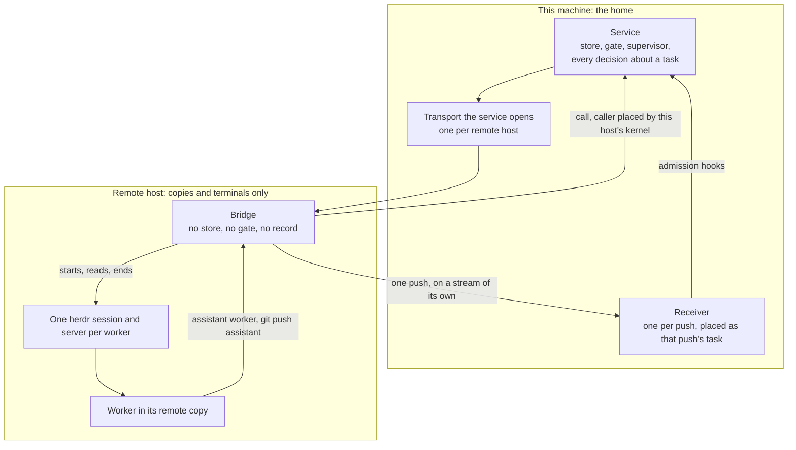

**The bridge**

The bridge is a build of this program, started by the service over the transport, with that
transport as its only channel back. It holds no store, no lock on the home, no gate, and no
configuration of its own, and it decides no task's course: dispatch, admission, relaunch, every
finding and every hold stay the service's. What it does decide, it decides from that host's kernel
and filesystem on rules this subsection fixes, and nothing a caller states enters any of it: it
places a caller and refuses one it cannot place, cuts and asserts a copy and refuses one that does
not assert, takes the readings placement needs, lists processes for the sweep, and ends what it
started when `remote_disconnect_grace` passes. It carries a worker's calls and pushes to
the service with the task it placed, and the service decides each one as it decides a local
worker's. There is one bridge per remote root, holding a lock in that root the way the service
holds the home's. The root names the home it belongs to, written once at first use, so a root is
never shared between homes and a bridge of another home is refused; that file says which home and
nothing about which bridge. Each bridge also writes an instance identity of its own when it
starts, as the service does in the home, and that identity, not the home file, is what tells one
bridge from the next (the ownership row below says what turns on it).

The bridge's build must be the service's, compared on the identity section 8's run record traces a
run to: the version, the source revision and modified flag the Go toolchain recorded, and the
toolchain's version. The bridge reports its own over the transport, read from what its toolchain
recorded and not from a version line it prints. A bridge whose identity differs, or that carries
no revision or a modified one, so that two different builds could share an identity, is refused,
and its host is ineligible until it matches. The architecture is not compared, because a remote host
of another architecture than this machine runs a binary built for its own, and the identity
compared names the source and the toolchain, which a build for either architecture records alike. The match covers this program's part and nothing more: two builds of one clean revision
made with different build flags compare equal, and a binary made to report another build's
identity is not caught. The coding agent and herdr on that host are other programs, and the match
says nothing about either. The transport is SSH, authenticated by your own SSH configuration under
the name you gave the host; the program adds no SSH credential and stores none.

**The herdr session provider**

herdr becomes the third terminal session provider beside `pipe` and `tmux`,
on the five operations section 8's session row names and through the held set those two share.
Remote hosts require it: with a host named and `session_provider` set to anything else,
the configuration refuses at parse time, so the provider stays one choice for the whole service.
What follows was read off herdr 0.9.5 on 2026-10-21 and 2026-10-22, by its own help, its default
configuration (`herdr --default-config`), and process listings of sessions started for
the purpose, and it is what the provider is built against; a herdr server
that reports another version is refused at start rather than driven on the assumption that it
behaves the same.

- **A server per worker.** herdr runs each named session as a server process of its own with a socket of its own, and a headless `herdr --session <name> server` stays the child of whatever started it. So each worker runs in a session of its own whose server the provider starts itself, headless, as its own child (on a remote host, the bridge's child), and the provider records that server's identity as the worker's host, read as the pane process's parent and checked against the process it started, on the terms the tmux provider records its server. A server keeps the working directory it was started in, and herdr keeps it running after its last pane is gone, so the provider starts each worker's server with its working directory in that worker's copy and ends it when the worker ends, as the tmux provider ends its server, and section 8's task record holds its identity beside the worker's session reference, as the store holds a subordinate's tmux server beside its delegation attempt's. A later bridge can then end the server by that identity, and the copy sweep reaches it where no record names it. The server of herdr's default session, the one you attach to, is never started by the program and is never a host.
- **Why the server is the host.** herdr names a pane's own session in its environment (`HERDR_SESSION`, `HERDR_SOCKET_PATH`), so the worker can reach its own server, and what that server starts, a pane among them, descends from the server and not from the agent, which is the reach that makes the tmux provider place its server as the worker's host.
- **No shell runs in the pane.** herdr starts a pane with the program its configuration names as the default shell, falling back to `$SHELL`, as a login shell on macOS unless the configuration says otherwise, and passes it no argument; it has no option that starts a pane with a command of the caller's choosing (`pane split` and `workspace create` take a directory and environment entries). So the provider starts each worker's server under the environment `agents.WorkerEnvironment` built and with `HERDR_CONFIG_PATH` naming a configuration file it writes for that worker alone, never your own, as the tmux provider starts its server with no configuration file. That file names as the pane's program a launch file the provider writes for that worker, which replaces itself, by `exec`, with the agent and the command line the adapter built, quoted by the program, and which exits at once, starting nothing, once it has run for that worker. The agent is then the pane's process from the start, the server's child and the leader of its own process group, as under tmux, and the session reference names it once it is read running the agent's binary. No login or interactive shell runs, so none of your shell's startup files does: with the configuration naming the launch file, the pane's process was the agent the launch file started, under the launch file's own identifier, and startup files that start a process, which ran in a pane whose program was zsh, did not run, even with `$SHELL` naming zsh and the configuration asking for a login shell. A pane opened later in that session, by the worker or by you, runs the launch file again, which exits, and herdr closes the pane. What the agent runs under is the server's environment plus what herdr sets for a pane, its `HERDR_` variables and the terminal's, which the provider does not choose. When the agent exits herdr closes the pane, and a capture after that answers the last screen the handle read.
- **What else herdr is relied on for:** typing into a pane, reading its screen, closing it, and the command you run to attach from this machine. Liveness comes from the agent process's identity, never from herdr's own account of the agent.

**What a remote worker is held to**

The same as a local one, rule by rule. Where the mechanism differs, the row says how.

| Rule | On a remote host |
|---|---|
| **Placement** | Across a machine boundary this machine's kernel can attribute nothing, which is why a push whose ancestry ends at a daemon is refused today (the process model above). The bridge places instead: it walks a caller's ancestry on the remote host's own kernel, the walk the service makes here, up to the agent process of a worker it started or the server of that worker's own herdr session, which the bridge started as its own child for that worker alone and which is the worker's host on the terms the tmux provider's server is. Because no two workers share a server, the host rule places a process as one worker's and never as a neighbour's by sharing; herdr's default session is nobody's host, so a shell in it is placed as nobody's. It hands the service the task it placed, over the transport only the two of them hold. A caller it cannot place is refused there with the typed refusal a local caller gets. Nothing on a remote host is placed as a person's shell: a person works at this machine, and a push to the gate from a remote host that no worker made is refused. No caller states a task and no worker is handed a credential, which is what separates this from the per-worker secret the 2026-10-19 reading rejected. |
| **Route back** | A remote worker's route, `assistant worker …`, is the same command run on the remote host. It reaches the bridge's socket under the remote root and never this machine's socket. The bridge places the caller and carries the method across; the service decides it exactly as for a local worker and refuses it for anything the bridge did not place as a worker. This is the relayed-socket shape; a second home on the remote host is the alternative compared below. |
| **The gate** (P1, P2, P7) | The remote copy's `assistant` remote reaches the bridge's socket and never the gate's bare repository. Each push is a connection of its own to that socket, and the bridge places the process that opened it, by its kernel credentials and ancestry, before it carries a byte. For each push it placed, the service starts a receiving process of its own, leading a process group of its own, which joins the worker set as that one task's worker for exactly its own lifetime. It receives the bytes of that one connection and no other, carried on a stream of the transport that belongs to that connection alone, runs the admission and notification hooks every push goes through, and exits. So the task admission's worker rule reads is the task the bridge placed for those bytes: a second push, of the same task or another, is a second connection, a second placement and a second receiver, and a receiver is never reused or shared. The run validates what was pushed, on this machine, under this machine's trusted configuration. Your code host's credentials never leave this machine: the remote host needs only the coding agent's own login. A push the worker makes to any other remote is not seen by the gate, as for a local worker. |
| **Isolation** (P11) | The bridge cuts the copy from the commits a local copy is cut from, carried over the transport, never from a checkout already on that host, at exactly `tasks/<id>/copy` under the remote root: a path it creates for that task, refusing the cut if anything is already there. It asserts it the way a local copy is asserted, by file identity: the copy's root is exactly that path, it is a full clone with its own object store, and it is distinct from every other task's copy. The root itself must be empty or absent when a bridge first uses it, so a root that names a directory already holding your files, your home directory among them, is refused at first use and never adopted. A checkout of your own on that host, inside the root or outside it, is therefore never a task's copy: it is not at a task's copy path, and one placed at that path before the cut refuses the cut. The assertion is the program's, made on that host's filesystem, not the worker's report, and the worker's instructions repeat the check before it creates a branch. A launch whose assertion the bridge cannot make, or cannot return, refuses. |
| **Liveness** (P9) | A probe of a remote reference goes through the bridge. A remote session reference also records the instance identity of the bridge that started the session. It reads Live only while the transport is up, the bridge answering is that incarnation and still holds the worker's session, and the agent process it started is present by identifier and start time, both read and compared on that host. It reads Dead only when the bridge reads absence there. An unreachable host, a dropped transport, a bridge that does not answer within its deadline, an answer from another home's bridge, and an answer from a later bridge of this home about a process that is still present all read Unobserved, never Dead: a later bridge holds no handle to it, as a restarted local provider holds none to a survivor. herdr's account of an agent (working, idle, blocked) is evidence a coordinator may read through `peek` and never absorbs a wake on its own: it is herdr's reading of a screen, not a live process signal. |
| **Recovery** (P6) | A remote task is relaunched only where it ran, in its same copy, through the one anchored relaunch, and only on the proof section 11 already asks for, made on that host by its bridge: the agent process is gone and no process has a working directory under the copy. It is never relaunched on this machine or on another host, because its work is in a copy only that host holds and because an unreachable host proves nothing about duplicate work. A task on an unreachable host reads Unobserved and surfaces again each `escalation_window`; the program discards nothing it cannot reach. A worker its bridge ended when the grace passed reads Dead once the host answers, and is relaunched in its copy on these terms. Moving a task between machines is deferred (section 12). |
| **Ownership** (P15) | The bridge is owned by the service. A worker's process group on a remote host is owned by its task, as here, and is ended through the bridge when the task ends. An end the program cannot deliver because the host is unreachable is recorded as owed, surfaced, and delivered when the host answers, never dropped. When the transport has been gone for longer than `remote_disconnect_grace`, the bridge ends every worker it started and then itself, so while the bridge lives a lost connection bounds how long a worker runs unobserved. That end ends no task and writes nothing: the bridge holds no record and the service cannot read a copy it cannot reach, so the task stays its copy's owner, reads Unobserved while the host is unreachable, and once it answers reads Dead and is relaunched in its copy on the recovery row's terms. A remote copy becomes kept work only when its task ends, on the proof section 6 asks for, the project, the branch and what the copy holds that the default branch lacks, read from the copy by its bridge; a task that ends while its host is unreachable owes that read with its end, and no kept-work entry is written without it. <br><br>A service that reconnects within the grace reattaches to the same bridge and the sessions it holds only when two things hold. The bridge must be the incarnation the sessions' references record, read from its own instance identity and never from the root's home file, which stays true of every bridge of this home. And the service must prove it is the service: the bridge's socket is reachable by every process of yours on that host, its workers among them, so a reattach is accepted only from a connection that answers with a secret the bridge handed the service over the transport it was started on and that the service holds in memory alone. A service that restarted holds no secret, so it does not reattach: it asks the bridge to end its workers and itself, which needs no secret because any process of yours there could end them anyway, and starts a new one. A reattach is the one place a held session survives the transport it was created over, and it can because its handle never left the program. <br><br>A bridge starts only when the service starts it, so the service is present at every start: before the new bridge starts anything, the service hands it the session references its store records on that host and the herdr server identity recorded beside each, and the bridge ends each process one of them names that is still present, by identity, and every process with its working directory in a copy, each worker's server among them, since it was started there, and deletes the herdr session each ended server held. Anything else there that it cannot end or prove idle it reports, naming what it is, as section 11's restart step requires of this home. So neither a worker nor its server that a bridge that died left behind runs on without an owner once the host is reached again, and no shell ran beside an agent to leave a process neither reaches (the herdr provider above). On stop and on restart the service reaches every configured remote root this way, and reports a root it cannot reach. |
| **Configuration** (P7) | Remote hosts are named in your global settings only, section 10's global-only `remote_hosts`: how to reach each host, its remote root, and the path of the binary the bridge runs. No repository copy, trusted or pushed, may name any of them, because each chooses where, and as what, a process starts with your credentials. |
| **Records** (P14) | The task has one row, in this home. Section 8's task record gains the machine it runs on, written once at dispatch and kept by promotion and relaunch, empty for this machine, and that field is the one place a task's machine is stored. Everything else points at it. A session reference does not name the machine: it names its task, as every worker's reference does, and a probe of a remote reference goes to the bridge of the machine that task's record names and nowhere else. Beside a remote reference the task record holds the identity of the herdr server hosting it, which is the one record of that server. A kept-work row names the owner it outlived, and its machine is that owner's; carry on gives the new task the kept copy's machine rather than placing it. The detail view and the status line read the same field. The remote root holds copies, each worker's herdr configuration and launch file, the bridge's lock, socket and instance identity, and the name of the home it belongs to, and no record. |

**Which machine a task runs on**

Placement is the program's, decided at dispatch, because getting it wrong breaks what you cannot
see at the moment of the decision: a disk that fills under a copy, or a runtime fault that only
one architecture shows. The development fleet hit such a fault on 2026-10-21, golang/go#82394,
reproduced on amd64 and reported against amd64 only, which is why a repository may keep its
work off an architecture. The coordinator does not name a machine and no request field can; what
it chooses is the role, as today.

| Fact | Where it lives | Who decides |
|---|---|---|
| Which machines exist and how each is reached | `remote_hosts`, global-only | You. |
| How many workers a machine takes, and the free disk and load a dispatch needs there | `max_workers`, `min_free_disk`, `max_load` on each remote host and on this machine (`placement.local`), global-only | You set the limits; the program applies them to readings it takes at dispatch. |
| A machine's architecture | Read from the machine, by its bridge or here; never configured | The machine itself, its one owner. |
| Which architectures a repository's work may run on | `placement.arch`, trusted-only | The repository's default branch. It can only narrow the machines a task may go to. |
| Which eligible machine a task gets | Nowhere: it is a rule, not a setting | The program: the eligible machine with the fewest live workers of this home, ties going to this machine. With one remote host, the most the first increment allows, no other tie can arise; an increment that allows more states its own tie rule. |
| A coding agent's remaining quota | Not read | Nobody yet: ranking by quota stays deferred (section 12, decision 13). A provider that runs out is section 10's availability failure, as here. |

A machine is eligible when every rule holds on readings taken at dispatch. A reading that cannot
be taken, an unreachable host among them, makes the machine ineligible, because missing
information is never read as room. With no machine eligible the task stays queued and surfaces at
once, naming the rule that refused each machine, and again each `escalation_window`
while it stays queued, as a crashed worker does, so a surface that was missed is not the only one;
it is dispatched when a machine becomes eligible.

**Compared with a second home on the remote host**

#### A second home per remote host, with a delegated-task handoff

The shape the 2026-10-19 reading of #310 preferred (option A there, GAP-11's old shape A with one subordinate home per host). The remote host runs a service of its own, with its own store and gate, and a task crosses homes by a delegation record.

**Keeps:** every kernel-attributed relation local to one machine, unchanged: placement, isolation, the sweep, and liveness need nothing new. A remote run goes on while this machine is unreachable.

**Costs:** a task in two stores, which holds P14 only by declaring one row a pointer, the reason decision 20 rejected that shape for subordinate coordinators; section 11's "never claims another home's work" rewritten; an authenticated service-to-service channel, a delegate-homes key and a delegate resolution tier, none of which exist; your code host's credentials and a second gate on the remote host, whose pass means the same thing only while both builds and both configurations agree (P2); and two services to install, upgrade and recover.

#### One home and a bridge (chosen)

The remote host holds copies and terminals; the bridge is the program's hands there, holds no record, and decides no task's course.

**Keeps:** one store, one gate, one supervisor loop, one configuration, and one row per task, so P14 holds structurally, as decision 20 chose; credentials for your code host stay on this machine; a pass is made on one machine by one build.

**Costs:** a new placement input, the remote kernel's answer carried by the program's own process over the program's own transport; isolation, the sweep and liveness each need a bridge operation; nothing a remote worker does reaches the gate while its host is unreachable; and the bridge's build has to match the service's on every host.

**Chosen: one home and a bridge.** The second home costs P14 in exactly the way
decision 20 already refused, and adds a channel, a key and a tier to buy independence from this
machine that a one-developer tool does not need: you work at this machine, so a partition that
stops remote pushes stops you too. The bridge keeps every placement attributed by a kernel rather
than by a claim, which is the property the 2026-10-19 reading found the thin-process shape lacked.
The owner chose it on 2026-10-22 (decision 22).

**What this does not cover**

- The bridge's answer is as trustworthy as your account on the remote host. A process running as you there that can alter the bridge's memory or its binary defeats placement, as one that can alter the service defeats it here.
- Until `remote_disconnect_grace` passes, a worker on an unreachable host runs unobserved; its pushes fail meanwhile and lose nothing, and what it spends is not bounded by anything shorter than the grace.
- The grace is the bridge's timer, so it bounds nothing once the bridge itself is gone. A bridge that dies while its host is unreachable leaves its workers running until the host is reached again and the next bridge's start ends them, however long that is. Nothing on the host outlives the bridge to enforce the grace; the owner accepted this on 2026-10-22 as a residual gap of the first increment (decision 22), rather than a supervisor or a watchdog on the host.
- A worker can address another worker's herdr session by name, since `herdr session list` lists every session and its socket to any process of yours. A pane it opens there runs that session's launch file, which exits at once, but it can type into that worker's agent, and it can rewrite that session's configuration file, which is a file of yours, and have the server reload it, so that a pane it opens there afterwards is a shell descended from that worker's server and placed as that worker's. The host rule has that reach under tmux too, with no rewrite needed, since it places every descendant of a server as that server's worker whoever opened the window (internal/service's `placement.go`), and a worker can find another worker's socket under the home. Nothing here closes it.
- A process the agent starts that leaves its process group and works outside the copy is reached by nothing once the agent is gone: no record names it and the copy sweep does not see it. A local worker has the same gap, where agents' sweep finds such a process only in its copy. The launch file is a script, so the host's `/bin/sh` runs it for the moment before its `exec`; section 13's startup-file check is what shows that nothing of yours runs then.
- A push is placed as the process that opened its connection, when it opened it, as a local caller is placed as the peer read when its connection was accepted. A placed process that hands its open connection to a process that is not the worker's is not detected.
- A worker's process that leaves its ancestry, by double-forking or daemonizing, is placed as nobody's and refused, as here.
- The sweep on a remote host is the bridge's process listing on that host, so it covers what that listing covers and nothing more.
- A person attached to a remote worker's session through herdr can type into it, as under tmux, and nothing records it.

<sub>Section 9</sub>

## Surfaces

A person at a terminal and an agent driving programmatically are both first-class users. They
share the same decisions, the same options, and the same authority. Only the rendering differs.

### Command line

| Command | Purpose |
|---|---|
| `assistant` | Attach to this branch's active run. With no run, start one. |
| `assistant init` | Create or repair the gate for this repository. |
| `assistant status` | Repository, gate, service, active run, and local branch state. |
| `assistant runs` | Recent runs, newest first. |
| `assistant rerun` | Start a fresh run from the last known head, inheriting the recorded intent. The last known head is the commit the branch's last run pushed, or the commit it was submitted with when it pushed nothing. When the checkout stands on another commit, rerun refuses and starts nothing: behind what the run pushed, it names `assistant sync`; anywhere else, it names a push to the gate or a start with an intent. Given `--intent`, the fresh run takes that intent in place of the recorded one and records it as supplied, which is acceptance criteria, the standing an intent given to a start has when nothing is said about it. That is all a replaced intent changes: the head a rerun validates and its refusal are the same with it or without it. An empty intent is refused as incorrect usage and starts nothing. |
| `assistant sync` | Reconcile your local branch with what the pipeline pushed, or recover work it holds. Prints the exact plan and requires confirmation. |
| `assistant tasks` | List fleet work with its resolved current state. |
| `assistant watch` | Fleet view: everything in flight, everything waiting on you. |
| `assistant doctor` | Check every dependency, and decisively report whether a run can start at all. Once `init` has run, also print the one next step of a first run, read from where the checkout's change stands, from making a branch through the push that sends it; that read writes nothing and decides nothing about whether a run can start. |
| `assistant service …` | Start, stop, restart, status. |
| `assistant gate …` | What the gate's own hooks invoke, not a verb a person drives: `admit` runs before any reference changes and refuses a push it cannot validate, and `notify` runs after and starts the run. They are named here because the hooks the gate installs depend on them existing; a person never types either. |
| `assistant host …` | The coordinator's host and its hook. `install` is the one host verb a person types, once, for setup: it is section 6's stop guard installer. The other host verbs are hook plumbing a person never types: `stop` runs from the hook the host fires at turn end and is section 6's stop guard, answering whether the turn may end and blocking it when work is in flight and no live supervisor is the service holding this home's lock. It is named here because that hook depends on it existing. It is the second command outside the table, and with `assistant gate` it is not a precedent for a third: each is the interface a hook this program installed or asked for requires. |
| `assistant eject` | Remove the gate and its records. |

`assistant init` records the repository the gate validates, and takes four flags.
`--upstream` names the remote the change is destined for, and without it that is the
working copy's origin. `--default-branch` names the branch trusted configuration is
read from. Without it, init takes the branch the working copy records origin's HEAD as naming,
which it reads locally without fetching, and never the branch checked out. When the working copy
has no origin, records no HEAD for it, or records one outside origin's branches, init refuses and
sets up no gate and records no repository. Either way it reports which branch it recorded and where that came from.
It then offers the test and lint commands the checkout's own files declare, reading files and running nothing,
and writes one into the checkout's `assistant.json` only with consent (P1): an answer at a terminal,
one command at a time, or `--accept-commands` for all of them. Without either it writes nothing. It
never replaces a key the file already names and offers nothing for `commands.document`. A written
command reaches no run until the file lands on the default branch, because commands are read there (P7), and
init says so.

The fourth is `--fork-url`, for **fork pull requests**. It names a fork of the upstream, and with
it a run sends its branch to the fork and proposes the pull request from the fork to the upstream. The
repository record holds the fork beside the upstream as a field of its own, so the repository a run writes its
branch to and the one its pull request targets are never read out of each other. init records a fork only when
the fork and the upstream are both repositories on the code host this build proposes changes on and the fork is
not the upstream itself; otherwise it refuses as incorrect usage and sets up no gate and records no repository.
A run whose record names a fork that cannot be resolved is refused before it starts, rather than sent to the
upstream instead. The push to the fork is anchored on the fork's branch, observed before the work, as every
push is (P6), and opening the pull request is confirmed against both repositories it names before anything is
written. Without the flag init records no fork, and a run sends its branch to the upstream. No verb is added.

The **managed service** is a pair of flags on `assistant service`. `start --install`
hands the home's service to the operating system's own service manager, a launchd agent on macOS and a systemd
user unit on Linux, so it is brought up again when the user logs in, including after the machine restarts; on
Linux it comes up at boot without a login only where the user's lingering is enabled, which install does not
change. `stop --uninstall` stops the service through its own stop, which refuses while runs are
active as every stop does, and only then removes what install set up. The home's lock still allows one
service per home, so install is refused while a service is up, and a start with a managed service set up goes
through the manager rather than starting a second. A restart under the manager ends the service for the
manager to bring up again. On macOS, install refuses when the home, the program, or a checkout the home serves
is inside Documents, Desktop or Downloads, which macOS keeps from a program its service manager starts unless
the user grants it access, and names both remedies: move them out, or grant the program Full Disk Access and
install again with a flag saying so, which the program cannot check. On Windows, and wherever neither manager is
available, install is refused. No verb is added.

The **usage view** is a flag on `assistant runs`, taking a window. It reads section
8's agent invocation record and totals it by agent, model provider, model type, model version, the model identifier the launch used, purpose, role, effort, and context window, and by run and stage
where a row names them: calls, failures by category, duration, and each token count. A count the
agent did not report is shown as unreported and never summed as a zero. A provider, a type, a
version, an effort, or a context window recorded as not named is totaled on its own and never as one of the named values,
and one a row predates is totaled as unknown, apart from both.
It covers the calls a
stage makes and says so: a worker's turns and any price are not in it.
<kbd>proposed</kbd> Once worker turns are recorded on section 6's
[learning what converges](#round-records) terms, it totals a worker's rows by task and attempt
beside the run and stage totals, and says it covers stage agent calls and worker turns and
excludes the coordinator's own turns and any price; a task whose agent does not declare that it
reports worker usage is shown as not recorded, never as nothing. The local protocol
carries the same read as one open method, so a driving agent gets the same model. It is a
detailed evidence document in P13's sense, because its rows are agent names, model identifiers,
and stage purposes; the line pointing at it is phrased. It also carries a ceiling line stating
where the recorded use stands against section 10's `usage_ceiling`: no ceiling set,
under it, reached, not weighable because a call did not report a count it is set on and its
agent does not declare that it does not report that count, which includes every call by an
agent this build holds no declaration for, or not known because the record could not be read, with the exact
figures when a count is set, including how many calls a count leaves out because their agent
declares it does not report it. The
line is over the ceiling's own window, which need not be the window the view was asked for. No
verb is added.

The **log view** is a flag on `assistant runs` given with a run, naming a stage. It
reads that run's section 8 per-stage log for the stage, where a fix round is logged under the stage
whose findings it fixes. The service writes it, best effort, around each stage body and each round:
when it began and ended, what it returned, and the account and full reply of each agent call that
passes through the service's own wrapper, redacted on the way in. A write that fails is reported in
the service log and leaves no mark in the stage's log. What the view prints is a bounded tail with a
marker saying how much it left out and where the whole log is. A log is evidence and never state:
nothing decides anything from it (P8). It is an answer of its own, apart from the detail view, and it
keeps exact identifiers and stage names, so it is a detailed evidence document in P13's sense and
P13's list names it; the line pointing at it is phrased. The local protocol
carries the same read as one open method. No verb is added.

Answering a hold is a flag on `assistant`, and it takes a task as well as a run, so a
hold a task raised with no run behind it, an investigation's among them, is answered the same
way. Given a task with no hold of its own open, it answers the hold on the task's current run,
so a run a task produced is answered without checking out the task's branch.
`--hold` names which of a task's own holds to close (the hold's key, or a finding
id under that task); without it the oldest open one is answered.
`--note` records free text with the resolution about what was decided; who decided
stays the surface, never a claim made by the note.
`--run` with `--task` answers the task's current run even while the
task still has holds of its own open, so a promoted delivery run is reachable without first
clearing every report hold. Without `--run`, a task's own hold still comes first.
A kept-work entry (section 6) is answered the same way: `--answer` is
`land`, `carry-on` or `discard`, `--hold` names the
entry, and `--task` names the task whose copy it is, or, for an entry a person's push
left, `--run=RUN` names the run. That is an optional value on the same flag, the way
`--cancel=RUN` takes one, and bare `--run` keeps the meaning above.
Discard is answered twice: `--answer discard` alone shows exactly what would be
lost, with a short digest of it, and removes nothing; repeating it with
`--confirm DIGEST` removes the copy only if the copy still holds exactly what that
digest names.
<kbd>proposed</kbd> A housekeeping
pass's retirement hold is answered the same way, with `--answer retire` or
`--answer keep` and `--task` naming the pass, on the terms section 6's
[housekeeping](#housekeeping) gives.
No verb is added for it.
<kbd>proposed</kbd> An entry holding a claim (section 6's [kept work](#kept-work)) is also
answered with `--answer withdraw`, with `--hold` naming that entry and `--task` or `--run=RUN`
as for its other answers. It takes the claim back on section 6's terms: it is refused while the
claimed outcome is mid-flight, it removes nothing and moves the copy only back to where the
entry names it, and its reply names the claim it took back, any task it ended, any move back,
and whether it closed the entry as gone. Given to an entry with no claim it is refused as incorrect usage, in a sentence saying
there was nothing to withdraw, and nothing changes. `--note` is recorded with the withdrawal as
with any answer. No verb is added for it.

Ending a run is a flag on `assistant` too, `--cancel`. Alone it ends this
branch's run, wherever it stands. Written `--cancel=RUN` it ends the run named, and it
reads no working copy, so it ends that run from anywhere. A run the home has no record of, and a
run that has already ended, are refused as incorrect usage, in a sentence saying there was nothing
to end and why, and nothing changes. No verb is added for it.

Standing consent is a flag on `assistant` too, `--standing-consent`, and it
needs the repository's `allow_standing_consent`, read only from the trusted copy, so a
pushed branch cannot allow it for itself (P7). Given when a run starts or is attached to, it puts
that run under standing consent, and given a task, as answering is, it puts the task's current
run under it without checking out the task's branch; without the key it is refused as incorrect
usage and changes nothing. The program then answers the holds of the stages before push itself: a
fix round over every finding that is not a note, and approval where only notes remain, within
section 5's bounds. A hold carrying an `ask` whose action the stage never stated (P3),
or one no fix round can resolve, such as a stage with no command configured, is left for you.
<kbd>proposed</kbd> It leaves a stage held because section 5's [fix ladder](#fix-ladder) is
spent for you, since the fix round it would give is what the ladder has run out of.
It never answers the push, pull request, or checks holds, and never answers past a refusal P6 or
P7 produces. Each answer is recorded as the program's, never as a person's, and status, the run
listing, the run's record, and the pull request body say the run ran under it. No verb is added.

Creating a task, promoting an investigation to delivery, and relaunching a task whose terminal
is gone are the coordinator's typed commands from section 8, and each is a service method
rather than a verb: none is a row in the table above, and each is reached through the
coordinator client described below. Create takes an optional role, section 10's
`roles`. No role means the `worker` role. A role the resolved
configuration does not name, and either of the gate roles `review` and
`fix`, is refused as incorrect usage and creates no task.
<kbd>proposed</kbd> Create may
instead carry the housekeeping mark, which the coordinator client's `create` takes as a
flag. That creates an investigation under the `housekeeping` role, with the program's
part of its instructions before the coordinator's, on the terms section 6's
[housekeeping](#housekeeping) gives. A marked create that names a role, one
for a repository whose trusted `housekeeping.paths` is empty, and one while a pass of that repository is open are
each refused with a typed refusal and create no task, and so is any create that names the
`housekeeping` role. No verb is added. Each is coordinator-only. A caller whose process is inside a
registered worker group, which the service decides from the credentials the socket reports and
never from anything the caller says about itself, is refused, so an investigation cannot
promote itself and no worker can create or relaunch a task. Relaunch goes through the one
anchored relaunch that section 11's reconciliation also uses: the attempt it begins is anchored
to the attempt history it read, so a coordinator's relaunch and reconciliation's cannot both
relaunch the same task.

Messaging a running worker and stopping one are service methods on the same terms, and
coordinator-only for the same reason. Section 6's steering owns what each does and what proves
it happened. The relaunch after a stop is no new method: it is the answer to the stop's hold.

Delegating a domain and ending a delegation are two more service methods on the same terms,
`domain.delegate` and `domain.end`, and coordinator-only: the first
writes section 8's delegation record and starts the domain's subordinate coordinator, and the
second writes that record's one revision. A subordinate coordinator is placed the way a worker
is. From the credentials the socket reports and the caller's parent chain, the service places a
caller as the worker of a task, the subordinate of a domain, or neither, never from anything the
caller says about itself, and where it cannot tell it errs toward the side that claims less.
That placement is a relation the service decides over the same credentials, not a third access
class.

Within its domain a subordinate coordinator is admitted to: creating a task, whose domain is
written from the placement and which no request field names; messaging, stopping, and reading
the recent output of a worker; relaunching a task; recording that a reported investigation's
findings were relayed; listing, awaiting, subscribing to, and acknowledging the wake queue, for
its domain's rows alone; and arm verification. It is refused, with a typed refusal naming it as
a subordinate: promoting a task; answering a hold, because a hold waits on a person; marking
the catch-up read seen; <kbd>proposed</kbd> creating a housekeeping pass; starting, rerunning, or cancelling a run; synchronizing a branch;
stopping or restarting the service; and the two delegation methods. A task outside its domain
is refused with a typed refusal of its own. It records no delivery posture: a task it creates
takes its delegation's, as section 6 says.

These methods, with listing, awaiting, and acknowledging the wake queue, reading a worker's
recent output, recording that a reported investigation's findings were relayed, and arm
verification, are reached
through `assistant coordinator …`, a client dispatched beside the table on the same
terms as `assistant gate` and `assistant host`. It adds no row. It is the
interface the coordinator requires, and the third command outside the table by the owner's
decision rather than a precedent the first two set. Each subcommand is one service method.
Every one but `tasks` calls a method the service, not the client, refuses for a
worker; `tasks` calls the open reads `tasks.list` and `task.get`,
which any caller may make.

What is reached beside the table rather than as a verb is two clients. The coordinator client's
subcommands are `create`, `tasks`, `message`, `stop`,
`peek`, `relaunch`, `promote`, `relayed`,
`answer`, `wakes`, `await`, `listen`,
`acknowledge`, `supervision`, `delegate`, and
`end-delegation`. `tasks` is `tasks.list`, or `task.get`
when a task is named, the listing `assistant tasks` answers; a subordinate coordinator
is answered its own domain's tasks alone. `answer` is `task.respond`, the
answer `assistant --task … --answer` gives, refused for a worker; for a subordinate
coordinator it is refused and the ask recorded as an escalation, handed up to the first
coordinator. `listen` holds the wake stream, `wakes.subscribe`, printing each
wake as it is queued and handing out none. `delegate` is `domain.delegate` and
`end-delegation` is `domain.end`, each one service method, coordinator-only,
and refused for a subordinate coordinator as for a worker. No verb is added. `await` blocks until the wake
queue holds a wake on offer to the caller, or until a bound the caller gives elapses, and then
hands those wakes out, acknowledging nothing: only `acknowledge` closes one, and when
a wake handed out is handed out again is section 8's `wake` row. `wakes`
hands wakes out the same way in the machine interface, which is the coordinator's; in a person's
rendering it is `wakes.peek`, a listing of the queued wakes that hands out nothing. `peek` reads a task's worker's recent output,
redacted and bounded, and how to attach to its terminal where the provider offers that; the
output and the attach command travel only in the machine interface, because worker output is
evidence and never relayed (P13). The worker route, `assistant worker …`, is the route
a launched worker uses to acknowledge a message, file an investigation's report, and record an
event about how its work stands. It is dispatched beside the table on the same terms and adds no
row: it is the interface a launched worker requires, and the fourth command outside the table by
the owner's decision rather than a precedent the first three set. Each of its subcommands is one
service method, and the service, not the client, refuses it for a person's shell, deciding from
the credentials the socket reports and never from anything the caller says about itself.

Workers on another machine add no verb, no flag, and no request field. Remote hosts are section
10's global settings and placement is the program's at dispatch, so neither the coordinator nor
you name a machine for a task. On a remote host the worker route is the same command, reaching
that host's bridge rather than this socket; the service decides each call from the placement the
bridge read on that host's kernel and never from anything the caller says about itself, on the
terms [workers on another machine](#remote-hosts) gives. `peek`
hands back the command that attaches to a remote worker from this machine. The detail view names
the machine a task runs on, and a plain status line names it by the name you gave it in your
settings, which is your word and not an internal term (P13).

### <a id="catch-up"></a>Catching up

With many tasks running, the question that matters is what is waiting on you, what landed, and
what is still moving. `assistant watch` answers it first, in one read, before it
follows the stream. The read is resolved from the records that own each fact (P8), and the
person's rendering and the machine interface return the same model (P14).

| Part | Read from | Filtered by the seen mark? |
|---|---|---|
| **Waiting on you** | Every open hold, a run's and a task's, oldest first, each with the answer that closes it. | Never. An open decision is shown until it is answered. |
| **Landed** | The merge records and cleanup records section 6's terminal tier derives Landed and Complete from. <kbd>proposed</kbd> And the nothing-to-deliver records it derives Landed from, each shown as already on the default branch with nothing delivered, never as merged. | Yes: only records not yet marked seen. |
| **Under way** | Every task section 6's work-in-flight definition counts, and every run being advanced, with its resolved state. | Never. It is what is true now. |
| **Stopped without a decision** | Tasks that resolve Failed or Unknown, each with its next action. | Never. |

- **The seen mark.** "Since you last looked" is section 8's seen mark: which landed records
  you were shown, one per home. It is never a time read off a clock and never inferred from the
  log or the stream.
- **It moves only when you say so.** A flag on `watch` marks seen exactly the
  records a read showed, so anything recorded between the read and the mark is still shown next
  time. A read alone marks nothing.
- **Landed is bounded.** A read shows unseen records newest first, up to a fixed count in
  the program, and says how many more there are. The rest stay unseen rather than being dropped.
  The count is not a setting.
- **Answering is the existing answer.** Each listed decision carries its
  `--answer` command, with `--task` where a task holds. There is no
  second way to resolve a hold.
- **It is not the wake queue.** Acknowledging a wake records that the coordinator handled
  it, and the seen mark records that you were shown something. Neither stands in for the
  other.
- **Wording.** It is a plain status rendering under P13, not an evidence document, and it
  points at the detail view for identifiers.

A second flag on `watch` prints the read once and exits. The local protocol carries
an open read and a restricted mark, refused for a task's worker. No verb is added, and
`status`, which answers for one branch, does not carry it. Not in this design: a
dated report file, an interactive board, away mode's return brief, planned work that is not yet
a task, and bucketing holds by age.

> **Commands that can destroy work refuse by default**
>
> Stopping or restarting the service, and replacing the binary, all refuse while runs are
> active. Each lists the affected runs and requires an explicit force flag; a general
> yes-to-everything flag does not satisfy it. Every invocation, forced or not, records who
> called it. A process descended from an active validation stage cannot use the force flag at
> all, because a validating agent must never be able to stop the thing validating it.

### Terminal interface

One screen that answers four questions in order of urgency. It adapts from a two-column layout
to a stacked one on narrow terminals.

**Where am I?**

All nine stages with status icons, durations on completed stages, and a fixed count on stages that fixed something.

**Why did it stop?**

The findings list with a risk header, selection checkboxes, severity, location, and any note you attached.

**What changed?**

The diff for the fix round, loaded on demand. If it cannot load, approval is disabled rather than offered against unknown content.

**What is happening now?**

A live log tail, and while checks are running, the pull request state and a clear signal once checks are green.

The detail view is a detailed evidence document in P13's sense, so it names the nine stages and
shows each finding's identifier, location, and full text as they are. The configuration keys
the run dropped and the proposals raised about it are part of that evidence. The plain status lines
are not evidence documents: they stay phrased under P13 and section 6's translation table, and
so does the message that points you at the detail view.

Design constraints: use only the terminal's own palette so it follows the user's theme; keep a
fixed-width gutter so content never shifts as the selection moves; and reflect run state
honestly. Working, waiting on a person, and dead must be visually distinct, because a stall that
looks alive is worse than an error - and so is its mirror, a run being advanced right now that
renders as failed, which tells a driving agent to abandon healthy work.

### Machine interface

An agent drives the same gate through a structured command family. The contract has five parts.

| Element | Contract |
|---|---|
| **Blocking calls** | Starting or responding blocks until the next decision point or a terminal outcome. A long call is working, not stalled, and a run never advances past a decision on its own. The bare start attaches, so a run already being advanced is reported where it stands rather than advanced twice, and that one call returns `executing` instead. A run with no recorded position that nothing is advancing cannot be attached to and carried on, so it is told to end and start a fresh run rather than to attach. |
| **One answer, no disagreement** | A reported run must not be able to describe its record and its execution disagreeing. The fact of whether something is advancing the run right now is an *input* to the outcome, never a field carried alongside it, and the recommended next action is derived from the pair rather than written at each branch. Absence of a checkpoint is its own case, not a status standing in for one. This is structural: the surface that builds the answer must not be able to assign the action at all. |
| **Structured output** | Machine-readable on standard output, progress on standard error. Control characters are escaped visibly rather than emitted raw. |
| **Stable exit codes** | Success and normal decision points; operational failure; incorrect usage. Three meanings, never overloaded. Incorrect usage is a request the caller got wrong, whether the command line could not be parsed or the service answered the request as invalid, and it is the same code for every method. Init that cannot prove the default branch because the checkout records no answer for it is incorrect usage, since the remedy is a branch the caller names or a record the caller makes; a read of what the checkout records that fails is an operational failure. A run that has not executed is not an operational failure: it is unfinished, so it exits with the first meaning and its next action says what to do. |
| <a id="outcome-set"></a>**Outcomes** | Seven, in two groups, and this row is where the set is stated. Each one is marked with a `data-outcome` attribute naming its group, so the set, its order, and its grouping can be read off this row alone; a build whose own set differs in any of the three is wrong against this row rather than merely inconsistent with it. Five say a run is finished with. <code data-outcome="finished">checks-passed</code> means validated and green but not merged, and it means stop driving and ask the person. <code data-outcome="finished">passed</code> means merged. <code data-outcome="finished">pushed</code> means validated and pushed on a repository with no code host, so no pull request was opened and no checks ran; it exits as success, and its next action says the merge is the person's to make on the remote. A pull request closed without merging ends the run as `failed`, with the reason recorded. <code data-outcome="finished">failed</code> and <code data-outcome="finished">cancelled</code> are terminal and require a next action, never silence. Two say it is not. <code data-outcome="unfinished">decision</code> is the decision point a blocking call returns at, and <code data-outcome="unfinished">executing</code> is a run whose execution has not finished, which only an answer that reported the run without advancing it can carry. It covers three situations a reader must act on differently: a segment in flight; a segment that stopped without settling, leaving the run at a resumable position with nothing moving it; and a run with no recorded position at all. The outcome is the same for all three because none is finished with. What separates them is the next action, decided by whether anything is advancing the run and whether a checkpoint recorded a position. Every outcome carries a next action, terminal or not. |
| **Relay verbatim** | A finding that needs a decision is relayed with its full text, unsummarized and unjudged, unless standing consent to resolve unattended was given. That relay is a detailed evidence document in P13's sense, so the finding keeps its exact identifiers; P13's "never text to relay" governs worker reports and tool output, not a finding you are asked to decide on, and the message asking for the decision is still phrased. |

> **Why the terminal five are the whole answer to how a run ended**
>
> The five terminal outcomes answer one question: how did this run end. That is the question a
> blocking call asks, since starting or responding does not return while the run is still
> moving, and every way a run can be finished with is one of the five. They were not an
> incomplete list of run states; they were the complete answer to that question.
>
> A read asks a different one: where does this run stand right now. Reporting status, and
> reporting one run by identifier, answer without advancing anything, and a run part way
> through a stage has no terminal answer to give. Reaching for one of the five there says
> something false about it. `executing` is the answer that was missing, and it
> relaxes nothing above it: a call that did advance the run still returns at a decision point
> or with a terminal outcome.
>
> Attaching straddles the two. It blocks while it advances the run, but a run already being
> advanced is reported rather than advanced a second time, and that report can be
> `executing`: attaching asks where a run stands, and that it is moving is an answer
> to that. A caller never answers `executing`, because there is nothing to answer.
> Its next action is to attach, which carries the run on and blocks until its next decision -
> unless the service is already advancing it, where the answer comes at once and the caller
> pauses before asking again.

> **Rich intent is required, not optional**
>
> A driving agent supplies your goal in your terms, plus the decisions, tradeoffs, and
> constraints behind it, and the approaches you ruled out. A one-line summary of the diff makes
> the reviewer flag choices you already made deliberately, which is the fastest way to make the
> gate feel like an obstacle.

An agent already running inside a validation stage is contained: it may inspect, fix, and return
its own stage, and nothing else. Attempts to start, stop, respond to, or push around a pipeline
return a specific containment error. An environment marker is diagnostic evidence only, never
authorization; authority comes from authenticated process ancestry.

<sub>Section 10</sub>

## <a id="config"></a>Configuration

Two layers. Global settings live in your home; per-repository settings live in a file at the
repository root. The repository layer overrides the global one field by field, except for a
global-only-to-loosen key, which a repository layer may only tighten.

### The trust boundary

This is P7 made concrete, and it is the security-critical part of the design. Configuration
fields fall into five classes by where they are read from.

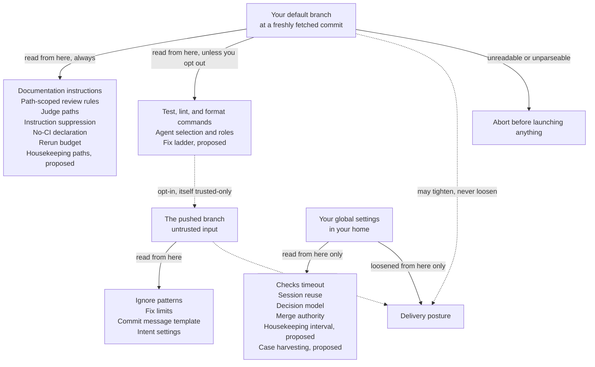

#### Read from the pushed branch

Fields that cannot execute anything or weaken a check. A contributor may set these freely.

#### Trusted unless you opt out

Commands, agent selection, and roles. These run shell and choose which process starts with your credentials. The opt-out exists for a single-developer repository and is itself readable only from the trusted copy, so a branch cannot enable it for itself.

#### Always trusted-only

Anything that shapes what review or documentation demands, or that declares a check unnecessary. A contributor must never be able to suppress a maintainer's review rule from their own branch.

#### Global-only

Fields a repository may not set at all, in either copy. These are operator preferences about how this machine behaves rather than facts about a repository, so a repository should not set them even where doing so could not weaken a check. The test is authority, not harm.

#### Global-only-to-loosen

Fields whose values run from strictest to loosest, where only your own configuration may choose a looser value than the default. Your global settings are the floor: a repository copy, trusted or pushed, may name the value beneath it or a stricter one, and that value takes effect. A looser one refuses the whole resolution rather than being dropped, so the run, the intake, or the promotion does not proceed. A pushed copy is compared with what the trusted copy left, and a stricter value there affects only that run.

> **Unreadable trusted configuration aborts the run**
>
> If the trusted commit cannot be fetched, or its configuration file cannot be read and parsed,
> the run stops before launching any agent. It does not guess at defaults. A readable tree with
> no configuration file is valid and uses defaults; that is a different case and must be
> distinguished.

A repository may also carry `assistant-knowledge.md` at its root, curated project
knowledge: the conventions every worker and every reviewer should be told. It is read only from
the trusted copy, on the same terms as the configuration file (P7), and never from a pushed
commit, a working copy, or anything an agent wrote, so a branch that rewrites it is reviewed
under the default branch's copy and not its own. A launch reads it at a fresh fetch of the
default branch; a run reads it at the trusted commit its configuration was read at. It is
composed into a launched worker's first turn and into a run's review prompt as context that
grants nothing: it widens nothing an agent may do and outranks nothing else the agent was told.
A run whose trusted configuration sets `suppress_project_instructions` is told none.
Its text passes credential removal before it reaches an agent. A document over 32 KiB, or one
that is not UTF-8 text, is refused and never truncated: the launch records the refusal and the
task resolves Failed, and a run does not start. A tree with no document composes nothing and
refuses nothing. Each launch records the commit and the digest of the document it was told, on
section 8's task record, and the text is never stored: the repository's own history of the file
is its audit.

### Schema

| Key | Default | Meaning |
|---|---|---|
| `agent` | `auto` | One agent or an ordered fallback list. Resolved against what is actually runnable at run start. If nothing resolves, the run fails before its first stage rather than reporting command-only validation as a pass. A role that names no agent uses this list. The default fixer names `cursor` and does not. A role that names its own agent does not consult this list. |
| `roles` | `fix` names `cursor` | Which agent, model provider, model type, model version, effort, and context window each role runs. The default names `fix` as `cursor`, with no model, no effort, and no context window, and names no other role, so review and worker use `agent`. A `roles` table you set replaces that default, except that a table which does not name `fix` keeps this fixer. A `fix` role that names no agent leaves the fixer on `agent`. The program assigns `review`, `fix`, and `worker`; any other name is a worker role a task may name. <kbd>proposed</kbd> It also assigns `housekeeping`, the role every housekeeping pass runs under and no other task may name, which resolves to the `fix` row when this table does not name it. Same trust class as `agent`, so a pushed branch sets it only under `allow_pushed_commands`. The rules are the section below. |
| `commands.test` | empty | A targeted check for this change, not a full suite. Deliberately empty by default. |
| `commands.lint` | empty | Static analysis. When empty, the document stage performs a combined pass and routes its lint findings to the lint stage. |
| `commands.format` | empty | Run immediately before pushing. |
| `fix_rounds.review` | `1` | One round, and only over `fix` findings. An `ask` finding is never eligible, so the presence of one holds the stage regardless of this value. Setting it to zero sends every review finding to you. |
| `fix_rounds.{rebase,test,lint,checks}` | `3` | Per-stage attempt limits. |
| `fix_ladder.order` <kbd>proposed</kbd> | `fresh`, `effort`, `model` | The rungs section 5's [fix ladder](#fix-ladder) climbs after its opening rung, in order, each named at most once from that closed set. The default order follows the development fleet's evidence, recorded on the proposal's pull request: a fresh session first, because it changes the least and every escalation in that evidence began with one, then effort, then model, the lever that cost the most per token there. That evidence changed more than one lever at a time, so the order is a default to be changed from the round records, not a measured ranking. An empty list is no ladder: every automatic round resumes the run's fixer session, as before this key, and nothing holds for the ladder. A name outside the set, or a name given twice, fails at parse time. It chooses which agent, model, and effort a fix round starts with your credentials, so it is in the trust class of `roles`, read from the pushed branch only under `allow_pushed_commands`. It is recorded when a run starts and carried in its checkpoint. |
| `fix_ladder.climb_after` <kbd>proposed</kbd> | `1` | How many of one stage's unattended fix rounds in one run, its automatic rounds and the rounds standing consent asked for, as section 5's [fix ladder](#fix-ladder) counts them, are taken on the opening rung before the ladder climbs. The default is chosen to fit the default round limits, not measured: the fleet's live ladder climbed after three failing reviews, which no default limit reaches within one run. It is in `fix_ladder.order`'s trust class and is recorded on the same terms. The limits table bounds it on both sides. |
| `fix_ladder.rounds_per_rung` <kbd>proposed</kbd> | `1` | How many of one stage's unattended fix rounds in one run are taken on each rung after the opening one, a skipped rung taking none. The default is chosen to fit the default round limits, not measured; the fleet's live ladder took two per rung across pushes. It is in `fix_ladder.order`'s trust class and is recorded on the same terms. The limits table bounds it on both sides. |
| `fix_ladder.models` <kbd>proposed</kbd> | empty | The `fix` role's next models, in order, each one rung of the ladder's `model` step. Each entry has the shape of a role's `fallback` object, an agent with an optional complete model triple, effort, and context window, and is validated as a role is, at parse time and again when the run starts, so an entry that cannot run fails the run before its first stage rather than at the round that reaches it. An entry names no backup, and inherits nothing from the `fix` role. Empty skips the `model` step, which is the default because the default fixer names no model to climb from. A list naming the same agent and triple twice fails at parse time. It is in `fix_ladder.order`'s trust class, and its entries are read again at every round, as a role is at every launch. The limits table bounds its length. |
| `run_budget` | `40` | Total node executions per run. The second of the three loop bounds. |
| `run_usage_budget.output_tokens` <kbd>global-only</kbd> | `0` | The per-run usage budget: output tokens one run's own agent calls may report generating before the run parks. Zero is no budget. A run-level bound held beside `run_budget`. It is recorded when the run starts and carried in its checkpoint. Before every step it is compared against the run's own rows of the agent invocation record, and it changes on a live run only by adopting a new budget into the run's history. A call that reported no output count leaves the run's spend unknown, which parks. It is not the usage ceiling, which is the home's and holds. |
| `ignore_patterns` | empty | Paths excluded from review and documentation checks. |
| `review.path_rules` | empty | Extra review guidance scoped to paths. Applied in declared order, each labelled with its own scope and the files it matched, so a scoped rule never reads as repository-wide. |
| `judge_paths` | tests, CI, lint config | Path patterns for the files that decide whether a check passes. Read only from the trusted copy. The default is `*_test.go`, `*_test.py`, `test_*.py`, `*.test.*`, `*.spec.*`, `**/test/**`, `**/tests/**`, `**/__tests__/**`, `**/testdata/**`, `.github/workflows/**`, `.golangci.yml`, `.golangci.yaml`, `.eslintrc*`, `eslint.config.*`, `ruff.toml`, `Makefile`, `.gitlab-ci.yml`, `*Test.java`, `*Test.kt`, `**/src/test/**`, `conftest.py`, `pytest.ini`, `tox.ini`, `jest.config.*`, `vitest.config.*`, and `.mocharc*`. Like any list, a repository's value replaces the default rather than extending it, and an empty list turns the rule off. |
| `housekeeping.paths` <kbd>proposed</kbd> | agent instruction files | Path patterns for the repository's agent context, the files a housekeeping pass keeps true and the only ones it may change (section 6's [housekeeping](#housekeeping)). Read only from the trusted copy, because a branch that could widen the list could let a pass edit anything. The default is `AGENTS.md`, `**/AGENTS.md`, `CLAUDE.md`, `**/CLAUDE.md`, `.claude/rules/**`, `.cursor/rules/**`, `README.md`, and `assistant-knowledge.md`. Like any list, a repository's value replaces the default rather than extending it, and an empty list turns housekeeping off for that repository. |
| `document.ownership` | empty | Which document owns which subject. Without this the document stage guesses, and guessing produces documentation churn on most changes. |
| `suppress_project_instructions` | `false` | For a repository whose own instructions would give a validating agent an operator identity. If any resolved agent lacks a verified suppression mechanism, the run fails before launching it. |
| `no_ci` | `false` | A positive declaration that this repository has no checks. Only this makes an empty check list count as green. |
| `delivery` <kbd>global-only-to-loosen</kbd> | `gated` | The delivery posture of this repository's delivery tasks, section 6: `gated` or `local`, from strictest to loosest. Only your global settings may loosen it. A repository copy, trusted or pushed, may name the posture beneath it or a stricter one; a lighter one refuses the whole resolution, so the run, the intake, or the promotion does not proceed, and a branch cannot choose a lighter path for itself. A stricter posture in a pushed copy affects only that run. `direct` is deferred and is rejected at parse time. It never changes what a person's push to the gate does. |
| `autonomy.merge` <kbd>global-only</kbd> | empty | The repositories, each named as the code host names it, `owner/name` on GitHub and `gitlab.com/group/project` on GitLab, where section 6's autonomy flag may merge a run that ended `checks-passed`, after the live read section 6 gives. Empty means the program merges nothing. |
| `evaluation.harvest` <kbd>global-only</kbd> <kbd>proposed</kbd> | empty | The repositories, each named as `autonomy.merge` names one, whose reviews that find a `fix` or `ask` at severity `error` are kept as evaluation cases in this home, on section 6's [learning what converges](#round-records) terms. Empty keeps none. What this machine keeps of a repository's code is your decision rather than the repository's, so no repository copy, trusted or pushed, may set it, and a repository file naming it is refused at parse time. Nothing it keeps leaves this home. The limits table bounds its length. |
| `allow_pushed_commands` | `false` | The opt-out that lets the pushed branch set commands, agent selection, and roles. It is itself readable only from the trusted copy, so a branch cannot enable it for itself. |
| `allow_standing_consent` | `false` | Whether a run of this repository may be put under section 9's standing consent. It allows and does not turn on: only the per-run flag section 9 gives puts a run under it, and that flag is refused where this is false. Read only from the trusted copy, so a pushed branch cannot allow standing consent for itself; like every trusted-only key, the operator's own file may also set it, which allows it in every repository of the home. |
| `checks_timeout` <kbd>global-only</kbd> | `168h` | Idle timeout, re-armed whenever the base branch advances. On elapse the run holds rather than ending, and that hold is the one section 11's recovery step 3 applies to. |
| `escalation_window` <kbd>global-only</kbd> | `30m` | How long a terminal may stay unchanged, with positive evidence of progress, before the supervisor surfaces it anyway. It is also how often a crashed worker that is still silent surfaces again. The default is chosen, not measured; the limits table bounds it on both sides, and those bounds are chosen, not measured. |
| `recheck_window` <kbd>global-only</kbd> | `2h` | How long a declared external wait may sit idle before it surfaces, so a forgotten wait cannot stay invisible. The default is chosen, not measured; the limits table bounds it on both sides, and those bounds are chosen, not measured. |
| `supervision_beacon_interval` <kbd>global-only</kbd> | `10s` | How often the supervisor loop rewrites its liveness beacon. A beacon is stale at three times this interval, and arm verification waits five times it for the first beacon; both are fixed multiples of this row, not rows of their own. It stops nothing and parks nothing. The default is chosen, not measured; the limits table bounds it on both sides, and those bounds are chosen, not measured. |
| `stall_inspection_count` <kbd>global-only</kbd> | `3` | How many times the same unchanged screen may surface before the next surface demands a deeper inspection, section 11's repeated stall. It raises the level of what surfaces and bounds nothing. The default is chosen, not measured; the limits table bounds it on both sides, and those bounds are chosen, not measured. |
| `stall_hold_count` <kbd>global-only</kbd> <kbd>proposed</kbd> | `3` | How many surfaces of the same unchanged screen demand a deeper inspection before the next one also holds the task for you, section 6's [stalled worker](#stall-hold): once the screen has surfaced `stall_inspection_count` plus this many times, the next surface holds, which with the defaults is the seventh. Counting past the inspection rather than from the first surface keeps the coordinator's inspection ahead of your decision at every value. It ends nothing; the hold it raises waits on you. It is not a loop bound and parks nothing, and it is not `relaunch_attempts`. It is global-only on `stall_inspection_count`'s terms. The default is chosen, not measured; the limits table bounds it on both sides, and those bounds are chosen, not measured. |
| `relaunch_attempts` <kbd>global-only</kbd> | `2` | How many times reconciliation relaunches a task that resolves Failed with its terminal gone, in place, counted from the task's attempt history. Past it the task holds for you, and you decide whether it is retried: nothing retries a task automatically without bound. Zero relaunches nothing and holds every such task. It is a bound on a task, not one of the three loop bounds, and stops no run. The default is chosen, not measured; the limits table bounds it, and the ceiling is chosen, not measured. |
| `stop_grace` <kbd>global-only</kbd> | `30s` | How long a stop or SIGTERM waits for the groups the service registered to end before ending them by force. The service has exited by then. It is accepted from `1s` to `10m`. |
| `git_deadline` <kbd>global-only</kbd> | `10m` | How long one invocation of git the service makes may run before it is ended with its process group. A clone, a fetch and a push are the longest, and the repository decides their size, so an operator whose repository needs longer over a slow link raises it, and one who wants a tighter bound lowers it. It is global-only because it bounds a program on your machine, and a repository that could raise it could hold the machine as long as it liked: no repository copy, trusted or pushed, may set it, and a repository file naming it is refused at parse time (P7). Section 8's process model says which deadline bounds which program, and when a caller's own deadline applies instead. The default is chosen, not measured; the limits table bounds it on both sides, and those bounds are chosen, not measured. |
| `gh_deadline` <kbd>global-only</kbd> | `2m` | How long one invocation of `gh`, the GitHub command line the service runs to talk to the code host, may run before it is ended with its process group. Each invocation is a handful of requests with a bounded answer, so one still running at the default is taken as wedged rather than slow. It is global-only on `git_deadline`'s terms, and refused in any repository file on the same terms. The GitLab adapter starts no program, so this does not bound it. The default is chosen, not measured; the limits table bounds it on both sides, and those bounds are chosen, not measured. |
| `promotion_window` <kbd>global-only</kbd> | `1h` | How long a reported investigation's worker is kept for a promotion before it is ended. Its copy is kept either way. |
| `notify.command` <kbd>global-only</kbd> | empty | The operator's private channel: a command line the service runs once for each wake, on the terms `commands.test` runs under, in the home with the service's environment. Its standard input is the wake object as one JSON line. Each wake is claimed before the command runs and settled once with how the command ended, and it is not offered again, whether the command failed or its end was never recorded; section 8's notification record holds both. What the command prints and how it exits are recorded and never read as an answer or an acknowledgement, and the wake stays waiting for the coordinator. Empty runs nothing. No repository copy, trusted or pushed, may set it; a repository file naming it is refused at parse time (P7). |
| `session_provider` <kbd>global-only</kbd> | `pipe` | Which terminal session provider the service starts every worker through: `pipe`, the reference provider, or `tmux`. It chooses which program starts every worker, and so which process starts with your credentials, and it is one choice for the whole service, so no repository copy, trusted or pushed, may set it (P7). A third value, `herdr`, runs each worker in a herdr session of its own, on a server the program starts for that worker, and is the provider `remote_hosts` requires: naming a host under any other provider refuses at parse time. |
| `remote_hosts` <kbd>global-only</kbd> | empty | The other machines workers may run on, section 8's [workers on another machine](#remote-hosts). Each entry names the host as your SSH configuration names it, the absolute remote root on it, which must be empty or absent when a bridge first uses it, the absolute path of the binary its bridge runs, and optionally `max_workers`, `min_free_disk`, and `max_load`, the limits a dispatch there needs. Empty runs every worker on this machine, as today. Each field chooses where, and as what, a process starts with your credentials, so no repository copy, trusted or pushed, may set it; a repository file naming it is refused at parse time (P7). |
| `placement.local` <kbd>global-only</kbd> | no limits | `max_workers`, `min_free_disk`, and `max_load` for this machine, on the terms a remote host's are. Unset limits nothing, so a home with no remote host places exactly as today. |
| `placement.arch` | empty | The architectures this repository's tasks may run on, as the machine reports its own. Empty allows every one. It can only narrow where a task goes and never adds a machine, so it is read from the trusted copy only, never from a pushed commit; a task no eligible machine satisfies stays queued and surfaces, at once and again each `escalation_window`, rather than running where it was told not to. |
| `remote_disconnect_grace` <kbd>global-only</kbd> | `30m` | How long a bridge whose transport is gone keeps the workers it started before it ends them and then itself. Copies are kept either way, and no task ends by it: each is relaunched in its copy once its host answers. It bounds nothing once the bridge itself has died. The default is chosen, not measured; the limits table bounds it on both sides, and those bounds are chosen, not measured. |
| `housekeeping.interval` <kbd>global-only</kbd> <kbd>proposed</kbd> | `0` | How long after one housekeeping pass of a repository was created the next may fall due, on the terms section 6's [housekeeping](#housekeeping) gives. Zero, the default, makes no pass due in any repository, so recurring passes start only when you set it, never by a default changing underneath you. It does not stop the coordinator creating a pass when you ask for one. It decides when the program asks for agent work to start with your credentials, so no repository copy, trusted or pushed, may set it, and a repository file naming it is refused at parse time (P7). A repository can only turn housekeeping off for itself, through `housekeeping.paths`. Twelve hours matches the development fleet's twice a day. The limits table bounds a value that is not zero on both sides, and those bounds are chosen, not measured. |
| `session_reuse` <kbd>global-only</kbd> | `true` | One durable fixer session per run. Review turns are always fresh regardless, per P4. |
| `decision_model` <kbd>global-only</kbd> | `evaluate` | The mode of the checks in section 5, "Checks a decision model may add": `evaluate`, `enforce`, or `off`. They run against the one supported provider, and only where the provider's key is in the operator's environment, never in a configuration file; with the key present they send the changed lines of every reviewed file to that provider. |
| `usage_ceiling.window` <kbd>global-only</kbd> | `168h` | How far back from each comparison the usage ceiling sums section 8's agent invocation record. The ceiling is the home's, not a run's: it is compared against that record across every run within the window, and it is not one of the three loop bounds, so it parks nothing. Before every agent call a stage body or a fix round starts, the service compares it, and when it refuses, that call is not started and the run holds for you on an `ask` whose remedy lies outside the change, which standing consent leaves alone. Once the ceiling would admit the refused call, answering that hold `retry` runs the stage it held again in the same run; section 5's Retry row says when that is and what a retry runs. Equal counts as reached. A record that cannot be read, or a call in the window that did not report a count a ceiling is set on, refuses too, because missing information is never read as room. The one exception is a call whose agent declares, in section 8's adapter declaration, that it does not report that count: its silence on that count neither refuses nor is read as a zero, so the total is of the calls that report it, and the figures say how many calls it leaves out. A count the agent declares it reports and left unreported still refuses, a count a call did report is counted whatever its agent declares, and a call by an agent this build holds no declaration for, such as one an earlier build recorded, is held to every count. What it bounds is section 14, decision 17. The limits table bounds it on both sides. No repository copy, trusted or pushed, may set it or any other `usage_ceiling` key; a repository file naming one is refused at parse time (P7). |
| `usage_ceiling.input_tokens` <kbd>global-only</kbd> | `0` | The ceiling on recorded input tokens, a whole number. Zero is no ceiling on that count. `usage_ceiling.window` says what it is compared against and what reaching it does. |
| `usage_ceiling.output_tokens` <kbd>global-only</kbd> | `0` | The ceiling on recorded output tokens, on the same terms. |
| `usage_ceiling.cache_read_tokens` <kbd>global-only</kbd> | `0` | The ceiling on recorded cache read tokens, on the same terms. |
| `usage_ceiling.cache_creation_tokens` <kbd>global-only</kbd> | `0` | The ceiling on recorded cache creation tokens, on the same terms. |
| `commit.fix_message` | `fix: {summary}` | Subject line for fix commits. `{summary}` is the single required substitution, replaced by the agent's summary of the fix; a template without it is invalid. The template, the agent's summary, and the rendered result are each validated for length and for characters that could disguise content before anything is staged. |

**Why `1h` for the promotion window.** Keeping the worker buys a promotion that
continues with the worker's context warm. A model provider's prompt cache lasts about an hour,
so past that, relaunching on the stored report costs about the same as waking the idle worker,
and the idle worker holds a process and memory the whole time. An hour covers reading a report
and deciding in the same sitting.

### Roles

You assign an agent, a model provider, a model type, a model version, an effort, and a context window to a role.
A task names a role. The review stage and the fixer name theirs. The program does not rank
agents, providers, types, or versions by remaining quota or by price. That choice stays
deferred, and section 9's usage view is the measurement it would start from.

The default configuration names `fix` as `cursor`, with no model, no effort, and
no context window, and names no other role. Review and worker use `agent` until a document names them.
A `roles` table that does not mention `fix` keeps that fixer. A `fix`
role that names no agent uses `agent`.

The program assigns three roles. `review` is the review stage, and every review is
a fresh context (P4). `fix` is a fix round. The durable fixer session, when session
reuse is on, is this role's session, and a review never resumes it, even when both roles name
the same agent, the same provider, the same type, and the same version (P4). `worker` is a task that names no other role.
Any other name you define is a worker role, and a task may name it. A task that names
`review` or `fix` is refused at intake and is not created.
<kbd>proposed</kbd> The program
assigns a fourth, `housekeeping`, to every housekeeping pass and to nothing else, so a
task that names it is refused at intake on the same terms. Where the table does not name it, it
resolves to the `fix` row, which stays the one owner of what that row says (P14). It is
a worker role in every other respect: its session is the pass's worker session, never the fixer
session of a run, and the run its push starts reviews with `review` and fixes with
`fix` (P4).

<kbd>proposed</kbd> The `fix` role also answers the first rungs of section 5's
[fix ladder](#fix-ladder): its agent, triple, effort, and context window answer the opening,
`fresh`, and `effort` rungs, `effort` one step up from the effort the role names, and the
entries of `fix_ladder.models` answer the `model` rungs after it. Those entries are not roles,
no task may name one, and none is a backup: an unavailable entry never selects the role's
`fallback`, and the role's `fallback` never stands in for an entry. A fixer moving to a
ladder entry starts a separate session in the same working copy and durably records which agent
owns it, as a fixer switching to its backup does. Every review stays a fresh context on every
rung (P4).

A role names one primary agent, with no arguments, and may name one `fallback` object with its own agent, optional complete model triple, effort, and context window. A backup does not inherit any of them from its primary. A backup cannot contain another backup and must name a different agent. The agent is the process that
starts. The model provider is who serves the model, the model type is which of that provider's
models runs, and the model version is which release of that type runs. Those are not the agent:
one process can start another provider's model. The provider, the type, and the version are a
triple from the table below, which is the whole set. A type is valid only on its provider's
rows, and a version is valid only in that type's cell. The same version token under two types
is two versions. The role does not name a model identifier. The adapter translates the triple
into the identifier it starts, and that translation is the adapter's. Effort is one of
`low`, `medium`, and `high`, and it is not a stand-in for the
type or the version. The context window, the role's `context`, is one of
`standard` and `1m`: which window of the named model the launch asks for.
It is not a stand-in for the type or the version either, so no version cell spells a window,
and nothing infers one from the model identifier.

| Provider | Type | Versions |
|---|---|---|
| `anthropic` | `opus` | `5.5`, `5`, `4.8`, `4.7`, `4.6`, `4.5` |
| `anthropic` | `sonnet` | `5.5`, `5`, `4.6` |
| `anthropic` | `haiku` | `5.5`, `4.5` |
| `anthropic` | `fable` | `5.1`, `5` |
| `openai` | `gpt` | `6-astra`, `6.1-sol`, `6-luna` |
| `google` | `gemini` | `4-argon` |
| `google` | `flash` | `3.8`, `3.6` |
| `xai` | `grok` | `4.7`, `4.6`, `4.5` |
| `cursor` | `composer` | `2.5`, `2` |

A provider, a type, or a version outside that table, a type on the wrong provider, or a version
in the wrong type's cell, fails at parse time and names the role. Adding a provider, a type, or
a version is adding it to that table. A provider, a type, a version, an effort, or a context window on a role
that names no agent is invalid, because each belongs to one process and means nothing across
the `agent` fallback list. A context window on a role that names no triple fails at
parse time and names the role: a window is a window of a model, the agent's own model is not
one the role names, and no adapter's declaration could be checked against it. Naming the provider, the type, or the version without the
other two fails at parse time: part of a triple does not say which model runs. Omitting the
triple means that agent's own model, and the launch records that the provider, the type, and
the version were not named. Omitting the effort means that agent's own effort, recorded as not
named. Omitting the context window means the window that agent starts the named model at
on its own, recorded as not named. Omitting the agent means the role uses `agent` as resolved for a run,
including its fallback list, and then the role names neither a provider, nor a type, nor a
version, nor an effort, nor a context window.

- A role name is lowercase letters, digits, and hyphens, starting with a letter. `review`, `fix`, and `worker` are the three the program assigns.
- An effort outside `low`, `medium`, and `high` fails at parse time and names the role.
- A context window outside `standard` and `1m` fails at parse time and names the role. Adding a window is adding it to that set.
- Each adapter declares which version cells of the table it translates. A triple it has not declared is refused before it is launched, naming the role, the provider, the type, and the version. The program does not start a different provider, type, or version in its place, and it does not pick a different agent because that agent declared the triple.
- Each adapter also declares, for each version cell it translates, which context windows it can start that cell at. A triple and window it has not declared is refused before it is launched, naming the role, the triple, and the window. It is never started at the standard window, or at the agent's own, in its place. Which windows an adapter declares, and how it spells one, are the adapter's, as its translation is. A declaration says what the adapter asks for: the program does not observe the window a started process has, and a declaration does not establish that the installed agent grants it.
- The limits table bounds how many roles there are and how long a name is. Those bounds are chosen, not measured. A provider, a type, and a version have no length of their own, because each is a cell of the table.

A role is resolved when its work is about to start, from the trusted configuration, on
`agent`'s terms (P7). A named agent that cannot run, a named effort the adapter
cannot express, a provider, type, and version the adapter has not declared, a context window
the adapter has not declared for that triple, or an agent that
has not declared a capability that role's path requires, refuses that launch and names the
role. Only an explicitly configured backup may replace an unavailable primary, on the terms below. A missing capability or an invalid configuration never selects a backup. A worker role whose agent has not
declared worker sessions is that refusal, and the task resolves Failed from it. A review or a
fix that cannot start fails the run before that stage launches.

A role with a backup tries its primary first and the backup only after a missing executable or a recognized agent-reported quota, authentication, or service-availability failure. Unknown errors, invalid reports, timeouts, cancellation, and context-window exhaustion do not select a backup. No live quota polling or ranking is involved. A review remains a fresh context on either agent. A fixer switching agents starts a separate session in the same working copy and durably records which agent owns it; it never passes the primary's session to the backup. Each invocation tries at most those two candidates, within the graph's existing bounds.

A worker handoff records a written-once selection anchored to the attempt observed, stops the primary, and uses the existing bounded relaunch path to sweep and reassert the same copy before starting the backup. Uncommitted work remains in that copy. The selected backup remains selected for that task across service restarts; changing its configured identity refuses rather than guessing. A recorded handoff is current selection, never inferred from an event log. If the copy cannot be proven safe, the relaunch bound is exhausted, or the backup cannot run with the chosen provider, the existing refusal or hold is reported. A handoff failure raises an attempt-anchored retry/stop hold rather than remaining only in a log. A retry with no recorded session uses the existing standing-copy dispatch sweep and the same relaunch bound. Worker backup capabilities are checked before the primary starts. Cursor workers use its ACP pipe interface; Cursor does not declare attachable terminal workers, so a tmux selection is refused rather than silently replaced with a pipe.

The role a task runs under does not follow the branch it pushes. The run that push starts
reviews with `review` and fixes with `fix`.

A relaunch, and a run that resumes, reads the role again. It does not reuse an agent, a
provider, a type, a version, an effort, or a context window recorded on an earlier attempt, and it does not
resume a session that belongs to a different agent than the role now names. The task keeps the
role name. The invocation records the agent, the provider, the type, the version, the model
identifier the adapter started, the effort the launch actually used, and the context window it
asked for. A change to a role, its context window included, applies from the next launch that
resolves the role: a process already started keeps what it was started with, and a session the
role resumes is resumed on the terms the role names at that launch.

### Validation rules

- Invalid configuration fails at parse time and names the offending key and value, including on a pushed branch whose fields are otherwise ignored. A broken rule should surface before it merges.
- Path patterns follow one documented matcher, and a wildcard never crosses a path separator on any platform.
- Bounded lists and prompt sections have explicit limits, measured on what is actually assembled rather than on the raw source. The limits are the table below. They are checked per layer as each document is parsed, which is sufficient: a repository layer replaces a list rather than appending to it, so a merged list is never longer than the longer of the two layers, and both were already checked.
- Reserved agent flags that would defeat managed behavior are rejected at load rather than silently ignored.

| Limit | Value | Measured on |
|---|---|---|
| Agent fallback list length | `8` | Elements of `agent`. |
| Role count | `32` | Elements of `roles`. Chosen, not measured. |
| Role name length | `32` | Runes of one role name. Chosen, not measured. |
| Command line length | `4096` | Runes of one `commands.*` value. |
| Ignore pattern count | `512` | Elements of `ignore_patterns`. |
| Path pattern length | `512` | Runes of one pattern. |
| Path pattern segments | `64` | Its `/`-separated segments. Bounds the matcher's work together with the length of the path being tested. |
| Path-scoped review rules | `64` | Elements of `review.path_rules`. |
| Patterns per review rule | `64` | The paths one rule scopes to. |
| Review rule guidance length | `4096` | Runes of one rule's guidance text. |
| Judge path patterns | `512` | Elements of `judge_paths`. |
| Document ownership entries | `512` | Elements of `document.ownership`. |
| Ownership subject or path length | `512` | Runes of one subject or document path. |
| Fix commit subject length | `72` | Runes of the template, and again of the rendered result. |
| Run budget ceiling | `100000` | `run_budget`. The budget exists to bound a run, so it is itself bounded. |
| Per-stage fix round ceiling | `100` | Any `fix_rounds.*` value. |
| Fix ladder climb floor <kbd>proposed</kbd> | `1` | `fix_ladder.climb_after`. At zero the opening session would be replaced before it had answered anything. Chosen, not measured. |
| Fix ladder climb ceiling <kbd>proposed</kbd> | `100` | `fix_ladder.climb_after` and `fix_ladder.rounds_per_rung`. The per-stage fix round ceiling, which no stage can take more rounds than. Chosen, not measured. |
| Fix ladder rounds per rung floor <kbd>proposed</kbd> | `1` | `fix_ladder.rounds_per_rung`. At zero every named rung would be passed without a round, which is the empty `fix_ladder.order` by another name. Chosen, not measured. |
| Fix ladder model entries <kbd>proposed</kbd> | `8` | Elements of `fix_ladder.models`. The agent fallback list's bound. Chosen, not measured. |
| Harvested repository entries <kbd>proposed</kbd> | `64` | Elements of `evaluation.harvest`. The merge authority bound. Chosen, not measured. |
| Checks idle timeout ceiling | `8760h` | `checks_timeout`. |
| Escalation window floor | `1m` | `escalation_window`. Chosen, not measured. |
| Escalation window ceiling | `24h` | `escalation_window`. Above this a stalled worker is invisible for a day. Chosen, not measured. |
| Recheck window floor | `1m` | `recheck_window`. Chosen, not measured. |
| Recheck window ceiling | `168h` | `recheck_window`. Above this a forgotten wait is invisible for a week. Chosen, not measured. |
| Supervision beacon interval floor | `1s` | `supervision_beacon_interval`. Below this the loop spends its passes rewriting the beacon. Chosen, not measured. |
| Supervision beacon interval ceiling | `10m` | `supervision_beacon_interval`. Above this a stopped supervisor is invisible for most of an hour at the staleness multiple. Chosen, not measured. |
| Stall inspection count floor | `1` | `stall_inspection_count`. At one every surface of a stall demands an inspection. Chosen, not measured. |
| Stall inspection count ceiling | `100` | `stall_inspection_count`. Above this a stall surfaces more often than anyone would read before an inspection is demanded. Chosen, not measured. |
| Stall hold count floor <kbd>proposed</kbd> | `1` | `stall_hold_count`. At zero the hold would fall on the coordinator's first inspection surface, so you would be asked at the same moment rather than after an inspection. Chosen, not measured. |
| Stall hold count ceiling <kbd>proposed</kbd> | `100` | `stall_hold_count`. Above this a stall the coordinator was told to inspect surfaces more than a hundred more times before you are asked. Chosen, not measured. |
| Remote host count | `1` | Elements of `remote_hosts`. One is what the development fleet runs and what the first increment is verified on; section 12 defers more. Chosen, not measured. |
| Remote disconnect grace floor | `1m` | `remote_disconnect_grace`. Below this a brief loss of the connection ends every remote worker. Chosen, not measured. |
| Remote disconnect grace ceiling | `24h` | `remote_disconnect_grace`. Above this an unreachable worker runs unobserved for a day. Chosen, not measured. |
| Merge authority entries | `64` | Elements of `autonomy.merge`. Chosen, not measured. |
| Relaunch attempts ceiling | `20` | `relaunch_attempts`. Above this a worker that fails the same way every time is restarted for days before you hear. The floor is zero, which is a value you may choose. Chosen, not measured. |
| git deadline floor | `1m` | `git_deadline`. Below this an ordinary fetch of a large repository is ended before it can finish. Chosen, not measured. |
| git deadline ceiling | `2h` | `git_deadline`. Above this a wedged git holds a run for longer than a sitting before it is ended. Chosen, not measured. |
| gh deadline floor | `10s` | `gh_deadline`. Below this an ordinary request to the code host is ended before it can answer. Chosen, not measured. |
| gh deadline ceiling | `30m` | `gh_deadline`. Above this a wedged `gh` holds a run for half an hour, far past what a handful of requests takes. Chosen, not measured. |
| Housekeeping path patterns <kbd>proposed</kbd> | `512` | Elements of `housekeeping.paths`. The judge path patterns' bound. Chosen, not measured. |
| Housekeeping interval floor <kbd>proposed</kbd> | `1h` | `housekeeping.interval` when not zero. Below this the due check fetches every repository far more often than merges arrive. Chosen, not measured. |
| Housekeeping interval ceiling <kbd>proposed</kbd> | `168h` | `housekeeping.interval`. Above this a repository's agent context goes more than a week without a pass. Chosen, not measured. |
| Usage ceiling window floor | `1m` | `usage_ceiling.window`. Below this a ceiling bounds little more than the call in flight. Chosen, not measured. |
| Usage ceiling window ceiling | `8760h` | `usage_ceiling.window`. The same year `checks_timeout` is bounded by. Chosen, not measured. |

<sub>Section 11</sub>

## <a id="recovery"></a>Failure and recovery

Failure is a first-class outcome: loud, attributed, explained, and followed by a next action. A
restart should be a non-event.

### Service restart

On startup, after taking the exclusive lock and before serving anything:

1. End a run that was waiting on checks when the service stopped and whose recorded pull request is now merged or closed, on the terms section 5's "Waiting on checks" gives; the hold step 3 resolves is the only other run the pull request's state ends. A run held on a person's decision is not ended by it.
2. Resume only fully recorded holds whose isolated copy and stage history both validate. An ambiguous or partially recorded active run fails closed rather than resuming on a guess.
3. Before resuming the hold the checks stage raised when `checks_timeout` elapsed, and only that hold, re-read the pull request by its recorded identifier, never through a lookup that cannot return a merged or closed pull request. A pull request positively read as merged or closed closes that hold by an explicit resolution the service records, naming itself as the resolver and the state it read, and the run ends as section 5's "Waiting on checks" says for that state. Open, unrecognized, or not read stays held. A hold that waits on a person's decision about a finding is not re-read: the pull request's state must not answer a question a person was asked.
4. Mark every other stale active run failed, with the reason recorded.
5. Reap orphaned agent processes, remove isolated copies no run owns, and never touch one whose run is still active. A copy no run owns that holds unlanded work becomes a kept-work entry rather than staying on disk unrecorded. Anything else under this home that no record owns, and that cannot be ended or proven idle, is reported, naming what it is, rather than left running silently. The same holds for every configured remote root, through its bridge: before a new bridge starts anything, it ends each process a session reference the store records on that host names, each herdr server recorded beside one, and every process with its working directory in a copy there, each worker's server among them, and reports anything else there it cannot end or prove idle. A root that cannot be reached is reported and its tasks read Unobserved.
6. Clear any waiting-on-a-person marker so a recovered failed run is not displayed as still waiting.

### Fleet reconciliation

Fleet state lives on disk and in the live session provider, never in conversation memory. At
session start the coordinator does a cheap presence check per task, then reconciles only the
tasks recorded in this home. It never sweeps a shared namespace or claims another home's work.

| Situation | Response |
|---|---|
| Terminal gone, work not landed | Preserve the isolated copy. Prove no live process owns it, then relaunch in that same copy with the same instructions plus a note about what already happened. Never a fresh generic launch while the copy is unaccounted for. Where the platform has no sweep, that proof cannot be made, so the relaunch is refused and goes ahead only on your answer to retry it, given to the hold the refusal raises on the task with `--task` and `--answer`, as at the relaunch bound (P6). A task that resolves Reported is not relaunched: its stored report is what it delivered (section 6), so a reported investigation whose terminal is gone is left as it is. <kbd>proposed</kbd> Nor is a retired housekeeping pass, whatever it resolves: the relaunch refuses it on its retirement record ([housekeeping](#housekeeping)). |
| A subordinate coordinator's terminal gone | Its session is re-probed on the same terms as a task's. It is relaunched only on the reading that relaunches a task, Unknown from the process tier with a dead terminal, as a new delegation attempt anchored to the attempt history read and bounded by `relaunch_attempts`; past the bound it holds for you. A probe that reads Unobserved, a dropped connection among them, is left alone, as the ambiguous row says. Ownership never transfers: the delegation stands until its own record ends it, its tasks stay its subordinate's, and the wake is subordinate gone, to the first coordinator. The sentence above still holds: the session is this home's, and nothing here claims another home's work. |
| A remote host unreachable | Every task on it reads Unobserved and is left alone, as the ambiguous row says, surfacing again each `escalation_window`. It is never relaunched on this machine or another host. Once the host answers, its bridge makes the terminal-gone row's proof there and the relaunch, if any, happens in the same remote copy; a worker its bridge ended when `remote_disconnect_grace` passed is relaunched this way, and nothing becomes kept work by it. An end owed to one of its workers is delivered then, with the read of the copy a kept-work entry needs. Nothing on it is discarded while it cannot be reached. |
| Terminal alive, screen unchanged | Only a stall if nothing positively proves progress. A worker thinking for a long time is not stuck. |
| Repeated stall on the same unchanged screen | Escalates. Once the same unchanged screen has surfaced `stall_inspection_count` times, section 10's key, the next surface demands a deeper inspection rather than another surface look. The count raises the level of what surfaces and stops nothing. <kbd>proposed</kbd> Once it has surfaced `stall_hold_count` more times, the next surface also holds the task for you, section 6's [stalled worker](#stall-hold); that hold ends nothing either. |
| Ambiguous liveness | Leave it alone. Relaunching on an ambiguous reading risks two supervisors for one task, which is worse than one late check. |
| Queued wakes present at start | Drain before doing anything else, including before reading further. |

### Custody of your branch

Because the pipeline commits fixes in a copy, your local branch can fall behind or diverge from
what the pipeline holds. One service owns every mutation of your branch, and it classifies before
it acts.

| Classification | Meaning and next action |
|---|---|
| **Pipeline holds it** | A run is active. Wait for it. |
| **Recoverable** | A terminated run moved the head. Recovery brings that work back to you. |
| **Yours already** | The run's last checkpoint, and its isolated copy where that still stands, show the head never moved, read when you ask rather than recorded at termination. With no checkpoint the class cannot be read and custody refuses. Nothing to do, and recovery is a no-op. |
| **Behind** | Fast-forward a clean checked-out branch to a freshly verified pushed commit. |
| **Diverged but equivalent** | Contents match. Anchor the current head under a recovery reference first, then move. |
| **Genuinely diverged** | Blocked. Nothing changes and you are told why. |

#### Never

Stash, merge, rebase, force, switch branches, delete a branch, or touch a remote. Reading status never fetches and never mutates. The one move that does not keep the branch's history, adopting a diverged but equivalent head, is not a force in this sense: it is anchored on the head the run observed, allowed only on the proof beside this, and the current head is kept under a recovery reference before it happens. Any other force is refused.

#### Adopting a diverged head requires proof

An executable three-way merge whose result matches the preserved tree, anchored on the merge base. Comparing patch identity is not sufficient: it discards hunk locations and whitespace, so it cannot tell a genuine replay from a similar edit somewhere else. Anything undecidable escalates.

### Recovering an investigation

An investigation task's isolated copy is scratch, but its report is not. The report survives
cleanup, and any decision the investigation surfaced must be registered as a durable hold before
the task can be treated as complete. Cleanup verifies that registration and refuses without it.
A hold is not closed because the investigation finished, the report was filed, or the task was
cleaned up. It is closed when you answer it, with the same answer that closes a run's hold,
given the task rather than a run, as section 9 says.

<sub>Section 12</sub>

## <a id="mvp"></a>The MVP cut

The source projects have a combined surface area of roughly a hundred commands, five session
providers, seven agent adapters, and four delivery paths. Most of that breadth is real, earned
response to real problems, and almost none of it is needed to find out whether the core idea
works for you.

<kbd>Phase 1</kbd>

### The irreducible core

Everything here is load-bearing. Removing any one of them removes a promise.

- The gate: named remote, bare repository, admission and notification, background service.
- All nine stages. Cutting one breaks P2.
- Findings with three actions and the fail-closed default.
- The fix loop with all three bounds.
- Holds, their actions (up to four, per section 5), and durable resume.
- The graph layer with halt points and checkpoints.
- The data-loss rules in full. This is not phaseable.
- The configuration trust boundary in full. Also not phaseable.
- **Claude Code** as the only agent adapter, behind the full adapter interface. It has a native output schema and resumable sessions, so the structured-output and session-reuse paths are exercised properly rather than stubbed. It also gains a long-lived worker mode, the command line's stream-json mode driven over standard input, so the fleet's workers are real agents rather than only the stand-in the tests script. In phase 1 the tests' worker is the scripted stand-in under this adapter's stream mode, and a run against the real command line is a manual check. A push made from inside the worker's process group is the worker's push, because process group is how the product attributes a push to a worker. The adapter declares that mode as the `worker_sessions` capability, and declares it once a conformance probe covers it; until then section 8's rule that undeclared means unavailable holds, and no shipped adapter runs the fleet's workers.
- **One** forge adapter.
- Fleet: **both task shapes**, dispatch, isolation assertion, the state resolver, cleanup proofs, and promotion from investigation to delivery.
- Decision holds raised by an investigation, and the cleanup check that refuses without them.
- The supervisor loop inside the service, the durable wake queue, and the stop guard.
- The terminal interface and the machine interface.

<kbd>Phase 2 and later</kbd>

### Deferred, with reasons

- **Agent adapters beyond Claude Code.** Each one is a week of quirks, and agents without a native output schema need a whole parsing path. Build the interface now, the adapters when you need them.
- **Extra forge adapters.** Same reasoning. Do not promise breadth ahead of demand. GitLab landed on that demand, addressed by a specifier that names its host, `gitlab.com/group/project`, where a GitHub one stays `owner/name`, and a GitLab project `autonomy.merge` names is merged on the same terms as a GitHub repository. The other code hosts stay deferred.
- **Extra session providers.** One reference provider proves the abstraction, and tmux is now a provider beside it, chosen with `session_provider`. Claude Code workers run under tmux in the adapter's terminal mode, which section 1's Promise 1 and section 6's steering row describe. Further providers prove nothing new. herdr is the third, because it is the one that runs a worker on another machine, which is new; section 8's [workers on another machine](#remote-hosts) says why.
- **Beyond one remote host on macOS.** The first increment is one remote host, reached over SSH, running macOS and herdr, because that is what the development fleet runs (#388) and what it can be verified on. Deferred until a machine of that kind is in use: Linux remote hosts, more than one remote host, a remote host without herdr, any transport but SSH, moving a task between machines, and placing by an agent's remaining quota, which is the deferred ranking below. A remote root shared by two homes is not deferred but refused.
- **Delegate coordinators in a home of their own.** The most complex feature in either source project, and it only earned its cost at a fleet size you had not reached, which is why it was deferred. It is no longer deferred in that form: section 2's subordinate coordinator, a named domain of tasks inside this one home, replaces it, on the terms section 14's decision 20 records.
- **The direct delivery mode.** The gate is the thesis, and this is the one mode that shares unvalidated work. When it is promoted, the program forwards the worker's pushed commit from the gate with an anchored update and the worker gains no second remote, and the merge record is its landed record. The local mode is not deferred: it shares nothing, and section 6 specifies it.
- **Ranking agents by remaining quota.** Section 10's roles are how you name which agent, model provider, model type, model version, effort, and context window each role runs. The program does not rank them by remaining quota or by price. Explicit failover after a recognized availability failure is section 10's separate rule. Ranking stays deferred, and section 9's usage view is the measurement it would start from.
- **Interrupting a worker's turn.** It needs proof the turn ended, which nothing reads yet. Stop and relaunch cover the need; an adapter offers interrupt once it declares it with a conformance probe for that proof.
- **Transcript-based intent inference.** Supply intent explicitly first. Inference is a convenience over a mechanism that must already work.
- **Away mode.** Requires the supervision loop to be trustworthy first.
- **Evidence publishing to a branch.** Store evidence locally and link it. Publishing is an optimization.
- **Review evaluation corpus.** A quality tool for when review quality is your bottleneck.
- **Decision-model checks.** Extra scrutiny that adds a provider dependency and is never part of what a pass means. The review stage has to work without them first.
- **Fan-out and fan-in in the graph.** Nothing in phase one needs parallel nodes. Keep the checker rule; skip the feature.

<kbd>Never</kbd>

### Permanent non-goals

- **Configurable stage order.** It is the only thing making a pass comparable across repositories.
- **Standing configuration that skips a stage.** Per-run skips by a person, yes. A rule that skips on your behalf, never. A lighter delivery posture starts no run, so it skips no stage.
- **Adding stages.** A repository strengthens a stage; it does not add one.
- **Risk-based automatic skipping.** A classifier's guess must never weaken what a pass means.
- **A hosted service.** Your credentials, your machine, your initiative.
- **Owning merge policy.** That belongs to your forge.
- **Being your CI.** The gate is the inner check; CI stays the shared outer one.
- **Silent degradation.** A gate that cannot run completely refuses and explains. It never quietly becomes a weaker check.

> **The one thing to build first**
>
> Before the graph layer, before the fleet, build the state resolver, which computes the
> state record on each read and stores nothing. It needs no new infrastructure, it is the
> smallest change in this document, and it removes an entire class of wrong behavior: acting
> on a stale event because the tail of a log was mistaken for the truth. Everything else in
> the orchestrator reads from it.

<sub>Section 13</sub>

## Verification

Each principle implies a test. Write these as the principles are implemented, not afterwards.
Several of them are the only reason the corresponding rule stays true a year later.

| Rule | The test |
|---|---|
| **P1** | After initialization, an ordinary push to `origin` behaves exactly as before: same target, same refs, no run started. |
| **P2** | No configuration path can reorder, remove, or add a stage. A per-run skip works; a configuration file attempting a standing skip is rejected at parse time. |
| **P3** | Feed the parser a finding with a missing action, an empty action, and an unrecognized action. All three become `ask`. None is eligible for automatic fixing. |
| **P4** | Assert that every review invocation is session-free and that only fixer invocations carry a session. This is a structural assertion over invocation records, not a behavioral one. |
| **P5** | A run whose only changes came from a fix round still produces a full review of those changes, with the same finding schema. A test stage fix round that commits code after review does not reach the remote until a fresh review of those commits approves them, and a run with no such commits invokes the reviewer once. |
| **P6** | A remote that advanced out of band with commits the run did not incorporate causes the push to refuse, not to force. |
| The lease anchor equals the head the run last observed, never a tip read immediately before pushing. Assert on the anchor value, since the wrong version always passes behaviorally. |  |
| Kill the service mid-run at each stage boundary. Every time, the work is recoverable and the classification is correct. |  |
| **P7** | A branch that sets a command, an agent, or a review rule in its own configuration has no effect on what runs. The trusted copy governs. |
| An unreadable or unparseable trusted configuration aborts before any agent starts. A readable tree with no configuration file proceeds with defaults. These two cases are distinguished. |  |
| **P8** | Given an event log whose last line says a decision is open, and a validation run that has moved past it, the resolver reports the run's state and marks the event superseded. Assert the resolver never reads only the tail. |
| **P9** | A matrix over the wake classifier: for every combination of wake kind and evidence, assert absorb or surface. Include the case where evidence is absent and assert it surfaces. |
| **P10** | With work in flight and the service's supervisor loop stopped, the coordinator cannot end a turn silently. Also assert that a stale liveness beacon blocks even when the process is alive, and that a fresh beacon with a missing lock also blocks. |
| **P11** | Launching with a resolved path equal to the primary checkout refuses. Launching into a path that is not an isolated copy refuses. |
| **P12** | Cleanup with committed, unpushed work refuses. Cleanup after a squash merge and branch deletion succeeds through the content check. A provider lookup failure that leaves the question open refuses. |
| **P13** | A static test over every user-facing string: assert the required wording is present and assert the internal vocabulary is absent. Both directions, or it drifts. |
| **P14** | A static test asserting each contract appears in its owner and does not appear anywhere else. The negative half is the one that actually holds the line. |
| **P15** | Start a run, a worker, a delegation and a notify command. End each owner by its normal path, by a stop, and by killing the service outright. After each, no process this home started remains (checked by process group and by working directory), and a copy holding unlanded work does remain, with a kept-work entry that surfaces at once; a new task in that project does not dispatch until the entry is answered while a person's push still runs and names it, and a discard removes the copy only on the person's answer. A test that starts a service ends it with the test, and CI fails when any process a test started outlives its package. |
| <kbd>proposed</kbd> **A stalled worker (P15, P6).** A stand-in worker whose agent process stays live and whose screen never changes, under a short `escalation_window` and with `stall_inspection_count` and `stall_hold_count` both one. The first and second surfaces register no hold, the second demanding an inspection; the third registers exactly one hold naming the task. After it the probe still reads the worker Live and the copy's commits and uncommitted files are unchanged; that case is the check's positive control. With the hold's wake acknowledged and no answer, the terminal's screen is still captured at every later pass, counted by captures and never by liveness probes, which a pass takes for every task it resolves whether or not it reads the terminal; a task held on another hold with its wake acknowledged is captured at no pass, which shows the count can fail. The task counts as in flight, so with the supervisor loop stopped the stop guard blocks a turn end, and with a healthy supervisor it allows one, on P10's terms. The worker stays live, and no second hold is registered. The same stand-in raises no hold when its screen changes before the third surface, when it has declared a wait, when a run attributed to its branch is being advanced, and when its terminal reads Unobserved. With the hold open: the agent exiting surfaces terminal gone and the program closes the hold, naming itself and what it read; the screen changing closes the hold the same way, surfaces the closure once, and restarts the count; the terminal reading Unobserved leaves the hold open. Approve leaves the worker live, and the next hold comes only on the third surface of a new count. Stop leaves no process of the worker's group, the copy's commits and uncommitted files all still there, and the stop's hold open. Retry relaunches in the same copy as the one anchored relaunch, counted by `relaunch_attempts`; with `relaunch_attempts` zero it registers the bound's hold and starts nothing. A stop or retry whose probe does not read the worker dead is refused, the hold stays open, and nothing is relaunched. An answer of `skip`, or any word but the three, is refused and the hold stays open. Stopping the service with the hold open leaves no process of the worker's group, on the row above's terms. A repository file naming `stall_hold_count` is refused at parse time (P7). |  |
| <kbd>proposed</kbd> **A withdrawn kept-work claim (P15, P6, P8).** A delivery task's copy kept with an open entry, carried on through the socket while the old task's directory refuses the rename, so the claim stays owed with its task created and undispatched. Status lists the entry naming the claim, a new task in the project waits naming the claim and the withdraw, and a land answer to the entry is refused naming the claim. A withdraw then clears the claim. The entry is open and listed as before, and a new task in the project still does not dispatch. The created task resolves Withdrawn, is not in flight, and a dispatch pass dispatches nothing for it, also after the entry is later landed. The copy's commits, uncommitted files and ignored files are unchanged at the path the entry names. Exactly one withdrawal record names the entry, the claim's kind, the task it named, who gave the claim and when, who withdrew it, when, and the note given with the withdraw. The entry carried on again creates a new task whose worker starts in the copy, which is the positive control that the reopened entry is answerable. A carry on stopped after the move through a test seam, its completion then refused at the new path, is withdrawn: the copy stands again at the entry's path with every commit and file it held, nothing stands at the new task's path, and the record names where the copy was moved back from. The same withdraw is refused, writing nothing, when a directory stands at the entry's path, and when the directory at the new path is not the copy the claim read. With the copy taken from both paths, the withdraw closes the entry as gone: the task resolves Withdrawn, the project's waiting task dispatches, and the record says the entry was closed as gone. The same withdraw with the entry's path unreadable is refused naming it and leaves the claim, which shows the gone reading can fail. A land claim whose copy is taken away after a stop is closed as gone the same way. A land claim with no run, left by a service stopped after the claim, is withdrawn and the next start starts no run; without the withdraw the same next start starts one, which shows the check can fail. Each of these is refused, writes no withdrawal record, and leaves the claim and the copy as they were at the refusal: a withdraw while a carry on is being carried out, held between its claim and its completion through a test seam; one while a landing's unrecorded run, left by a service stopped between starting it and recording it, has not ended, which is taken once that run is cancelled before validation; one once that run has begun validation, after which the next start records the claim naming that run and closes the entry; one after a landing's run was recorded and then cancelled, as incorrect usage, since the entry closed with the record; one given on another entry of the same copy, naming the entry that holds the claim; and one given to an entry with no claim, as incorrect usage. A discard records no claim while its removal is deferred: after a discard preview the entry holds no claim, a withdraw is refused as incorrect usage, and the copy is unchanged. A worker is refused, and so is a subordinate coordinator, as for the entry's other answers. Stopping the service around the withdraw leaves the claim whole or cleared with its record, never one without the other. |  |
| **Remote** | **Placement and the gate (P1, P14).** Through a real bridge, a push from a process descended from task A's agent is placed as A's and admitted on the worker rule; one from a process on that host descended from no worker, a shell you open there among them, is refused with the typed reason; one descended from task B's agent, or from a process descended from B's own herdr server, is placed as B's however it names A's branch. Pushes from A and from B made while each other's are still being received reach the gate through a receiver each and are admitted as their own task's, and no receiver takes a second push. The two workers' herdr servers are read by process listing as two processes, and the test fails if they are one; a shell opened in herdr's default session is placed as nobody's. A worker route call is placed the same way. The positive control is a push placed as A's that reaches the gate. |
| **Isolation (P11).** The bridge refuses a copy at any path but its task's copy path, a copy sharing another repository's object store, another task's copy, a checkout of the person's on that host inside the root and outside it, a cut into a copy path that already holds anything, and a remote root that is not empty at first use; a launch whose assertion does not come back refuses and starts nothing. The agent's environment, read from the running agent, holds every entry `agents.WorkerEnvironment` built and none of the variables it removes. With startup files of the person's that start a process and set a variable, neither the process nor the variable appears beside a worker's agent, while the same files run in a pane whose program is the person's shell, which is the check's positive control; a second pane opened in a worker's session starts no second agent, and herdr closes it. |  |
| **Liveness and supervision (P9).** With the transport cut mid-task, a probe reads Unobserved and never Dead, and the wake surfaces; with the bridge reading the agent gone, Dead. A later bridge reads an earlier bridge's reference Unobserved, never Live, while its process stands. herdr's account of an agent as working, with no other evidence, absorbs no wake. |  |
| **Recovery (P6).** A task on an unreachable host is never relaunched, here or elsewhere; once the host answers and the bridge proves the agent gone and the copy unowned, the relaunch is the anchored one, in the same remote copy, and the copy's commits are all still there. |  |
| **Ownership (P15).** Cut the transport with remote workers running: a service that reconnects within the grace reattaches to the same bridge and reads its sessions Live, which is the positive control; a connection to the bridge's socket from a worker, without the secret, is refused as a reattach. Stop, restart, and kill the service: a restarted service does not reattach, and afterwards no process the old bridge started remains. Kill the bridge outright inside the grace and let the service reach the host again: the new bridge ends every process the old references name, every herdr server recorded beside them, and every process with its working directory in a copy before it starts anything, and afterwards no process the old bridge started remains, checked by process group, by working directory, and by herdr's own list of sessions, the workers' servers among them. The same holds when the bridge is killed after it started a worker's server and before the store recorded it. Past the grace, no process the bridge started remains on the host (by process group and by working directory), the copies remain, no kept-work entry is written, and once the host answers each task reads Dead and is relaunched in its copy. End a task while its host is unreachable: no kept-work entry is written until the bridge has read the copy, and one holding unlanded work is then an entry that surfaces at once. An end owed to an unreachable host is delivered when it answers. |  |
| **Configuration (P7).** A repository file, trusted or pushed, naming `remote_hosts`, `remote_disconnect_grace`, or `placement.local` is refused at parse time; a pushed `placement.arch` has no effect; a host named under a provider other than herdr refuses; a bridge whose recorded build identity differs from the service's, or that carries no revision or a modified one, makes its host ineligible, and a bridge binary that prints the service's version line while recording another build does too. |  |
| **Placement of tasks.** A matrix over machines and readings: a limit exceeded, a reading that cannot be taken, and an architecture `placement.arch` excludes each make a machine ineligible; with none eligible the task stays queued and surfaces at once and again each `escalation_window`, and a tie goes to this machine. In CI the remote host is the test machine itself reached through the bridge under a separate remote root, and the bridge and herdr are real; a second physical machine, a real network partition, and a second architecture are manual checks, said so where the result is reported. |  |
| **Roles** | A context window outside `standard` and `1m`, one on a role that names no agent, and one on a role that names no triple each fail at parse time and name the role; none is read as a window it did not name (P3's stance on an unrecognized value). A triple and window the adapter has not declared is refused before anything starts, and nothing is started at another window in its place. A branch that sets a role's context window in its own configuration has no effect (P7). The set of windows is spelled once, in the configuration's role table, and every adapter declaration is checked against it (P14). The invocation record keeps a named window, a window not named, and a row from before the column as three facts, and the usage view totals them apart. A relaunch reads the window from the role again. |
| **Nothing to deliver** <kbd>proposed</kbd> | **(P6, P8, P15.)** Through the binary, a delivery task's worker pushes to the gate a branch the upstream does not hold, whose one commit makes an edit the default branch already carries under another commit, so the run's rebase really replays the commit and drops it. The review stage never runs and every stage after rebase is skipped, the upstream gains no branch, no pull request is opened, and exactly one nothing-to-deliver record names the run, the default-branch commit, the submitted commit, and the checkpoint entry. The task resolves Landed from that record in the terminal tier, its worker is ended with no hold registered, the cleanup decision removes the copy on the default-branch content proof, the task resolves Complete, and a task queued behind it dispatches. The positive control is the same task whose commit the default branch does not carry: no record is written, and the task resolves Ready from its run, as before. Each of these writes no record, and its task resolves from its run tier: the same branch already present on the upstream when the run's rebase observes it; a default branch that applied the same edit and then reverted it, so the replay drops the commit cleanly and leaves nothing to change while the default branch lacks the edit, which shows the content check can fail; a branch with no commit of its own; a commit together with its revert; and a rebase that conflicts and is resolved by a fix round that drops the change. With a commit made in the copy after the push, and separately with an uncommitted file, the task still resolves Landed, but the copy is kept with a kept-work entry naming what it holds, nothing is removed, and the project's next task waits on the entry. A person's push of a branch no task's attempt names writes the record and changes no task; a person's push of a task's own branch lands that task. A rebase after a push that leaves nothing to push holds and writes no record. Stopping the service around the run's end leaves the run ended with its record, or neither. A housekeeping pass whose run rebases to nothing resolves Landed, then Complete, and has no retirement record. |
| **Housekeeping** <kbd>proposed</kbd> | With `housekeeping.interval` zero, no wake is raised however far the default branch moves. With it set, a wake is raised once the interval has passed and the default branch has moved past the last pass's base, and not when only one of the two holds. A fetch that fails raises the wake naming the failure (positive control: the same repository with a working fetch and no movement raises nothing). A marked create while a pass is open is refused, two concurrent marked creates leave exactly one task, and a wake raised while a pass is open names that pass. A trusted `housekeeping.paths` that is empty raises nothing, and a pushed one has no effect (P7). A repository file setting `housekeeping.interval` is refused at parse time. A promoted pass whose commits touch a path outside `housekeeping.paths` holds at review with an `ask` naming it, including when the worker's account says it touched nothing, and the same change inside the paths does not hold. A pass whose run rebased to nothing lands on section 6's [nothing left to deliver](#nothing-to-deliver), writes no retirement record, and a later pass can be created; a pass whose run was cancelled stays open until a retirement hold is answered `retire`, and `keep` leaves it open (positive control: a landed pass needs no retirement). A pass that something still moves after an interval raises the wake naming it, whether or not the default branch moved, and gets no retirement hold and no retirement record. A promoted pass with an open report decision and a run still advancing resolves Held and still gets no retirement hold (positive control: once that run ends and the worker reads dead, it gets one); an answer of `retire` after a run attributed to the pass has started is refused and the hold stays open. A `retire` answer closes the pass's stop hold as `stop` under the same resolver, and a `retry` on a relaunch hold, a coordinator's relaunch, or reconciliation of a retired pass whose terminal is gone is refused and starts no worker (positive control: the same relaunch of a pass not retired starts one). A pass whose worker screen stays unchanged while its run sits in a stage surfaces once `escalation_window` elapses, before `housekeeping.interval`, including a promoted pass that resolves Held from an open report decision with every wake acknowledged (positive control: a pass that nothing moves, resolving Held with no wake queued, has its terminal left unread, as any Held task does). Retiring a pass whose copy holds unlanded work writes a kept-work entry and removes nothing. A create naming the `housekeeping` role is refused, a pass resolves to the `fix` row when the table does not name its role, and every review invocation of its run is session-free (P4). |
| **Fix ladder** <kbd>proposed</kbd> | **(P4, P5, P6.)** Through the binary, with the stand-in agent as the fixer and a stage whose review keeps reporting a `fix` finding after every round, a `fix` role naming `medium`, one entry in `fix_ladder.models`, `climb_after` and `rounds_per_rung` both one, and a round limit of five: round one opens a session, round two's invocation opens a new one rather than resuming and its prompt is the program's handoff, naming the earlier round's commits and marking its summary as the fixer's claim; round three opens another at `high`; round four opens another on the entry's agent and model at the entry's effort; and the next automatic round is not taken and the stage holds on an `ask` naming each rung. Every review invocation of the run is session-free, and none is given the handoff or a fixer session's reference. Standing consent leaves that hold open. A round you ask for at it runs at the last rung and moves nothing. Under standing consent, a stage whose round limit is zero climbs on the rounds consent asks for at its holds: the first opens a session, the second opens a new one on `fresh`, and so on up the same ladder, and the consent answer that would start a round past the last rung leaves the ladder's hold instead (positive control: the same stage with the counter of unattended traversals ignored stays on the opening rung, which is the defect the counter exists for). Rounds you ask for at a hold between them do not move the rung, before or after a later unattended answer. A checkpoint written before the counter existed resumes with it read as zero. With a round limit of two the run parks on that limit after round two, and nothing holds for the ladder (positive control: the limit is reached first). A round that changes nothing on a new rung still parks the loop at its second such round, so the rung is not part of what convergence measures (positive control: a run whose rounds change something is not parked). With session reuse off, `fresh` is recorded as skipped; with the `fix` role naming `high`, `effort` is; with no entries, `model` is; each skipped rung takes no round. An empty `fix_ladder.order` resumes the opening session on every round and never holds for the ladder. A name outside the set, a repeated name, and an entry outside section 10's table each fail at parse time naming the key; a pushed copy setting any `fix_ladder` key has no effect without `allow_pushed_commands` (P7); an entry whose agent cannot run fails the run before its first stage. A ladder changed in configuration between two segments of one run leaves the run on the ladder it started with. |
| **Round records** <kbd>proposed</kbd> | **(P8, P14.)** Through the binary across two repositories, every review and every fix round has a round row naming the invocations it served, its rung, and its kind, and a report built from the rows reads each round's tokens only from those invocations: a count the stand-in did not report reads unreported, and is never summed as zero. A review after a fix round whose finding sits in a line that round changed counts it, and one whose finding sits elsewhere does not. A run that parks, one that holds, and one whose task later lands each read their outcome from the run's records, and no round row is revised when the task lands. A worker that reports usage on two turns writes two rows of purpose `worker` naming its task and attempt and no run; the usage view totals them by task and says it covers worker turns; the usage ceiling's figures and the per-run usage budget's spend are unchanged by them (positive control: a stage call in the same window does move the ceiling's figures). An adapter that does not declare worker usage writes no worker row, and the view says the task's turns are not recorded. No row holds a prompt, an output, a diff, or a credential. |
| **Evaluation cases** <kbd>proposed</kbd> | **(P6, P7, P15.)** With `evaluation.harvest` empty, a review with an `error` `fix` finding writes no case. With the repository named, it writes exactly one case naming the reviewed commit, and a review of only notes or warnings writes none (positive control). When the branch's run merges, the case gains the landing and the merged head, once. A person's push of a branch no task is attributed to writes a case, and a later push of the same branch whose run merges completes it the same way, through a rebase that leaves the merged head not descending from the reviewed commit (positive control: a merge of a different branch completes nothing). A run of the branch whose pull request is closed without merging leaves its case open, and a later run of that branch that merges completes it from that merge (positive control: the closed run's merge record is the first one written for that branch after the case, so only its end keeps it from completing the case). A branch whose run rebases to nothing completes its case with no fix of its own, and a case whose branch never lands stays open. The reviewed commit stays readable from the gate's bare repository after its branch is deleted and the gate's repository is garbage collected, and no branch the push stage pushes, and no pull request, carries the case's reference. A repository file, trusted or pushed, naming `evaluation.harvest` is refused at parse time. No adapter, forge, notify command, or decision-model request is given a case, which is a test of what each of them can reach and not of one call. A case that cannot be written leaves the run as it would have been. |
| **Judge paths** | A fix round after review whose commit adds, changes, deletes, or renames a judge path holds with an `ask` naming it, including when the fixer's reply says it touched nothing; the same round with no judge path in its commit does not hold. A change that deletes a judge file, or moves one outside every pattern, holds at review; one that edits a judge file produces a `note`. A branch whose own configuration sets `judge_paths` has no effect on either. |
| **Graph** | A topology with an unbounded back edge fails to build. Two nodes writing one key with no declared merge rule fails to build. A checkpoint restore re-emits the open decision. |
| **Decision model** | Against a stand-in provider that answers over the wire, every answer from certain-yes to certain-no, plus an error, a timeout, and an unreadable answer, leaves the findings at least as strict as with the model off: nothing removed, nothing lowered, no stage passed that would have held. In `evaluate` no answer holds a run, and in every mode a failed call, an unreadable answer, or a missing key holds nothing and is reported. With the mode `off` or no key, no request leaves the machine. A repository layer that sets the key is rejected at parse time. |

### End-to-end

One journey test running the real binary against a deterministic stand-in agent, covering the
whole path: push, every stage, a hold, a fix round, a re-review, push, pull request, checks. Run
it on every supported platform. Process spawning behaves differently enough across platforms that
only an end-to-end run finds those differences. Where a phase-1 test needs a worker, the worker
is that stand-in under the Claude Code adapter's stream mode, and a push the test makes from
inside the worker's process group is the worker's push; a run against the real command line is
a manual check, not a test.

Then use the tool on itself. Every change to Assistant goes through Assistant's own gate. That is
the first calibration loop, and it is how a field incident becomes a regression test before it
becomes a memory.

<sub>Section 14</sub>

## <a id="decisions"></a>Decisions recorded

Five decisions were open when this document was first drafted. All five are answered, and the
rest of the document already reflects them. They are kept here because two of them changed the
shape of phase one and a later reader will want to know why. The sixth was settled later, when
the decision-model checks were measured, and is kept for the same reason. Decisions settled
after the first working version follow them, each moved here from the list below once it was
answered.

| # | Decision | What changed as a result |
|---|---|---|
| 1 | **Claude Code** is the phase-one agent adapter. | It has a native output schema and resumable sessions, so the structured-output path and the fixer-session path are both real in phase one rather than stubbed. Everything still sits behind the full adapter interface, so the second adapter is additive. |
| 2 | **Both task shapes** ship in phase one. | Overrides the draft, which deferred investigation tasks. Section 12 now includes promotion and the decision holds an investigation raises. The cost is a second lifecycle from the start; the gain is that dispatch, isolation, supervision, and cleanup all get exercised on work that carries no delivery risk. |
| 3 | The **graph layer lands in phase one**. | As drafted. Resume, progress display, and hold semantics are correct from the first version instead of being retrofitted onto a sequence that already made assumptions about them. |
| 4 | The coordinator is a **hybrid**: an agent for conversation and judgment, calling a program that owns every state change. | The largest architectural consequence. Section 8 now opens with the split, the ownership lists, and the three rules that stop it degrading into instructions. The test for which side owns a behavior: if getting it wrong loses work or weakens a pass, it belongs to the program. |
| 5 | Review gets **one automatic fix round**, over `fix` findings only. | Overrides the draft default of zero. Section 5 carries the two conditions that make the round safe: an `ask` finding never enters it, and the re-review runs in a fresh session treating the fix as author code. Without both, this setting reproduces the exact failure P4 exists to prevent. |
| 6 | A decision model answers **the two checks in section 5 and nothing else**. | Every other use proposed for it was measured or reasoned against and rejected. Those measurements were exploratory and their scripts and labels are not kept in this repository; only the two checks that shipped have a checked-in corpus. Scope-creep detection: a change spreading into a neighbouring file could not be told apart from one that belonged there. Ranking stale documents: the signal was weak and nothing would read it. Ranking files for the fixer: no better than plain text search, and nothing would read it. Severity triage: there were no labels to measure it on. Blocking an edit on a probability: an answer may only add a finding, and a guess is not evidence. A stop or progress judge in the fix loop: its three bounds are counted, and an answer that moves between calls is not a count. Calling the screen a security boundary: its payloads were written by the people building it, so it is a tripwire for plain attempts and not a defense. |
| 7 | Commits a fix round writes **after review are reviewed before they are pushed**, and only when there are some. | Closes the gap P5 left open for the test and lint stages, whose rounds were verified only by their own check. When the head is not the commit review read, the push stage reviews the commits between the two in a fresh session, as author code, with each stage's last round summary handed over as a claim, and holds with that review's findings unless all are notes. It is the review stage's own review measured from the reviewed commit, so the evidence rule, both lenses, and the decision-model checks apply unchanged. It adds no stage and no cycle: the stage order and why review comes before test both stand, because the first review still reads the code you wrote and the second reads only what the pipeline wrote. A run whose head is the reviewed commit pays nothing for it. The checks stage's rounds run after the push, and their repair is reviewed on a path of its own: the checks stage sends the run back to the review stage, and the push stage updates the branch a second time only as a fast-forward from the commit the run pushed, bounded by the checks stage's round limit; section 5's "A repair after the push" carries the detail. A pull request the code host reports as conflicting after the push is the other case where the run updates a pushed branch a second time, and it is reviewed by the same rule: the checks stage sends the run back to the rebase stage, which rebases only while the branch still stands at the commit the run pushed and only when the rebase applies cleanly, holding otherwise, so the run never decides conflicting content on its own. The result passes the review stage again in a fresh session, as author code, and the stages after it, and the push stage updates the branch a second time anchored on the commit the first push left there. That path is a cycle between existing stages, bounded at two passes back; it adds no stage, and section 5's "A conflict after the push" carries the detail. |
| 8 | A fix round you ask for at a hold is **bounded at three per stage per run**, by a fixed number rather than a setting. | Section 5's Fix action is a second cycle through a stage, and every cycle carries a bound. Each of these rounds is your explicit answer, so the bound is a backstop against a loop nobody is driving rather than a policy a repository tunes, and section 10 gains no key for it. An answer asking for a fourth is refused while the hold is still open, so approve, skip, and cancel remain; the run-wide budget still counts every round. The round is held to the judge rule at every stage it is offered at, review and rebase included, because asking for a round is not approving an edit to a check. It is offered at the stages before push and not at push, pull request, or checks: push forwards a commit, so re-running it would push the round's result before you saw it, and a round at the two stages after it would leave a commit nothing pushes. The checks stage's rebase of a conflicted pull request, which decision 7 records, is not such a round: it is no fixer's work, and it reaches the pull request only through a second review and a second anchored push. A round that changes nothing returns to the hold and says so; it does not end the run on the convergence bound, because every such round is one you asked for. A round standing consent asks for is not one you asked for: one that changes nothing counts toward the convergence bound, so a stuck consented loop parks after its second such round instead of spending this limit. |
| 9 | A running worker is **steered by message and stop**, through coordinator-only service methods, and relaunched by answering the stop's hold. | Section 6's steering and section 8's message record. A message is acknowledged through the worker event path and surfaces once if it is not; it is never resent. A stop holds rather than letting reconciliation relaunch, and its relaunch is the one anchored relaunch, counted by `relaunch_attempts`. No verb or flag is added. Interrupt is deferred until an adapter can prove a turn ended. |
| 10 | Catching up is **the read `watch` starts with**, and "since you last looked" is one seen mark per home that moves only when you mark a read. | Section 9's catching up and section 8's seen mark. Open decisions and work under way are never filtered; only landed records are, bounded by a fixed count. It is kept separate from the wake queue, and no verb is added. |
| 11 | A delivery task's path is a **trusted-only delivery posture**, and `local` is promoted while `direct` stays deferred. | Section 6's delivery modes, section 10's `delivery` key, and section 8's local landing record. A lighter posture starts no run, so the non-goals against standing skips and risk-based skipping both stand unchanged: the first gains one sentence saying so, and the coordinator may record a stricter posture than the project's, never a lighter one. A person's push always runs the full gate. `direct` is the one mode that would share unvalidated work, so it waits until the usage view says what a gated run costs. |
| 12 | The autonomy flag **merges only a `checks-passed` run**, in repositories the operator lists, after a live read bound to the observed head. | Section 6's autonomy flag and section 10's global-only `autonomy.merge`. The non-goal "Owning merge policy" stands: the forge's rules decide whether a merge is allowed, a forge refusal is reported rather than worked around, and the existing code-host read writes the merge record. |
| 13 | Agent cost is **measured before anything is routed**: a usage view now, routing when a second adapter is promoted. | Section 9's usage view, a flag on `runs` plus one read method, named an evidence document under P13; section 8's agent invocation record gains the run and stage it served, old rows reading unknown. Which agent, model provider, model type, model version, and effort a role runs is section 10's roles, which you name. Choosing among candidates by quota or by price stays deferred. |
| 14 | A role names **one agent, one model provider, one model type, one model version, and one effort**, and a task names a role. | Section 10's `roles`. The agent is the process. The provider, the type, and the version are a triple from that section's table, and the role does not name a model identifier: the adapter translates the triple. `review`, `fix`, and `worker` are the three the program assigns; any other name is a worker role. You assign them. The program does not rank agents, providers, types, or versions, and a role without a configured backup that cannot run refuses that launch with nothing started in its place. An explicit backup is allowed only on section 10's availability-failure terms. Review and fix stay separate sessions even when they name the same agent, provider, type, and version (P4). A task's role does not follow its push into the gate: that run reviews with `review` and fixes with `fix`. The default fixer is `cursor`. Review and worker use `agent` until a role names them, and a `fix` role that names no agent uses `agent` too, on that agent's own model. Choosing by quota or by price stays deferred in section 12. |
| 15 | **Windows is not supported**; macOS and Linux are. | Section 8's process model says so. The build is still vetted for Windows so it does not rot, and the surfaces that already refuse there keep their refusals rather than gaining a Windows implementation. Section 13's end-to-end run is owed on macOS and Linux. |
| 16 | P9's rule that a wake is absorbed **only on positive evidence** is about wakes that carry evidence; the program's own entries are absorbed by their kind. | Decided 2026-10-19 (#281, #320). P9 gains one sentence saying so, and section 5's flowchart gains the path: `queued` and `dispatched` record the program's own act, carry no evidence of anything, and never wake the coordinator. |
| 17 | The usage ceiling is **a bound on starting an agent call**, across the whole home, not on what the calls spend. | Decided 2026-10-19 (#306, #372). Section 10 gains the five global-only `usage_ceiling` keys and their window bounds, and section 9's usage view gains the ceiling line. It bounds starts and not spend: a call is counted when it finishes, so one call started under the ceiling can carry the total past it, two concurrent starts can both pass, and calls already running are not cancelled. A worker's own turns and the decision-model checks are not covered. |
| 18 | The delivery posture is **global-only-to-loosen**: only your own configuration may loosen it, and a repository copy may tighten it and never loosen it. | Decided 2026-10-19 (#304, #376). This replaces decision 11's trusted-only posture, because a commit on the default branch could turn `local` on without your consent. Section 10 gains the class, and section 6 and the `delivery` row say so. Your global settings are the floor; a repository copy, trusted or pushed, that names a lighter posture refuses the whole resolution, so the run, the intake, or the promotion does not proceed, and a stricter posture in a pushed copy affects only that run. On upgrade, a repository whose default branch says `local` while your global settings say nothing refuses every run, intake, and promotion until your global settings say `local` or the repository drops the key. |
| 19 | Curated project knowledge is **one document read from the trusted copy**, `assistant-knowledge.md`, told to workers and reviews as context that grants nothing. | Decided 2026-10-19 (#311, #384). Section 10 gains the document, section 6 says where it sits in a worker's first turn, and section 8's task record gains the knowledge revision each attempt was told. It is not a knowledge store, not a verb, and not a second instruction channel: the only way to change what an agent is told is a change that lands on the default branch, and notes for one task stay on the coordinator's message channel, section 6's steering. A fix round's fixer is not told the document. Each copy is a checkout holding its own revision of the file, which an agent can open; what this controls is what the program tells an agent. Nothing checks an agent's work against it. |
| 20 | A coordinator delegates **a named domain of tasks to a subordinate coordinator inside this one home**, never to a coordinator in a home of its own. | Decided 2026-10-19 (#309). Two shapes were read from the document: a delegate coordinator in its own home, section 2's old entry, and a subordinate domain inside one home. The second was chosen because it keeps one store, one service, one supervisor loop, and one gate, so a task has one row and one owner and no delivery action can be made twice; that is P14 held structurally, where the first shape would have put a task in two stores and kept P14 only by declaring one row a pointer and rewriting section 11's "never claims another home's work". Section 1 names it, section 2's entry replaces the delegate coordinator, section 12's deferral is reworded in the past tense, section 6's steering and section 9's coordinator-only methods carry the subordinate relation and its grant, section 9's client gains `delegate` and `end-delegation` with no verb added, section 6's posture rule says a subordinate records none, its live cycle is one wait per domain, section 8's wake row routes by kind, its data model gains the task's domain and the delegation, delegation attempt, and escalation records, section 6's flowchart gains subordinate gone and subordinate escalated, and section 11's reconciliation gains the subordinate's row. P10 and the stop guard are unchanged. Residual gaps: a parent chain the kernel rewrote when a process between a subordinate and its tool command exited places that command as a person's, the gap a worker's push already has; a wake of a kind the subordinate cannot act on reaches the first coordinator without the subordinate's context; and nothing bounds the number of domains. |
| 21 | **Nothing the program starts outlives its owner, and kept work is never silent**, a principle of its own. | Decided 2026-10-20 after the leaks above. Every started resource has one recorded owner and a bounded end. Unlanded work is the one exception: it is kept, surfaced at once, and no new task starts in its project until a person lands it, carries it on, or discards it. A reported investigation's worker is kept for `promotion_window` (default 1h, chosen for the prompt cache). The principle binds the program, its tests and the tooling that builds it. It is a principle rather than a section 8 rule because it binds every package that starts anything. |
| 22 | Workers may run **on another machine of yours, through a bridge, inside this one home**, never in a home of their own. | Decided 2026-10-22 (#310, #490), the owner accepting every recommendation #490 put forward. Two shapes were compared in section 8's [workers on another machine](#remote-hosts): a second home per remote host with a delegated-task handoff, which the 2026-10-19 reading of #310 preferred, and one home with a bridge on the remote host, chosen for decision 20's reason, P14 held structurally. Decided with it: (1) remote execution is taken up now, as specification before code, GAP-11 having landed as decision 20; (2) one home and a bridge, not a second home; (3) the bridge places a caller by the remote kernel's ancestry, up to a worker it started or that worker's own herdr server, and nothing on a remote host is placed as a person's shell; (4) each push is a connection of its own, placed by the bridge and received by a receiving process of its own that is never reused, rather than the program fetching from the copy; (5) herdr is the third session provider and the one remote hosts require, `session_provider` staying one choice, and the agent is the pane's program through a configuration and launch file of the provider's own, so no shell runs in the pane; (6) one herdr session, and so one server, per worker, the reach one worker keeps into another's session stated as a residual gap; (7) herdr's account of an agent is evidence only and absorbs no wake; (8) `remote_disconnect_grace`, default 30m within 1m to 24h, ends a cut-off bridge's workers and the bridge, but no task, and writes no kept work; (9) a reattach needs the same bridge incarnation and a secret the service holds in memory only, so a restarted service replaces its bridge rather than reattaching, and every new bridge first ends what the store's records name and what works in a copy; (10) a remote task is relaunched only on its own host, in its own copy; (11) the program places a task at dispatch, not the supervisor and not the coordinator; (12) placement limits are global-only, architecture is read from the machine and narrowed only by a trusted `placement.arch`, a task no machine can take surfaces at once and again each `escalation_window`, the machine with the fewest live workers wins and a tie goes to this machine, and the task record is the one place a task's machine is stored; (13) placing by remaining quota stays deferred, decision 13 unchanged; (14) the first increment is one macOS remote host over SSH with herdr, and a remote root shared by two homes, or not empty at first use, is refused; (15) the bridge's recorded build identity must equal the service's; (16) in CI the remote host is the test machine itself through a real bridge and real herdr, and a second machine, a real partition and a second architecture are manual checks; (17) a bridge that dies while its host is unreachable leaves its workers running until the host is reached again, accepted as a residual gap of the first increment rather than a supervisor or a watchdog on the host. Section 1, section 2's two rows, section 8's process model, layout, task record and subsection, section 9's paragraph, section 10's rows and limits, section 11's row and restart step, section 12's two items, and section 13's rows carry it. No code implements it at this decision; this text is what the implementation answers to. |
| 23 | A role may name **a context window**, beside its effort, from a closed set. | Decided 2026-10-21 (AGE-418). This extends decision 14: a role still names one agent, one triple, and one effort, and may name one context window, `standard` or `1m`. Two alternatives were rejected: a version cell such as `5.5-1m`, which would make a window a release of the model and double every cell that has one, and a window a display infers from the model identifier, which nothing could check. The window needs a complete triple, because each adapter declares its windows per version cell, and a launch the adapter cannot express is refused rather than started at the standard window. Section 10 gains the field and the declaration, section 8's agent invocation record gains the window, older rows reading unknown, and section 9's usage view totals it. It exists because a fleet's workers ran at the long window only through a launcher outside the program, so the role table and what ran disagreed. |
| 24 | The usage ceiling **does not hold a call to a count its agent declares it does not report**. | Decided 2026-10-19 (#375). This narrows decision 17's fail-closed reading of an unreported count, which otherwise lets one agent that never reports a count refuse every start for as long as its call stays in the window, so a ceiling on that count could not be used in a home that runs that agent at all. Section 8's adapter declaration gains the counts each adapter reports, held by a conformance probe, and section 10's `usage_ceiling.window` row and section 9's ceiling line say what the declaration exempts. Two alternatives were rejected: reading an unreported count as zero, which reads missing information as room, and leaving the agent's calls out of every count, which would leave uncounted what it does report. The exemption is the agent's declaration and never a single call's silence: a count the agent declares it reports and left unreported still refuses. The total of an exempt count understates what that agent spent on it, and the figures say how many calls it leaves out. |
| 25 | A run held on the usage ceiling **is retried in place** once there is room, rather than cancelled and started again. | Decided 2026-10-19 (#375). Section 5's hold gains a fifth action, Retry, offered only at a hold the usage ceiling raised, and section 10's ceiling row points at it. It runs the stage the ceiling held again from the top, in the same run, so the work before that stage is not repeated. When the call refused was an automatic fix round's, that round is taken again only if the stage, run first, still reports something to fix, so a failure that cleared while the run held costs no fixer call, and it is the round the refusal counted, so it spends none of the stage's round limit again. A fix round you asked for is not taken again, because a retry carries no request; the stage holds on that round's account and you ask again. It is a second cycle through the stage, like Fix, and bounded the same way: each retry leaves the hold back into the stage and counts toward that exit's bound, three per stage per run, a fixed number with no key in section 10. An answer asking for a fourth is refused while the hold is still open, so approve, skip, and cancel remain, and the run-wide budget counts every one. A retry while there is still no room is refused by the ceiling again and holds on the same question; it does not loop. Its way back into the stage is not held to convergence, as a round you ask for is not (decision 8): a retry with still no room leaves the run's state where the retry before it left it, so held to that measure the second such retry would park the run and take the hold, and the answers it offers, with it. The same holds for a fix round the ceiling refuses again after a retry, which repeats the refused round before it, so a retry starts the measure of the stage's own fix rounds afresh: the first such round after it is compared with nothing, and a round that repeats one taken since the retry still parks. What offers the retry is the program's own mark on the ceiling's hold, which no agent's report can carry, so an answer of retry at any other hold is refused while that hold stays open, and a retry drops only the ceiling's hold from those a refused fix round left. Standing consent never gives it, because the ceiling's hold is one whose remedy lies outside the change. The answer does not check for room itself: the stage's call is admitted or refused by the ceiling as any call is. |
| 26 | <kbd>proposed, not decided</kbd> Keeping a repository's agent context true is **a recurring housekeeping pass the program finds due and the coordinator creates**, as an investigation promoted to a delivery only when it finds factual drift. | Proposed 2026-10-24 (AGE-484) for the owner's decision, and nothing here is decided until the owner says so. The owner decided on 2026-10-24 that this becomes a product capability; the development fleet's interim version, a fixer the coordinator briefs twice a day, is the model and not the specification. The proposal recommends: (1) a pass is due on a combination, the global-only `housekeeping.interval` elapsed and the default branch moved past the last pass's base, which section 8's knowledge revision already records, and it raises a wake rather than creating a task, because the coordinator's notes have to reach the worker; (2) one open pass per repository, refused at create under the store's serialization, with an open pass named on the wake rather than doubled, and a retirement record, written once, for a pass that ends without landing: by your answer to a hold (this proposal first named a retirement by the program for a pass whose run rebased to nothing, a stopgap that decision 29 proposes to replace by that pass landing like any delivery task), each only while no run attributed to the pass is unended and its worker reads dead, read from those records and never from the task's resolved state, which the hold tier can make read Held while a run validates; a retirement registers no relaunch hold of its own, answers `stop` on any it finds when you retire, and is refused by every relaunch afterwards; a pass that something moves counts as in flight whatever it resolves, so a report decision that makes it resolve Held cannot take its worker out of supervision; a long run or a hang is never retired and is escalated to you by the coordinator, from the wake about a pass open for an interval and section 6's supervision of its task (owner's answer, 2026-10-24); (3) a program-assigned `housekeeping` role that resolves to the `fix` row, rather than the `fix` role itself, which intake refuses and whose session belongs to a run (P4), so it needs no role for the coordinator (AGE-344) and no second fix role (AGE-417); (4) the trusted-only `housekeeping.paths` as the scope, an empty list turning it off, with a review `ask` on any touched path outside it; (5) factual drift only, and a change that reads as a rule, a principle, or a specification becomes a hold, never an edit, including one a coordinator note says you decided; (6) an investigation first, because most passes change nothing and section 6 gives a delivery task no end without a change except Failed (decision 29 proposes one only for a change pushed to the gate whose commits the default branch already holds by content), promoted on the standing request that setting the interval or asking for a pass makes; (7) nothing new reaches you. Rejected: the program creating the task itself, which would leave the coordinator's notes out; a delivery task from intake, which needs a new terminal record for a delivery that delivered nothing; letting a task name `fix`; and the pass cleaning the machine, which stays the program's on P12's and P15's terms. Once decided, section 2's row, section 6's subsection, role paragraph and flowchart, section 8's task, wake, and notification rows and its retirement record, section 9's create paragraph, the retirement hold's answers, and the subordinate's refusals, section 10's two keys, trust diagram, roles text and limits, and section 13's row carry it. No code implements it at this proposal. |
| 27 | <kbd>proposed, not decided</kbd> A stalled live worker **holds for you once its stall outlasts the coordinator's inspection**, and the stall itself never ends it. | Proposed 2026-10-24 (#531, AGE-439) for the owner's decision, and nothing here is decided until the owner says so. It follows the owner's decision of 2026-10-22 on #430 that the bound P15 owes a stalled worker is designed here, and the owner's decision of 2026-10-24 (AGE-484, recorded on AGE-487) that long runs and hangs are detected by the coordinator and escalated to the owner, never retired on their own. The proposal recommends: (1) a stall is the count supervision already keeps, consecutive surfaces of one unchanged screen of a live worker whose task resolves Running, so a declared wait, a gate run being advanced, and an unobservable terminal are none; (2) past `stall_inspection_count` plus a new global-only `stall_hold_count`, default 3 within 1 to 100, the task holds for you, a hold and not a park, and nothing is ended; (3) the answers are approve, stop through section 6's Stop, and retry through the one anchored relaunch counted by `relaunch_attempts`, and any other answer is refused; (4) a task with an open stall hold stays in flight, so its terminal is read every pass, and the program closes the hold itself when the screen changes or the worker reads dead; (5) ending never discards work, the copy stays the task's, and every end section 8 lists still applies; (6) it agrees with decision 26's housekeeping proposal: for a pass the stall hold is the durable form of the hung-worker escalation that proposal names, it retires nothing, and the dead reading every retirement needs closes it first. Rejected: a maximum session lifetime, because it ends or asks about a worker on elapsed time alone and a worker waiting on its gate run or on a merge is old rather than stuck; ending after a number of unanswered escalations, because no record says a wake was answered, an acknowledgement records only that it was read, and the program ending a worker on its own is what the owner ruled out; and the program stopping the worker itself at the count and holding afterwards, which closes P15's bound more tightly but ends a worker nobody decided to end. P15 and section 8 keep their decided wording, and a proposed sentence beside each says which clause it would replace. |
| 28 | <kbd>proposed, not decided</kbd> A kept-work claim nobody can carry out **is withdrawn by your answer**, given as a hold answer, refused while its outcome is mid-flight, and removing nothing. | Proposed 2026-10-25 (#530, AGE-438) for the owner's decision, and nothing here is decided until the owner says so. It follows the owner's decision of 2026-10-22 on #475's design, recorded on #530, that kept-work answers follow the claim rule: an answer closes an entry only in the write that records its outcome, and an answer in progress is a claim that keeps the entry open, listed, holding dispatch, and refusing other answers. Section 6 now states that rule, which was decided and not yet written here. A claim the program can neither carry out nor take back on its own, a carry on whose task was created but whose copy cannot be adopted among them, leaves the entry stuck, and nothing unsticks it. The proposal recommends: (1) each answer's outcome is named: a landing's run, recorded when it starts, so the entry closes then and not when the work lands; a carry on's new task owning the copy; a discard's removal, which records no claim while it is deferred to AGE-486; (2) a withdraw answer for a claim, with no verb of its own, on the terms the entry's other answers are given; (3) mid-flight, when it is refused, is a claim a call is carrying out now, a landing whose unrecorded run, left by a stopped service, has not ended or has begun validation, a carry on whose task has begun an attempt, and a discard whose removal has begun; a landing whose run is recorded has already closed the entry; (4) a carry on that moved the copy is withdrawn by moving the copy back to the entry's path, only when it is the copy the claim read and the path is free; a claim whose copy is gone from every path it knows is withdrawn by closing the entry as gone, since an entry reopened over no copy would hold its project with nothing able to release it (P15); (5) a withdraw clears the claim and reopens the entry, removes nothing (P6), and ends a task the carry on created before it ever dispatches, which resolves Withdrawn, a terminal fact, is not in flight, and is refused by dispatch; (6) each withdrawal is one record, written once with the clearing, naming the claim as it stood, who withdrew it, when, any move back, any closure as gone, and the note, which is evidence and never read for whether an entry is claimed (P8); (7) an entry holding a claim is listed naming it, and a task it holds waits naming the claim and the withdraw. Residual gap: an entry with no claim whose copy is gone has no answer that closes it in this build; this proposal closes only a claimed one. Rejected: leaving a carry on's created task standing for a later carry on, since a later land answer would release it to dispatch a fresh clone and redo finished work; refusing a withdraw once the task exists, which leaves the stuck example stuck; and refusing a withdraw once the copy moved, for the same reason. Section 6's [kept work](#kept-work) owns the rule; section 6's lifecycle, resolver and in-flight list gain Withdrawn; section 8 gains the kept-work withdrawal record; section 9 gains `--answer withdraw`; and section 13 gains an acceptance row. |
| 29 | <kbd>proposed, not decided</kbd> A delivery task whose rebase leaves **nothing to deliver lands**, from a nothing-to-deliver record its run writes, and every other end that does not land goes to you. | Proposed 2026-10-26 (AGE-487) for the owner's decision, and nothing here is decided until the owner says so. It follows the owner's decision of 2026-10-24, recorded on AGE-487: only this end ends a task on its own, as a typed outcome the task records, and every other end that does not land, a long run or a hang among them, is detected by the coordinator and escalated to you. The proposal recommends: (1) the outcome is a record of the run, written once in the same write that ends a run on section 5's empty-diff short circuit, read from the run's recorded position and never from its report or status; (2) only a run whose submitted commits P12's content check finds present in the default-branch commit it read writes one, since an empty replay alone also follows a patch the default branch applied and later reverted, and only one whose push anchor found its branch absent where it would push, so a branch somebody already published, perhaps with a pull request, never lands this way; (3) the task the run is attributed to resolves Landed from it in the terminal tier, so everything that already waits on Landed proceeds as after a merge and no state or waiter is added; (4) the copy is removed only on P12's proof read against the copy as it stands, and kept as kept work otherwise (P6, P15); (5) it is not a pass, and the task's line never words it as validated or merged; (6) it replaces the on-proof retirement decision 26 proposed for a housekeeping pass as a stopgap: a pass whose run rebases to nothing lands like any delivery task, so housekeeping keeps only the retirement you answer (P14). Left open: the run's own outcome word, which section 9's set does not name for this end; how a task that does not land this way reaches you; and section 5's short circuit ending a run successfully whose change matched a reverted patch. Section 6's [nothing left to deliver](#nothing-to-deliver) owns the rule. Section 6's lifecycle, resolver, housekeeping and stalled worker, section 5's rebase row, section 8's process model and data model, section 9's catch-up read, section 13's rows, and decision 26 point at it. The alternatives weighed are on the proposal's pull request. No code implements it at this proposal. |
| 30 | <kbd>proposed, not decided</kbd> The product **records every round, worker turns included, and climbs a fix ladder** when a stage's fixer session is not converging, a fresh session, then effort, then model, then a hold for you. | Proposed 2026-10-26 (AGE-491) for the owner's decision, and nothing here is decided until the owner says so. It follows the owner's decision of 2026-10-26, recorded on AGE-491, that the product should learn what makes review and rework converge for all the work it does in every repository it serves. The proposal recommends: (1) every review and fix round keeps a round row that names the agent invocations it served, its rung, its review kind, a measure of findings in the previous round's own lines, and its wall time, and points at the records that own every other fact, the outcome among them, so nothing gains a second owner (P8, P14); (2) worker turns join the agent invocation record as rows of purpose `worker`, which extends what the usage view covers from stage agent calls to stage agent calls and worker turns, while the usage ceiling and the per-run usage budget keep comparing stage calls only; (3) section 5's fix ladder replaces resuming the run's fixer session on every unattended round, with its accounting in the graph module beside the run budget, its rungs skipped and recorded where they would change nothing, and a hold, never a park, past the last rung, inside the unchanged `fix_rounds` bounds and convergence check; (4) the handoff a fresh session gets is P4's explicit summary written by the program, and no review is given it or any fixer session (P4, P5); (5) evaluation cases are kept only for repositories the global-only `evaluation.harvest` names, in this home, and are sent nowhere, and each completes from its branch's landing, a merge or nothing to deliver and never a pull request closed without merging, whether or not a task is attributed to it; (6) the ladder counts a stage's unattended rounds, its automatic rounds and the rounds standing consent asks for, which needs one new counter in the graph's bound accounting, per edge the traversals that followed an unattended answer, since the accounting today keeps only whether the latest answer was. Left open: whether the usage ceiling should count worker turns; whether a task's worker should climb a ladder of its own across runs, which is what the evidence measured; whether the closed effort set should gain the efforts above `high` that evidence used; how harvested cases are removed; and whether the default ladder should be on before the replay benchmark reports. Section 5's [fix ladder](#fix-ladder) and section 6's [learning what converges](#round-records) own the rules. Section 2's vocabulary, section 8's data model, section 9's usage view and standing consent, section 10's schema, roles, and limits, and section 13's rows point at them. The evidence and the alternatives weighed are on the proposal's pull request. No code implements it at this proposal. |

### What to settle next

Nothing here blocks starting. These are the questions the first working version will answer
better than any amount of further discussion.

- **Where the hybrid line actually falls.** Section 8 draws it at state changes. The first
  week of use will find behaviors that are awkward on the side they were assigned. Move them
  deliberately, and keep the rule that decides.
- **Whether one automatic review round is enough, or too much.** Decision 5 is the setting
  most likely to need tuning once you see real findings. Watch how often the round produces a
  change the re-review then objects to; a high rate means the round is not paying for itself.
- **How much investigation work you actually dispatch.** If promotion turns out to be the
  common path, the two shapes may be better modeled as one shape with a delivery flag.
- **The second agent adapter.** Not which one, but when. The signal is the first time the
  single adapter's availability blocks a run you needed.
- **Whether the decision-model checks pay for themselves.** The evaluation record answers
  this rather than a guess: how often a flagged file or a reason not borne out was followed by
  anything, and how often a person waved a held file through. If they rarely lead anywhere, turn
  them off; if they fire wrongly on this kind of code, the fix is a new measurement rather than
  a looser setting.

---

Assistant, product requirements, version 0.1. Written from a behavioral reading of two source
projects, with no source code carried across.

Claims about the source systems were verified against their own source and reference
documentation rather than their marketing pages. Section 7 draws on a survey of graph
orchestration and durable execution approaches current to 2026.
